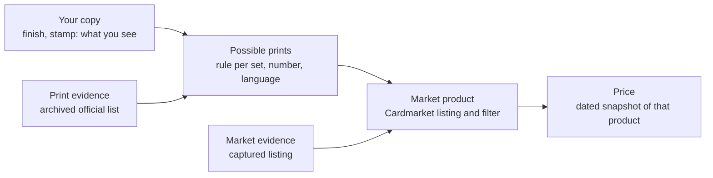
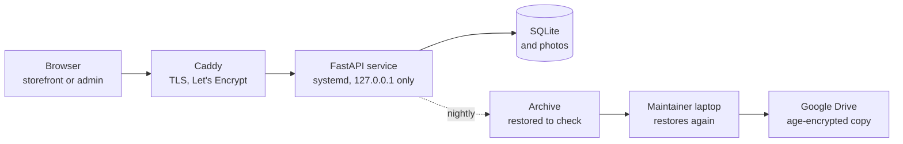

# Les cartes de Lily — case study

> **For:** engineers and hiring managers who want to see how Les cartes de Lily was designed, run and secured, in five minutes.
> **You will find:** the problem, the domain rules that had to be discovered, the architecture, operations, security, testing, the agent API and the known limits.
> **Status:** snapshot written in October 2026 and not kept up to date. The [English overview](README.en.md) describes the product; the French [documentation](docs/README.md) is the reference.

Les cartes de Lily is a small production backend: it digitises, identifies, prices and
sells one multilingual Pokémon card collection. It runs on a single server,
has real customers on a public storefront, and is maintained by one person
working with AI coding agents.

## The problem

A collection of 1,737 physical copies (1,121 distinct editions) across
several binders, mostly French with English, Spanish, Italian and Japanese
cards, had to be photographed, identified card by card, priced from sourced
data and sold without mistakes that cost money. The public storefront lists
1,416 of them for sale.
Three open-source collection managers were tried on copies of the data first.
None kept photos per physical copy (they attach a photo to the edition), and
all would have needed their data model changed for correction history, price
provenance, private roles and sales. A focused FastAPI and SQLite application
was written instead ([decision 0001](docs/decisions/0001-application-maison.md)).

*Measurement conditions: collection counts from the admin view; storefront
count from the public listings API (1,376 French, 21 Spanish, 18 English,
1 Italian); 23 October 2026.*

## The domain was the hard part

There was no specification. The rules below were discovered one at a time,
often through a mistake, and each now has a decision record and a test.

- **The same card can be worth €6 or €430** depending on its variant
  (Pikachu 78/110). A *reverse holo*, a holographic background around a flat
  artwork, barely shows on a binder photo. No model tested spotted reverses
  reliably, so above a value threshold (€10 by default) a person checks the
  physical card under raking light
  ([decision 0008](docs/decisions/0008-reverses-examen-physique.md)).
- **Edition, finish and stamp are three different things.** The edition is
  the set, printed number and language; the finish is what a person sees
  (flat, holo artwork, reverse); a stamp is a mark printed on the artwork and
  has its own field. "Rare" and "Rare Holo" share the same rarity symbol.
- **"Foil" means shinier than the card's standard print**, not "shiny". A
  Rare Holo is Standard; a holo-only promo stays Standard; a holo stamp on a
  normally flat card is Foil. Getting this wrong picks the wrong price series.
- **The open catalogue is incomplete, and the market answers another
  question.** [TCGdex](https://tcgdex.dev) misses some variants (a stamped
  Pikachu, some reverses). A seller's listing says *under which product the
  market sells this card*, not *what this card physically is*. Sellers list
  cards as "reverse" whose artwork alone is holo.
- **So a print reference separates the two questions,** each with its own
  evidence: an archived official print list for what can exist, a captured
  market listing for how it is sold. Evidence files are stored under their
  SHA-256 hash; a missing or altered file is flagged. Each language needs its
  own evidence; until a print and language are verified, the price keeps its
  legacy calculation and says so
  ([print reference guide](docs/PRINT_REFERENCE_GUIDE.md),
  [decision 0011](docs/decisions/0011-referentiel-mode-audit.md)).

- **Uncertain cards go to three separate queues** because each needs a
  different tool and a different authority: *to identify* (local code, then
  the operator on contact sheets), *to verify* (batch approval against
  catalogue images), *to examine* (a person in front of the binder, in page
  order, sorted by money at risk). Neither code nor agent ever confirms a
  variant or a condition from a photo
  ([resolution guide](docs/RESOLUTION_CARTES.md)). At the €10 threshold,
  399 of the 1,737 copies wait for that physical check, and 100 identified
  copies still have no price the system can prove.
- **A sale estimate is not a trend.** Catalogue prices give a reference trend.
  The estimate uses the median of pasted same-condition Cardmarket offers, with
  a quartile range; the Cardmarket API is closed to new users and the site is
  not scraped. Any later correction of identity, variant, stamp, language or
  condition makes the estimate stale ([valuation](docs/VALUATION.md)).

The engineering lesson: model a fuzzy domain explicitly, keep what was
observed apart from what the market says, store the evidence behind every
decision, and spend human time where an error costs money.

## Architecture

- Python, FastAPI, SQLite; plain HTML, CSS and JavaScript with no external
  dependency; admin, editor and reader roles, plus storefront customers.
- SQLite is a deliberate choice for one server and a few users who rarely
  write at the same time; PostgreSQL becomes relevant if that changes.
- **The server's database is the reference.** A laptop–server sync was
  explored and rejected: experiments run on a restored backup instead
  ([decision 0013](docs/decisions/0013-pas-de-synchronisation.md)).

## Deployment and hardening

- Oracle Cloud free tier, ARM instance, Oracle Linux 9 with **SELinux
  enforcing**: the scripts label the executables for systemd and let Caddy
  (`httpd_t`) reach the application's local port, with SELinux left on.
- systemd unit under a dedicated user: `NoNewPrivileges`, `ProtectSystem=strict`,
  `ProtectHome`, `PrivateTmp`, `UMask=0077`, a single writable data directory.
- Secrets live in one root-owned file on the server (mode `0640`), rewritten
  over SSH from the laptop without ever being printed. The Drive token and the
  backup encryption key never reach the server
  ([decision 0003](docs/decisions/0003-drive-depuis-le-portable-chiffre.md)).
- Provisioning can be re-run safely; the scripts are public, with no address
  or secret
  ([`deploy/`](deploy/), [hosting guide](docs/DEPLOYMENT.md)); the
  image-check model runs on CPU-only torch, sized for the ARM server
  ([decision 0009](docs/decisions/0009-torch-cpu-arm.md)).

## Security

A security audit was run while the site was already online, before the code
was published ([audit report](docs/AUDIT-SECURITE.md)):

- scrypt password hashing, `HttpOnly`, `SameSite=Strict`, `Secure` cookies,
  a new session at each login, sessions closed on every role or status change;
- origin check on every state-changing request, a strict content security
  policy with no inline script or style, no `innerHTML` or `eval`;
- parameterised SQL only; uploaded images limited in size, type and pixels;
- public responses built field by field from an allow-list; a test requires
  the staff check on every admin route;
- per-address rate limits that a forged `X-Forwarded-For` does not bypass
  (tested: 5 refusals, then HTTP 429).

The audit found one real defect: the anonymous storefront search made two SQL
queries per listing, so one address could keep the server busy. It now reads
the storefront in two queries.

*Measurement conditions: about 0.5 s before, 0.15 to 0.26 s after, network
included, on 1,415 listings; pip-audit found no known vulnerability in the
dependencies; October 2026.*

## Backups that are actually restored

Each night the server archives the database and photos and **restores the
archive to check it**. The laptop pulls it and restores it again, encrypts it
with age, uploads it to Google Drive, downloads it back and restores that copy
too. Retention: 7 on the server; on Drive, 7 daily, 8 weekly, 12 monthly.
Google cannot read the copies, and the server holds no Drive access
([backups](docs/DAILY-BACKUPS.md), [recovery](docs/RECOVERY.md)).

## Personal data

Customer accounts stay pending until an administrator approves them. A
customer can delete their account; retention periods are applied every night;
the processing register is in the repository ([GDPR](docs/RGPD.md)).

## Testing

- Python and JavaScript tests with injected fakes for every model and
  service: no test calls a real service or reads a key.
- A coverage test requires the staff check on every admin route.
- The recognition bench is replayed offline as a non-regression test.
- The documentation itself is tested: dead links, dates in living pages, and a
  private list of forbidden patterns (names, e-mail, IP addresses) read from
  outside the repository.

*Measurement conditions: 642 tests collected, about 13,000 lines of tests for
17,000 lines of application code, CI on GitHub Actions in about two minutes;
October 2026.*

## An API for AI agents, with humans in charge

An AI agent can work on **one delegated album** with its own revocable key,
through an HTTP API only; it never opens the database.

- Writes require an `Idempotency-Key`: a retried call never creates a
  duplicate, and a reused key with a different body is refused.
- Corrections carry the `expected_version` of the record (optimistic
  concurrency): a card changed in the meantime is not overwritten.
- The agent only writes **drafts** and applies corrections a person has
  already approved. Physical confirmations, reservations, publication, sales
  and payments stay with people
  ([agent pilot](docs/AGENT_CONTROL.md), decisions
  [0012](docs/decisions/0012-agent-brouillons.md) and
  [0014](docs/decisions/0014-corrections-agent-autorisees.md)).

## Models propose, a person decides

Recognition serves the domain rules above. Every model output is a proposal
stored with its evidence (photo, model, protocol, raw answer); no reading
changes a record. Choices were measured on a bench of cards checked by hand:
Gemini is the only text reader, DINOv2 settles editions that share a name,
Tesseract was rejected, thresholds that protect a valuable card are never
lowered. What no model could do: spot reverse holos through a sleeve. The
figures and their limits (21 to 31 cards, no Japanese card) are in the
[English overview](README.en.md#ai-and-vision-models-propose-a-person-decides).

## How it was built

The project was written with AI coding agents, mostly Claude Code. The maintainer
set the architecture and the milestones, established ground truth on the
physical cards, wrote each decision down, reviewed the changes, measured, and
runs the service. The bench, the tests and the documentation check act as
guardrails. Coding agents were also measured as card readers and were not
retained.

## Known limits and next steps

- One server, one collection per installation; no external monitoring yet.
- Rate limits live in process memory and reset on restart.
- Sign-up has no captcha: it is rate-limited and needs approval.
- Measurements cover one collection and a few dozen cards.
- Maintained by one person, with no guaranteed response time.
