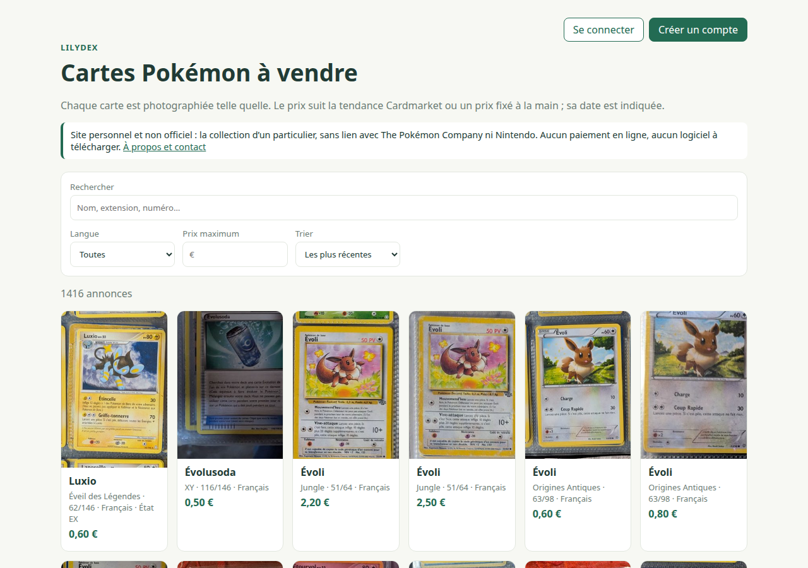
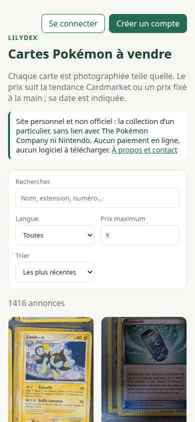

# Lilydex

[](https://github.com/citizenu03bb/lilydex/actions/workflows/tests.yml)

Lilydex numérise, identifie, estime et met en vente une collection de cartes Pokémon multilingue.
La boutique est en service : [lilydex.duckdns.org](https://lilydex.duckdns.org).
Le paquet Python et ses commandes s'appellent `pokeprice`, `pokeprice-manage` et `pokeprice-agent`.

> **In short.** Lilydex takes a multilingual Pokémon card collection from binder photos to a
> priced, sellable inventory: a FastAPI + SQLite web app used from an Android phone, a
> command-line album scanner, a public storefront, and an ARM Oracle Cloud server behind Caddy
> with hardened systemd units, nightly backups verified by a test restore, and off-site copies
> encrypted with age. **Models propose, a person decides:** Gemini reads the card, DINOv2 (CPU
> only) checks the edition from the image alone, and every proposal lands in a review queue with
> its evidence. On 27 to 31 hand-verified cards from one collection, no unsafe variant proposal
> above the value threshold, 22 of 27 editions confirmed by image alone with one false alarm, and
> Tesseract rejected after measurement. The interface and detailed docs are in French:
> [English overview](README.en.md) · [case study](CASE-STUDY.md) (design, operations, security).

<p align="center">
  
  
</p>

## Ce que fait Lilydex

**Numériser vos classeurs** (ligne de commande `pokeprice`). Vous photographiez chaque page ;
la commande découpe les pochettes, lit chaque carte et la rapproche du catalogue
[TCGdex](https://tcgdex.dev), avec ses cotes Cardmarket (€) et TCGplayer ($). Elle lit en
local par défaut (Gemma via Ollama) ou, en option, avec Gemini dans le cloud, un service qui
peut être facturé.

**Gérer la collection** (application privée, `/gestion`). Au téléphone Android comme sur
ordinateur : [exemplaires](docs/GLOSSAIRE.md#les-cartes), photos, historique de chaque
correction, variantes, prix, lots et ventes. Les rapports de numérisation s'y importent sans
doublon ni perte de vos corrections.

**Vendre** (vitrine publique, à la racine du site). Une sélection de cartes se consulte sans
compte, et une réservation se demande avec un simple e-mail. Le vendeur répond depuis sa
messagerie ; s'il accepte, la demande devient un lot et le client est validé.

**Déléguer à un agent.** Un agent IA peut travailler sur un album, avec sa propre clé d'accès,
révocable à tout moment : il prépare seulement des brouillons de lots ; une personne publie,
réserve et vend ([pilote agent](docs/AGENT_CONTROL.md)).

## IA et vision : la machine propose, l'humain décide

Les modèles proposent, s'abstiennent quand ils doutent et gardent une trace (photo lue,
modèle, protocole, réponse brute). Une personne confirme l'identité, la
[variante](docs/GLOSSAIRE.md#les-variantes) et l'état : aucune lecture ne modifie une fiche.
Gemini, un modèle vision-langage, lit une photo ; DINOv2 compare des images, sans texte.

| Brique | Modèle | Où ça tourne | Mesure |
|---|---|---|---|
| Lecture de la carte à la saisie | Gemini | cloud, appelé par le serveur | numéro juste 23 à 25 fois sur 30 selon le passage ; langue 30 sur 30 |
| Finition, tampon et langue du texte | Gemini | cloud, après chaque saisie | holo ou mate : aucune erreur sur 21 cartes quand la lecture tranche ; langue 31 sur 31 sans fausse alerte ; aucune variante fausse proposée au-dessus du seuil de valeur |
| Contrôle d'édition par l'image | DINOv2-small, pré-entraîné | serveur ARM, sans carte graphique | 22 vraies éditions confirmées sur 27, une fausse alerte |
| Porte énergie (ligne de commande) | DINOv2-small, plus proches voisins avec rejet | portable ou serveur | 166 énergies de base sur 166 admises, une autre carte admise à tort sur 1 601 |
| Préparation des photos | vision classique (Pillow), sans IA | serveur | non mesurée ; l'original est toujours gardé |
| Aide à l'état | Gemini | cloud, à la demande | non mesurée : une proposition, jamais une note |

*Conditions de mesure : 31 cartes d'une seule collection vérifiées sur la carte physique (25 FR, 5 EN, 1 IT, aucune japonaise ; 21 à variante vérifiée, dont 2 reverses), gemini-3.8-flash et DINOv2-small, banc rejoué dans l'application, deux passages jugés sur le pire ; porte énergie : 1 767 exemplaires, chaque carte hors de sa propre banque ; octobre 2026. Les lectures enregistrées sont publiées : `scripts/bench_recognition.py app-check` rejoue hors ligne les mesures de lecture et du contrôle d'édition depuis un clone ; les photos restent privées.*

Le [banc d'essai](docs/BANC-RECONNAISSANCE.md) a aussi mis à l'épreuve Tesseract, CLIP et
des agents Claude ; ses seuils de sécurité ne baissent jamais. Limites : les
[reverses](docs/GLOSSAIRE.md#les-variantes) ne se repèrent pas de façon sûre sur une photo de
classeur, les échantillons sont petits, aucun modèle n'est entraîné. Détail et garde-fous :
[IA et vision](docs/IA-VISION.md).

## Sous le capot

| Domaine | En place | Pour aller plus loin |
|---|---|---|
| Application | FastAPI et SQLite ; interface HTML, CSS et JavaScript sans dépendance externe ; rôles administration, gestion et consultation, clients de la vitrine ; historique des corrections | [Guide](docs/APP.md) |
| Ligne de commande | Numérisation d'albums qui reprend après une interruption ; rapports CSV, Excel et HTML | [Commandes](docs/COMMANDES.md) |
| Vision | DINOv2 sur un serveur ARM sans carte graphique, avec torch pour processeur seul ; chaque image n'est analysée qu'une fois, son résultat étant gardé sous l'empreinte SHA-256 de la photo | [IA et vision](docs/IA-VISION.md) |
| Référentiel des impressions | Règles appuyées sur des preuves archivées sous leur empreinte ; un contrat et vingt scénarios de réception | [Guide](docs/PRINT_REFERENCE_GUIDE.md), [contrat](docs/PRINT_REFERENCE_CONTRACT.md) |
| Exploitation | Oracle Cloud, offre gratuite ; Caddy et HTTPS par Let's Encrypt ; service systemd durci : utilisateur dédié, système en lecture seule et dossiers personnels masqués pour le service, aucune élévation de privilèges | [Héberger Lilydex](docs/DEPLOYMENT.md) |
| Sauvegardes | Archive nocturne vérifiée par une restauration ; copie chiffrée avec age, puis envoyée sur Google Drive | [Sauvegardes](docs/DAILY-BACKUPS.md) |
| Sécurité et vie privée | Audit avant la publication du code ; registre RGPD ; clés d'API sur le serveur seulement ; mots de passe hachés avec scrypt | [Sécurité](SECURITY.md), [audit](docs/AUDIT-SECURITE.md), [RGPD](docs/RGPD.md) |
| Qualité | Tests Python et JavaScript (Node.js) où des imitations remplacent les modèles et les services ; banc de non-régression ; contrôle automatique de la documentation | [Contribuer](CONTRIBUTING.md), [banc](docs/BANC-RECONNAISSANCE.md) |

## Choix d'ingénierie

Chaque choix a sa [fiche](docs/decisions/README.md) : contexte, options, mesure, décision,
conséquences.

- [Une application maison](docs/decisions/0001-application-maison.md) : sur trois logiciels
  libres essayés, aucun ne gérait des photos propres à chaque exemplaire, leurs corrections et
  le suivi de leur vente.
- [Tesseract écarté sur mesure](docs/decisions/0005-langue-sans-tesseract.md) : 3 fausses
  alertes sur 31 cartes, aucune erreur de Gemini rattrapée ; un contrôle de cohérence de la
  langue le remplace.
- [Une marge DINOv2 de 0,05](docs/decisions/0006-dinov2-marge.md), choisie sur une table de
  compromis : à 0,02, 3 fausses alertes sur 27 ; à 0,08, 11 éditions voisines signalées sur 26
  au lieu de 14.
- [Les reverses vérifiées à la main](docs/decisions/0008-reverses-examen-physique.md) dès que la
  version Foil vaut au moins le seuil de 10 € ou n'a pas de prix : aucun modèle testé ne les
  repère sûrement.
- [torch pour processeur seul sur un serveur ARM](docs/decisions/0009-torch-cpu-arm.md) : sans
  carte graphique, les bibliothèques CUDA seraient inutiles ; mémoire et disque mesurés.

## Essayer

Il vous faut Python 3.11 ou plus récent et [uv](https://docs.astral.sh/uv/) ; Node.js sert aux
tests, [Ollama](https://ollama.com) à la lecture locale des classeurs.

```bash
git clone https://github.com/citizenu03bb/lilydex.git && cd lilydex
uv sync --extra web
uv run --extra web pokeprice-manage serve
```

Ouvrez <http://127.0.0.1:3820/gestion> et créez le compte administrateur (mot de passe de dix
caractères au moins) ; la racine du site est la vitrine. La collection part vide : base,
photos et sauvegardes vivent dans `data/`, que git ignore. Pour la remplir, l'ouvrir au
téléphone sur votre Wi-Fi ou importer vos classeurs numérisés, suivez le
[guide de l'application](docs/APP.md#démarrer).

La lecture des photos est facultative. Elle demande une clé `GEMINI_API_KEY` ou
`GOOGLE_API_KEY` dans `~/.env` ou dans un `.env` du dossier de lancement ; la clé reste sur le
serveur, jamais dans le navigateur. Sans clé, saisissez l'identité à la main ;
`serve --no-auto-checks` coupe les lectures lancées après chaque saisie. Pour le contrôle
d'édition par l'image, ajoutez `--extra vision`.

## Limites connues

- L'interface, la vitrine et la documentation détaillée sont en français.
- La ligne de commande ne cherche les noms que dans les catalogues français et anglais
  de TCGdex ; la saisie dans l'application cherche dans le catalogue de la langue de la carte.
- La lecture des photos passe par un service cloud (Gemini, chez Google).
- Les mesures portent sur 21 à 31 cartes d'une seule collection, sans carte japonaise.
- Une collection par installation : plusieurs collections sur un même hébergement sont
  à l'étude.
- Une seule personne maintient le projet, sans délai de réponse garanti.

**Ce que Lilydex ne fait pas** : pas encore d'application installable (prévue ; c'est un site
web), pas de modèle entraîné ni affiné, pas d'alerte de contrefaçon, pas de note PSA ou BGS,
pas de paiement en ligne.

## Documentation

Le [sommaire](docs/README.md) range chaque page selon ce que vous venez faire ; le
[glossaire](docs/GLOSSAIRE.md) définit les termes.

- **Découvrir** : [IA et vision](docs/IA-VISION.md), [banc d'essai](docs/BANC-RECONNAISSANCE.md), [décisions](docs/decisions/README.md), [feuille de route](docs/ROADMAP.md).
- **Utiliser** : [application](docs/APP.md), [commandes](docs/COMMANDES.md), [vitrine](docs/VITRINE.md), [référentiel](docs/PRINT_REFERENCE_GUIDE.md).
- **Héberger** : [serveur](docs/DEPLOYMENT.md), [sauvegardes](docs/DAILY-BACKUPS.md), [données personnelles](docs/RGPD.md).
- **Suivre et contribuer** : [journal](docs/JOURNAL.md), [contribuer](CONTRIBUTING.md).

## Développement

Lilydex est développé avec des agents de code, surtout Claude Code. La majorité des commits
portent la mention `Co-Authored-By` (`git log --grep Co-Authored-By --oneline`). Le mainteneur
fixe les jalons et leurs critères de sortie, établit la vérité terrain sur les cartes
physiques, tranche par écrit et relit ; le banc d'essai et les tests servent de garde-fous.

Lancez la suite de tests, Python et scripts de l'interface (ces derniers avec Node.js) :

```bash
uv run --extra web --extra dev pytest
```

Ajoutez `--extra vision` pour inclure les tests du contrôle par l'image. Gemini, DINOv2 et
TCGdex y sont remplacés par des imitations : aucun test ne télécharge de modèle ni n'appelle de
service. Code : `src/pokeprice/`, interface : `src/pokeprice/web/`, tests : `tests/`. Voir
[CONTRIBUTING.md](CONTRIBUTING.md).

## Sécurité, licence et marques

Signalez une faille en privé, comme l'explique [SECURITY.md](SECURITY.md). Le code est publié
sous [licence MIT](LICENSE). Les noms, images et marques Pokémon appartiennent à leurs
détenteurs ; les données de catalogue et de prix viennent de [TCGdex](https://tcgdex.dev) et de
Cardmarket.
