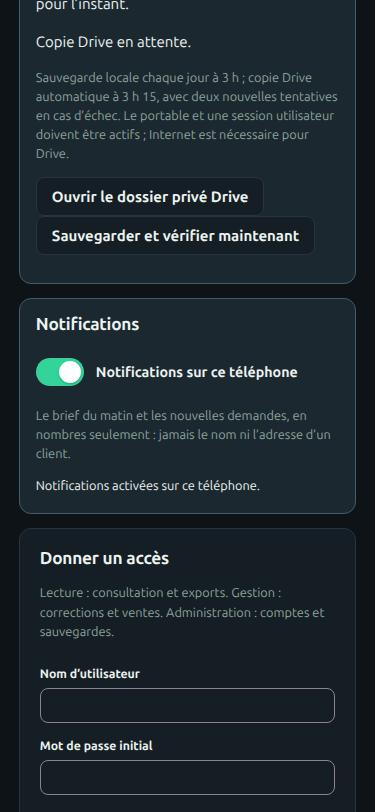

# Guide de l'application de gestion

> **Pour qui :** l'équipe qui gère et vend une collection (administration, gestion, consultation).
> **Vous y trouverez :** comment installer et ouvrir l'application, créer les comptes, l'utiliser depuis un téléphone, puis chaque tâche dans l'ordre où vous la rencontrez.
> **Statut :** en vigueur. Les options de chaque commande sont dans la [référence des commandes](COMMANDES.md).

La gestion est la partie privée du site. Vous y tenez l'inventaire de votre
collection, [exemplaire](GLOSSAIRE.md#les-cartes) par exemplaire : photos,
identité, variante, état, prix et ventes. La partie publique du site, la
vitrine, est décrite plus bas ([Publier en vitrine](#publier-en-vitrine)) et
dans ses [règles détaillées](VITRINE.md).

Vos cartes peuvent être en plusieurs langues ; l'interface et ce guide sont en
français. L'application est un serveur web écrit en Python (FastAPI) ; toutes
vos données tiennent dans une base SQLite et un dossier de photos, sur la
machine qui l'héberge. Consulter, corriger et suivre les ventes ne demande
aucun service extérieur. Les actions qui en appellent un, comme la lecture
d'une photo par Gemini ou le relevé d'un prix sur TCGdex, le signalent.

Les mots propres au projet sont définis dans le [glossaire](GLOSSAIRE.md).

Les fenêtres de dialogue de la gestion portent le nom de leur titre visible
pour les technologies d'assistance. Le contrôle automatique vérifie ces
références ; il ne remplace pas un essai avec un lecteur d'écran.

## Ce que vous pouvez faire

- **Démarrer** : installer, créer le compte administrateur, ouvrir l'accès à
  l'équipe ou à votre téléphone. → [Démarrer](#démarrer)
- **Saisir des cartes**, une à une ou en série, avec photo et lecture
  automatique, ou à la main. → [Saisir des cartes](#saisir-des-cartes)
- **Vérifier une carte** : identité, variante, tampon, langue, édition, état.
  → [Vérifier une carte](#vérifier-une-carte)
- **Relever les prix** et estimer un prix de vente.
  → [Relever les prix](#relever-les-prix)
- **Vendre** : lots, brouillons d'annonce, vitrine publique, demandes des
  clients. L'application n'encaisse rien et ne publie aucune annonce d'elle-même.
  → [Vendre](#vendre)
- **Consulter la collection** : recherche, filtres, tri par classeur,
  visionneuse, clavier. → [Consulter la collection](#consulter-la-collection)
- **Importer et exporter** : classeurs numérisés, CSV, JSON, page HTML
  autonome. → [Importer et exporter vos données](#importer-et-exporter-vos-données)
- **Sauvegarder et restaurer.** → [Sauvegarder](#sauvegarder)
- **Déléguer un album à un agent IA**, qui ne prépare que des brouillons de
  lots. → [Pilote agent](AGENT_CONTROL.md)

## Démarrer

### Installer et lancer l'application

Il vous faut Python 3.11 ou plus récent et [uv](https://docs.astral.sh/uv/).
Lancez les commandes à la racine du dépôt.

```bash
uv sync --extra web --extra dev
uv run --extra web pokeprice-manage serve
```

La première commande installe l'application (`web`) et les outils de test
(`dev`, inutiles pour un simple usage) ; la seconde démarre le serveur. Ouvrez
<http://127.0.0.1:3820/gestion>. L'adresse racine affiche la vitrine publique.

Sur un clone neuf, la collection est vide : le premier lancement crée le
dossier de données et une base vide. Remplissez-la en
[saisissant vos cartes](#saisir-des-cartes) ou en
[important des classeurs numérisés](#numériser-et-importer-un-classeur).

Par défaut, le serveur n'écoute que sur votre ordinateur (`127.0.0.1`) : aucun
autre appareil ne peut l'ouvrir. Le port 3820 se change avec `--port`.

> **Où lancer les commandes**
>
> - **Installation sur votre ordinateur :** à la racine du dépôt, précédez
>   chaque commande `pokeprice-manage` de `uv run --extra web`.
> - **Collection hébergée sur un serveur :** la base du serveur fait foi.
>   Lancez sur le serveur toute commande qui lit ou modifie la collection, sous
>   la forme décrite dans
>   [Héberger le site](DEPLOYMENT.md#lancer-une-commande-sur-le-serveur), avec
>   `--data /srv/pokeprice/inventory`. Une base restée sur votre ordinateur est
>   une ancienne copie : n'y écrivez rien.
> - **Sans `--data`,** une commande vise `data/inventory/` dans le dossier
>   courant, et y crée une base vide s'il n'en existe pas.

### Créer le compte administrateur

Au premier accès, la page vous demande de créer le compte administrateur :
un nom et un mot de passe d'au moins 10 caractères. L'application ne livre aucun
compte ni mot de passe par défaut. Vous pouvez aussi créer ce compte dans un
terminal ; la commande demande le mot de passe sans l'afficher :

```bash
uv run --extra web pokeprice-manage user <nom> --role admin
```

### Donner un accès à l'équipe

Chaque personne a son propre compte, avec l'un de ces rôles :

| Rôle | Ce qu'il permet |
|---|---|
| Consultation (`reader`) | Consulter la collection et l'exporter |
| Gestion (`editor`) | En plus : corriger les fiches, publier, gérer les lots et les ventes |
| Administration (`admin`) | En plus : gérer les comptes, les clients de la vitrine, les sauvegardes, supprimer un exemplaire |

L'administrateur ajoute un compte dans l'onglet **Réglages**, panneau « Donner
un accès », ou avec la commande `user` et `--role editor` ou `--role reader`.
Pour retirer un accès, décochez « Compte actif » puis cliquez sur « Modifier
l'accès ». Changer le rôle d'un compte ou le désactiver ferme ses sessions. Le
dernier administrateur actif ne peut être ni désactivé ni rétrogradé.

### Utiliser votre téléphone sur le même Wi-Fi

Pour consulter ou saisir des cartes depuis votre téléphone sans héberger
l'application, faites écouter le serveur sur votre réseau Wi-Fi :

1. Créez d'abord le compte administrateur, dans le terminal ou par le premier
   accès sur `127.0.0.1`. Ouvert au réseau, le serveur refuse de démarrer sans
   administrateur actif : sinon, le premier appareil du réseau à ouvrir la page
   deviendrait administrateur.
2. Relancez le serveur sur l'adresse IPv4 de votre ordinateur sur le Wi-Fi
   (par exemple `192.168.1.20`, visible dans les paramètres Wi-Fi) :

   ```bash
   uv run --extra web pokeprice-manage serve --host <adresse-wifi>
   ```

3. Sur le téléphone, ouvrez `http://<adresse-wifi>:3820/gestion`.

Deux limites : l'adresse de l'ordinateur peut changer quand le routeur en
attribue une nouvelle (DHCP) ; la connexion passe en HTTP, sans chiffrement,
et le navigateur refuse alors l'aperçu de la caméra (voir
[Saisir des cartes](#prendre-ou-téléverser-une-photo)). Pour un accès chiffré
depuis n'importe où, hébergez l'application sur un serveur : voir
[Héberger le site](DEPLOYMENT.md).

### Installer la gestion sur le téléphone

Servie en HTTPS, la gestion s'installe comme une application : une icône sur
l'écran d'accueil, qui ouvre `/gestion` en plein écran, sans barre d'adresse.
Dans **Réglages**, le bouton « Installer sur le téléphone » explique la marche
à suivre :

- **iPhone ou iPad** : dans Safari, touchez Partager, puis « Sur l'écran
  d'accueil » ;
- **Android** : le bouton « Installer l'application » ouvre l'invite de Chrome
  quand le navigateur la propose ; sinon, menu ⋮, puis « Ajouter à l'écran
  d'accueil ».

Ce qui rend l'installation possible, et ce qui reste sur le téléphone :

| Adresse | Rôle | En-têtes |
|---|---|---|
| `/gestion/manifest.webmanifest` | Nom, icônes, couleurs ; `start_url` et `scope` sur `/gestion`, affichage `standalone` | `Cache-Control: no-cache` |
| `/gestion/sw.js` | Service worker, de portée `/gestion` | `Cache-Control: no-cache`, `Service-Worker-Allowed: /gestion` |
| `/gestion/hors-ligne` | Page affichée quand le réseau manque | `no-store` |

Le service worker garde dans un cache l'interface seule : la page hors ligne,
les scripts, les styles, le manifeste et les icônes (liste `APP_SHELL` de
`webapp.py`). Le nom du cache porte une empreinte de tous les fichiers de
`src/pokeprice/web/` : un déploiement qui change l'interface crée un nouveau
cache, et l'ancien est supprimé à l'activation. Le réseau passe toujours
d'abord ; le cache ne sert que sans réseau. Les requêtes `/api`, dont les
photos, ne passent jamais par le cache : aucun prix ni aucune donnée de client
n'est gardé sur le téléphone. Sans réseau, toute page de la gestion affiche
« Hors ligne » et un bouton pour réessayer.

La vitrine publique n'a ni manifeste ni service worker. Les icônes
`icon-192.png`, `icon-512.png` et `icon-maskable-512.png` viennent de la
mascotte ; `scripts/make_app_icons.py` les régénère. En HTTP sur le Wi-Fi
(section précédente), le navigateur refuse le service worker : l'installation
demande l'adresse HTTPS du serveur hébergé.

### Recevoir les notifications sur le téléphone

Tant qu'un appareil ne reçoit pas les notifications, le brief propose une
carte « Recevoir le brief sur cet appareil », avec « Activer » ou « Plus
tard » (la carte revient deux semaines après) ; sur un iPhone hors de
l'application installée, elle explique comment l'installer. La carte n'est
pas une décision de la file : le serveur ne sait pas quel appareil est
abonné, c'est le navigateur qui le vérifie.

En tête des **Réglages**, l'interrupteur « Notifications sur ce téléphone » abonne
le téléphone au brief du matin et aux alertes de la vitrine (nouvelle
demande, rappels). Le téléphone demande la permission au moment où vous
touchez l'interrupteur. Sur iPhone, il faut d'abord installer la gestion
(section précédente) puis l'ouvrir depuis l'écran d'accueil : dans Safari,
l'interrupteur reste grisé et le rappelle. Le désactiver retire l'abonnement
du serveur et du téléphone.



La notification porte le titre et le texte courts des autres canaux, des
nombres seulement, jamais le nom ni l'adresse d'un client, avec l'icône de
l'application. La toucher ouvre la gestion à la bonne vue : `/gestion` pour le
brief, la demande concernée pour une alerte. Le serveur garde pour chaque
téléphone son point d'accès chez le service de push, ses deux clés et le
compte ; un abonnement que le service déclare expiré est supprimé.
L'interrupteur reste grisé tant que le serveur n'a pas ses clés
([activation](DEPLOYMENT.md#activer-les-notifications-web-push)) ; ce qui
passe par les services de push d'Apple, de Google ou de Mozilla est décrit
dans la [fiche 0033](decisions/0033-notifications-web-push.md).

| Route | Rôle | Droits |
|---|---|---|
| `GET /api/push` | Canal actif et clé publique VAPID | compte de gestion |
| `POST /api/push/subscriptions` | Enregistre l'abonnement du téléphone | compte de gestion |
| `POST /api/push/subscriptions/check` | Dit si ce téléphone est abonné pour ce compte | compte de gestion |
| `DELETE /api/push/subscriptions` | Retire l'abonnement, pour ce compte seulement | compte de gestion |

### Clé Gemini (facultative)

La lecture des photos passe par Gemini, un modèle vision-langage de Google
(`gemini-3.8-flash`). Elle demande une clé `GEMINI_API_KEY` (ou
`GOOGLE_API_KEY`), lue dans le fichier `.env` de votre dossier personnel ou du
dossier de lancement ; Git ignore ces fichiers. La clé reste sur le serveur,
jamais dans le navigateur, et les appels utilisent le compte API configuré.
Sans clé, la lecture échoue avec un message clair : vous saisissez l'identité à
la main, et le reste de l'application fonctionne. Sur un serveur hébergé, la
clé se place dans le fichier d'environnement du service.

### Où sont vos données

Toute la collection tient dans un dossier, `data/inventory/` par défaut, que
Git ignore :

| Élément | Contenu |
|---|---|
| `collection.sqlite3` | La base : fiches, historique, prix, ventes et comptes |
| `photos/` | Les photos de chaque exemplaire, nommées par leur empreinte SHA-256 |
| `reference_documents/` | Les pièces justificatives du référentiel, rangées par empreinte |
| `references/` | Le cache du contrôle par l'image (images TCGdex, vecteurs) ; il se recalcule |
| `thumbnails/` | Les vignettes de la grille ; elles se recalculent |
| `assistant.sqlite3` | Les conversations et le journal du chat, 30 jours au plus, hors des sauvegardes |

Pour utiliser un autre dossier, placez `--data` avant la commande :
`pokeprice-manage --data <dossier> <commande>`. Déplacez toujours le dossier
entier, jamais la base seule. Le dossier `backups/`, à côté, reçoit les
sauvegardes et les copies faites avant une migration.

### Mettre à jour l'application

Une nouvelle version du code peut faire évoluer la structure de la base. Quand
le serveur ou une commande ouvre une base plus ancienne que le code :

1. L'application copie d'abord la base telle quelle dans
   `backups/before-schemaN-fromM-<date>.sqlite3` (un fichier SQLite privé, dont
   l'intégrité est vérifiée) ;
2. puis migre la base vers la version attendue.

Si la copie échoue, la base n'est pas migrée et l'application ne démarre pas.
Une base plus récente que le code est refusée. Toute commande qui ouvre la
base, y compris `backup`, déclenche la migration. La copie ne contient pas les
photos (aucune migration ne les modifie) ; la rotation des sauvegardes garde
les 5 plus récentes. Faites une [sauvegarde complète](#sauvegarder) avant
de lancer une nouvelle version.

## Le brief et la file « À toi »

En haut de la gestion, pour les comptes qui peuvent modifier, le **Brief du
jour** dit en une ligne ce que les agents ont fait depuis 24 heures (cartes
confirmées par l'agent, annonces publiées ou retirées, demandes reçues,
ventes) et combien de choses attendent une personne, avec une estimation en
minutes. Ces comptes viennent des événements déjà journalisés : le brief
n'écrit rien.

Dessous, la file **À toi** ne garde que ce que les agents ne tranchent pas,
dans cet ordre : les demandes de la vitrine à accepter ou refuser avant leur
expiration, les prix sous le plancher anti-bradage à trancher ([fiche 0030](decisions/0030-derogations-plancher.md)), les
lots vendus à expédier, les lots réservés dont le paiement est à vérifier,
puis les photos à reprendre, dans l'ordre du classeur comme le panneau
« Photos à reprendre ». Trois éléments s'affichent ; « Voir les autres »
déroule la suite. Chaque carte a un bouton qui ouvre l'écran existant : la
demande dans Ventes, le lot, ou la ligne de photo à prendre.

La même synthèse est servie par `GET /api/todo` (paramètre `since` facultatif,
`AAAA-MM-JJ`), qui renvoie `done_since`, `waiting` et `minutes`. La commande
`pokeprice-manage --data <base> brief` l'affiche dans le terminal ; avec
`--notify`, elle envoie aussi un résumé court (des nombres, aucune donnée de
client) sur les canaux d'alerte de la vitrine, Web Push compris
([variables](DEPLOYMENT.md#où-vivent-les-secrets)). Sur le serveur,
`pokeprice-brief.timer` l'envoie chaque matin vers 7 h 30
([déploiement](DEPLOYMENT.md#envoyer-le-brief-du-jour)). Le code est dans
`src/pokeprice/todo.py`.

## L'assistant

Le bouton **Assistant**, en haut de la gestion, ouvre un chat : un panneau à
droite sur un ordinateur, tout l'écran sur un téléphone. Il **explique et
cherche ; il n'écrit rien** ([fiche 0029](decisions/0029-assistant-de-gestion.md),
V1). Il répond à des questions comme « Qu'est-ce qui m'attend ? », « Combien
j'ai vendu cette semaine ? » ou « Pourquoi le ronflex n'est pas en vente ? »,
dans la langue de la question, en deux ou trois phrases.

- **Ce qu'il lit.** Il passe seulement par les outils en lecture de la
  [fiche 0032](decisions/0032-outils-assistant-lecture.md) : la collection,
  les prix et planchers, les annonces, les ventes agrégées, l'activité des
  agents et la file « À toi ». Aucun outil ne lui donne le nom, l'adresse ou
  le message d'un client.
- **Ce qu'il sait de l'application.** Sa consigne contient une carte courte
  de la gestion : les onglets, ce que fait chaque écran, où agir. Pour « comment
  je fais pour… » ou une règle, l'outil `knowledge` lui lit à la demande une
  section de ce guide ou une règle métier (plancher anti-bradage, dérogations,
  autonomie des agents, lots, ordre du classeur), au moment de la question ;
  les commandes de serveur en sont retirées
  ([fiche 0035](decisions/0035-connaissances-de-l-assistant.md)).
- **Ce qu'il compte.** Doublons, classements (« top 10 de mes doublons ») et
  comptes par extension, langue ou statut passent par un outil de comptage
  sur toute la collection. Chaque nombre de sa réponse vient d'un outil
  appelé pour la question ; sinon il dit qu'il ne peut pas le compter
  ([fiche 0037](decisions/0037-comptage-et-nombres.md)).
- **Ce qu'il ne fait pas.** Quand on lui demande une action (publier, changer
  un prix, rembourser…), il dit qu'il ne fait que lire et montre où agir : la
  file « À toi », la fiche de la carte dans Collection ou l'écran Ventes.
- **Ce qu'il sait de l'écran.** Chaque question part avec ce que la gestion
  affiche : la vue, la fiche ouverte ou fermée depuis moins de dix minutes
  (son identifiant seul), les filtres, l'appareil, la version de l'interface
  et la dernière erreur. « Pourquoi celle-là n'est pas en vente ? » vise donc
  cette fiche, qu'il relit par ses outils. Rien d'un client n'en fait partie
  ([fiche 0036](decisions/0036-contexte-de-la-question.md)).
- **Pendant qu'il cherche**, une ligne dit ce qu'il regarde (« Je regarde les
  annonces… »). Une carte qu'il cite devient un lien vers sa fiche, si un
  outil l'a renvoyée pour cette question ; un identifiant inventé reste du
  texte.
- **Si la connexion coupe**, la réponse reste marquée incomplète avec un
  bouton **Réessayer la question**. L'identifiant de conversation arrive dès
  le début du flux : la reprise reste dans cette conversation. Une question
  déjà envoyée compte dans le plafond, même si sa réponse est interrompue.
- **Qui y a accès.** Les comptes de gestion qui peuvent modifier
  (gestionnaire, administrateur). Un compte en lecture seule n'a pas le
  bouton, comme il ne peut pas déléguer `assistant:read`.
- **Sans sa clé**, le chat est désactivé et le panneau le dit ; le brief et la
  file « À toi » marchent sans lui. Le modèle est Gemini 3.8 Flash, avec une
  clé à lui, jamais celle de la lecture des photos
  ([fiche 0031](decisions/0031-modele-du-chat.md),
  [variables](DEPLOYMENT.md#où-vivent-les-secrets)).

*Garde-fous.* Le serveur appelle les outils lui-même, au nom d'un principal
qui n'a que la portée `assistant:read`, avec la même vérification qu'une
délégation d'agent, refaite à chaque appel. Les résultats retournent au modèle
comme des données (réponse d'outil), jamais comme des consignes. Une question
compte quatre tours d'outils au plus, puis une réponse. Le serveur refuse un
outil inconnu sans rien exécuter.

*Limites.* 100 questions par jour pour toute la gestion
(`POKEPRICE_ASSISTANT_DAILY_LIMIT`) et 6 par minute et par compte
(`POKEPRICE_ASSISTANT_PER_MINUTE`). Le bas du panneau affiche les questions du
jour et les jetons consommés sur 30 jours, lus dans les métadonnées d'usage du
modèle.

*Coût* ([fiche 0039](decisions/0039-alerte-de-cout-du-chat.md)). Les jetons
de chaque question s'ajoutent au cumul du mois civil, chiffré au tarif public
de `src/pokeprice/assistant_pricing.json`. Quand le coût estimé atteint 30 €
(`POKEPRICE_ASSISTANT_COST_ALERT_EUR`, converti au taux
`POKEPRICE_ASSISTANT_EUR_PER_USD`), une notification part, une fois par mois.
Rien ne s'arrête : c'est un signal, pas un plafond.

*Conservation* ([fiche 0034](decisions/0034-conversations-du-chat.md)). Les
conversations, le journal des questions et des appels d'outils (outil,
arguments, durée, jetons, jamais le texte d'un résultat) vivent dans
`assistant.sqlite3`, à côté de la base, hors des sauvegardes. Ils sont gardés
30 jours dans le chat et dans l'historique envoyé au modèle, même si la purge
manque. `pokeprice-manage purge` efface les données expirées chaque nuit ; le
brief signale un retard dépassant une nuit. **Effacer** retire toutes vos
conversations et bloque les écritures d'une question en cours ; le décompte
du jour reste, sans texte ni argument.
Le démarrage retire aussi les traces tardives d'une conversation effacée
qui auraient été conservées par une version antérieure.

Près de la saisie, une note explique que les questions, le contexte de la
conversation et de l'écran, ainsi que les résultats des outils partent chez
Google (Gemini). N'y collez pas de données de clients. Les durées ci-dessus
concernent le stockage local du site.

*Signaler une réponse* ([fiche 0038](decisions/0038-capture-des-echecs.md)).
Sous chaque réponse, le bouton 👎 ouvre une note facultative (« Qu'est-ce qui
cloche ? ») ; **Signaler** l'enregistre avec la réponse, et le bouton affiche
« Signalée ». Appuyer de nouveau remplace la note. Le serveur signale aussi
seul une réponse quand le modèle ou un outil échoue, quand les quatre tours
d'outils ne suffisent pas, ou quand la question suivante, posée dans les trois
minutes, redit la précédente avec d'autres mots. Pour noter un défaut trouvé
en essayant le chat, écrivez une question qui commence par **« Défaut : »**
(« Défaut : il en compte 2, j'en ai 3 ») : elle ne part pas au modèle, le
chat répond qu'elle est notée, et elle se rattache à la réponse précédente.
Une conversation signalée échappe à la purge des 30 jours, jusqu'à 180 jours
après son dernier signal, pour le parcours du banc. Ses messages de plus de
30 jours restent exclus du chat et de l'historique envoyé au modèle ;
**Effacer** la retire comme les autres. `pokeprice-manage --data <dossier>
assistant-drafts` en tire des brouillons de cas du
[banc](../bench/assistant/README.md#brouillons-tirés-des-échanges-signalés),
sans aucune donnée réelle. Le masquage prend aussi en compte les anciens noms
et adresses figés dans une demande dont les coordonnées changent. Route : `POST
/api/assistant/answers/{id}/flag` (`{note?}`), l'identifiant étant le
`message_id` de l'événement `done`.

*Pour un développeur.* `POST /api/assistant` (`{question, conversation_id?, context?}`)
répond en flux `text/event-stream`, avec un événement `start` (identifiant de
conversation), puis `text`, `tool` (nom de
l'outil), `card` (`copy_id`, nom, numéro), `done` (conversation, jetons,
usage) et `error`. `GET /api/assistant` donne l'état, l'usage et la dernière
conversation ; `DELETE /api/assistant/conversations[/{id}]` efface. Le code
est dans `src/pokeprice/assistant.py` (boucle, journal),
`assistant_model.py` (adaptateurs : Gemini, factice pour les tests),
`assistant_context.py` (liste blanche du contexte) et `web/assistant.js` ; la consigne système, `assistant_prompt.md`, est la même
que celle du [banc](../bench/assistant/README.md).

## Saisir des cartes

### Ajouter une carte

Ouvrez **Collection → Ajouter une carte**. Vous pouvez tout saisir à la main,
sans photo, ou partir d'une photo :

1. **Prenez ou téléversez la photo du recto** (voir ci-dessous). Le recto
   entier et ses deux coins inférieurs doivent être lisibles.
2. **Préparez-la** si besoin : l'aperçu propose recadrage, redressement et
   balance des couleurs (voir [Préparer la photo](#préparer-la-photo)).
3. **Cliquez sur Lire la carte.** Gemini propose le nom imprimé, la référence,
   la langue, les PV et le texte d'un éventuel tampon ; l'application cherche
   l'extension dans TCGdex, sans chercher de prix. Une photo dont le recto
   n'est pas lisible est refusée : reprenez-la. La lecture est une
   proposition :
   - un champ qu'elle ne lit pas garde la valeur affichée dans le formulaire,
     et la recherche dans le catalogue part de cette valeur ;
   - l'observation du tampon déjà notée est conservée, sauf si Gemini lit un
     tampon sur une carte notée « absence constatée » : le texte lu est alors
     proposé et l'observation repasse à « non examiné », à vérifier en main ;
   - une référence lue différente de celle du formulaire vide l'extension,
     qui ne correspond plus ;
   - ses doutes de lecture et défauts visibles s'ajoutent au champ **Notes**,
     à la suite des notes existantes.
4. **Choisissez une édition proposée**, par son nom ou son illustration.
   Quand une seule édition correspond exactement au nom imprimé et à la
   référence complète, elle est présélectionnée ; une édition trouvée parce
   que le nom lu omet le suffixe Delta (δ) est seulement proposée. Cliquer de
   nouveau sur l'édition choisie rétablit ses valeurs après une modification. La comparaison montre **Votre exemplaire** et **Carte
   du catalogue** côte à côte, avec un zoom indépendant jusqu'à 400 %.
   Comparez l'illustration, puis cochez la confirmation : l'identité est alors
   **confirmée**. Sans la case cochée, l'édition choisie renseigne l'extension
   et l'identifiant catalogue, et l'exemplaire reste **à vérifier**. Modifier
   le nom, la référence, l'extension, la langue ou les PV décoche la
   confirmation ; si la saisie ne correspond plus à l'édition choisie, celle-ci
   n'est pas enregistrée.
5. **Enregistrez.** La photo et l'identité sont enregistrées ensemble. La fiche
   propose ensuite d'ajouter le verso.

Si la lecture échoue, saisissez le nom, la référence complète et la langue,
puis cliquez sur **Rechercher l'extension**. Une extension inconnue peut rester
vide.

Pour une carte déjà en stock, ouvrez sa fiche puis **Identifier la carte** :
l'opération complète cet exemplaire sans en créer un autre ; son emplacement,
sa photo, son stock et son état physique sont conservés ; ses notes, reprises
dans le formulaire, ne changent que par ce que vous y laissez. Une
modification concurrente de la fiche oblige à reprendre la préparation.

La lecture, les recherches dans le catalogue et la confirmation sont gardées
dans la provenance et l'historique. L'état physique et le prix restent à part :
ce parcours n'enregistre ni estimation d'état ni prix.

### Prendre ou téléverser une photo

**Prendre une photo** ouvre la capture native sur Android et iPhone. Sur
ordinateur, le bouton demande l'accès à la caméra et en affiche l'aperçu ;
choisissez la caméra s'il y en a plusieurs, puis **Capturer la photo**. Fermer
ce dialogue coupe la caméra. Une capture passe par l'aperçu habituel avant tout
enregistrement.

Le navigateur n'autorise l'aperçu de la caméra qu'en HTTPS ou sur
`localhost` : depuis une adresse Wi-Fi en HTTP, utilisez le téléversement. Un
refus de permission ou l'absence de caméra laisse le téléversement accessible.
Les mêmes choix servent, sur la fiche, à remplacer une photo.

Sur ordinateur, l'aperçu affiche une **mire de cadrage** au format carte. Un
téléphone peut servir de webcam sous Linux, avec `scrcpy` et le module
`v4l2loopback` : relayée par `scrcpy --capture-orientation=90`,
sa caméra garde sa résolution native, y compris en portrait, sans recadrage du
navigateur.

Les photos acceptées sont en JPEG, PNG ou WebP, jusqu'à 8 Mo et
24 mégapixels.

### Préparer la photo

L'aperçu propose trois réglages, calculés sur le serveur sans appel à Gemini :

- **Recadrage automatique.** La détection vise une carte verticale entière sur
  un fond uni, ou un cadre jaune continu même sur un fond texturé. Si les
  contours sont ambigus, coupés, multiples ou trop inclinés, la photo reste
  entière. Une marge garde les bords.
- **Redressement de la perspective**, à partir des quatre coins et du format
  d'une carte Pokémon. Il accompagne le recadrage : désactiver le recadrage
  désactive aussi le redressement.
- **Balance des couleurs**, appuyée sur les zones claires presque neutres et
  limitée à ±8 % par canal, sans saturation, lissage ni retouche des défauts.
  Elle ne corrige ni les reflets ni le flou.

Avec la mire, la capture transmet sa position (`X-Card-Guide`). Les contours
trouvés sur l'image entière restent prioritaires ; sinon, la détection reprend
dans la zone de la mire, ce qui tolère un tapis texturé et permet de redresser
un verso bleu ; en dernier recours, le recadrage suit la mire avec 6 % de
marge, sans redressement. La provenance indique `crop_source` (`contours`,
`contours-in-guide` ou `guide`). Les téléversements et la capture native
Android n'ont pas de mire.

Désactiver les trois réglages redonne exactement la photo d'entrée normalisée :
le JPEG orienté, limité à 1 600 pixels et débarrassé de ses métadonnées. Cette
version entière et la version préparée sont gardées sous des empreintes
distinctes, avec les réglages dans la provenance et dans les sauvegardes ; le
fichier du téléphone reste intact. Modifier un réglage annule la lecture et le
choix d'édition : relisez ou recherchez avant de confirmer.

Les préparations en cours sont privées et expirent au bout de 30 minutes ;
elles ne constituent pas du stock et n'entrent pas dans les sauvegardes.

### Saisir en série

**Collection → Saisie en série** enchaîne les cartes d'un classeur : vous
choisissez l'album, la page, la pochette et le format de page (9 pochettes par
défaut), prenez ou importez le recto et éventuellement le verso, vérifiez les
champs, puis **Enregistrer et passer à la suivante** crée un seul exemplaire et
propose la pochette suivante ; après la dernière, la page suivante.

- Les champs et photos non validés sont gardés 30 jours : un rafraîchissement,
  une fermeture ou un redémarrage permettent de reprendre la série.
  **Mettre en pause** garde le brouillon ; **terminer la série** libère ses
  préparations.
- La lecture Gemini se lance à la demande.
- Une même photo de recto, ou un emplacement déjà occupé, déclenche une
  alerte : ouvrez la fiche existante, ou confirmez qu'il s'agit d'un exemplaire
  physique distinct. Les alertes sont revérifiées à l'écriture ; un double
  appui ou une réponse perdue ne crée pas une deuxième carte.

### Lecture et contrôles automatiques après la saisie

Avec `pokeprice-manage serve`, chaque nouvel exemplaire enregistré avec une
photo du recto, à l'unité ou en série, est lu une fois juste après
l'enregistrement, sans retarder la saisie : lecture de la finition, du tampon
et de la langue, puis contrôle de l'édition par l'image si l'édition est
confirmée et l'option vision installée. L'historique indique « lancée
automatiquement à la saisie ». En cas d'échec (Gemini indisponible, photo
refusée), l'historique le note et la lecture reste possible depuis la fiche.
L'identification d'un exemplaire déjà en stock et le remplacement d'une photo
ne déclenchent rien. `serve --no-auto-checks` coupe ces lectures : rien ne part
vers Gemini sans action explicite.

### Préparer les photos d'une sélection

Cochez jusqu'à 20 exemplaires puis **Préparer les photos sélectionnées** :
simulez les réglages du recto ou du verso, agrandissez les comparaisons et
cochez les résultats voulus. L'application copie d'abord la base, sans les
photos (nommées par leur empreinte, elles ne sont jamais effacées), avant de
remplacer les photos. **Annuler ce traitement**, et les vingt derniers
traitements, se retrouvent dans **Photos par lot**, même sans carte
sélectionnée ; une fiche modifiée depuis le traitement bloque son annulation.
Sans photo originale conservée, la simulation signale qu'elle part de l'image
actuelle. Aucun modèle ni service de prix n'est appelé.

### Déplacer une sélection de cartes

Cochez les exemplaires à ranger puis cliquez sur **Déplacer vers…** dans la
barre de sélection : choisissez l'album d'arrivée (ou le même album pour
changer de page), le mode de placement (**Premières cases libres** ou **À
partir d'une page et d'une case**), le nombre de cases par page et le motif.
L'aperçu indique pour chaque carte son emplacement de départ et sa case
d'arrivée, signale toute case d'arrivée déjà occupée (avec le nom de la carte
présente) et mentionne les cartes publiées à l'unité en vitrine.

Les cartes réservées, vendues, supprimées ou engagées dans un lot actif
(brouillon de vente, réservation ou lot publié en vitrine) sont refusées :
annulez ou dépubliez d'abord le lot avant de déplacer physiquement la carte
([décision 0024](decisions/0024-deplacements-en-lot.md)).

**Déplacer ces cartes** copie d'abord la base, sans les photos, dans
`backups/before-move-batch-<date>.sqlite3`, puis déplace toute la sélection en
une seule transaction, en inscrivant une entrée d'historique par carte avec le
motif indiqué. Si une carte a changé entre-temps ou si une case d'arrivée est
occupée, rien n'est écrit. Après l'application, **Annuler ce déplacement** (dans
la fenêtre ou dans le bandeau affiché au-dessus de la grille) remet l'ensemble
des cartes à leur place d'origine en une transaction, tant qu'aucune fiche n'a
été modifiée depuis et que les cases d'origine sont restées libres.

### Déposer une page de classeur (3×3)

**Collection → Page de classeur (3×3)** prend ou téléverse la photo d'une page
entière (9 pochettes, grille 3×3) pour un album existant et un numéro de page,
sur ordinateur comme sur téléphone. Le serveur redresse l'image en portrait (ou
selon l'angle choisi) et la découpe en 9 pochettes :

- si un exemplaire unique occupe déjà `(album, page, pochette)`, l'aperçu
  compare sa photo actuelle avec la nouvelle découpe du recto ;
- si la pochette est vide, l'aperçu propose de créer une fiche « À identifier »
  (`unresolved`) rangée à cet emplacement avec la photo découpée ;
- si plusieurs fiches occupent déjà la même pochette, la case signale le
  conflit et reste décochée.

**Appliquer les pochettes cochées** copie d'abord la base, sans les photos,
dans `backups/before-photo-batch-<date>.sqlite3`, puis met à
jour les fiches existantes (en réinitialisant la confirmation d'état) et crée
les fiches « À identifier » dans une seule transaction. **Annuler ce dépôt de
page** restaure les photos antérieures et place en corbeille les fiches créées
par le lot, tant qu'aucune fiche concernée n'a été modifiée ou engagée dans un
lot depuis l'application ([décision 0025](decisions/0025-photo-page-classeur-gestion.md)).

## Vérifier une carte

Chaque vérification est une décision humaine, enregistrée avec son auteur, sa
date et son motif par le serveur. Les modèles ne font que proposer
([IA et vision](IA-VISION.md)).

### Corriger une fiche

Vous pouvez corriger le nom, l'extension, la référence, l'identifiant du
catalogue, la langue, les PV, la variante, l'état, les notes et l'emplacement.
Chaque correction garde son auteur, sa date, son motif et les anciennes
valeurs. Les états importés restent à confirmer.

### La variante : Standard ou Foil

La variante choisit la série de prix Cardmarket d'un exemplaire :

- **Standard** : la version normale de l'édition, mate ou holo d'origine. Une
  Rare Holo imprimée holo d'origine reste Standard : Cardmarket et TCGdex
  donnent son prix en tendance normale et rangent sous « holo » celui de sa
  reverse.
- **Foil** : une version qui brille davantage que la version standard :
  reverse (fond holographique hors de l'illustration, illustration mate) ou
  holo tamponnée d'une carte normalement mate, que Cardmarket range avec les
  Foil.

Le symbole de rareté ne suffit pas à trancher ; la fiche indique la version
standard selon TCGdex, dont les variantes sont parfois incomplètes. Le pipeline
d'albums marque Foil toute carte brillante ; une alerte signale les cartes Foil
dont TCGdex ne connaît pas de reverse.

Une fiche liée au catalogue montre, à côté du recto, l'**image TCGdex** de
l'édition, avec un lien vers ses données TCGdex et vers Cardmarket ;
l'agrandissement affiche le recto, le verso et cette image côte à côte. Cette
image est celle de l'impression standard : elle aide à vérifier l'édition, pas
la variante, car TCGdex ne montre ni les reverses ni les tampons. L'image est
demandée à TCGdex à la première ouverture de la fiche, puis gardée en cache ;
quand l'édition n'a pas d'image dans la langue de la carte, l'image anglaise,
de même illustration, la remplace ;
une édition sans image est redemandée après une semaine.

La fiche sépare la **finition observée sur la carte** (mate, holo, holo avec
cadre brillant, reverse, spéciale) et la **catégorie de prix calculée**. Le
serveur déduit la catégorie de la finition, du tampon et des données de
l'édition : mate → Standard ; fond reverse → Foil ; holo d'origine →
Standard ; illustration holo d'une édition mate avec reverse connue → Foil. Le
menu calculé est verrouillé dans la fiche. Cas particuliers :

- Une édition qui a explicitement une impression mate et une impression holo
  parallèle, avec deux tarifs et sans reverse : « Holo dans l'illustration »
  donne Foil, qui désigne alors l'impression parallèle (Manaphy 2/17 POP
  Série 9).
- Des tarifs qui décrivent une holo d'origine et une reverse, sans impression
  mate, complètent un catalogue incomplet : Baggaïd 74/99 Destinées Futures est
  Standard pour l'illustration holo, Foil pour la reverse, conformément à la
  [liste officielle](https://assets.pokemon.com/assets/cms2/pdf/trading-card-game/checklist/bw4_web_cardlist_en.pdf).
- Une Prime comme Roigada 85/90 Indomptable a un cadre holo d'origine : « Holo
  avec cadre brillant », Standard. La
  [liste officielle](https://assets.pokemon.com/assets/cms2/pdf/trading-card-game/checklist/hgss3_web_cardlist_en.pdf)
  la classe parmi les Prime ; les numéros 81 à 90 n'existent qu'en version
  brillante.
- EX Fantômes Holon, numéros 18 à 98 : une illustration holo avec le tampon de
  l'extension est la parallèle vendue comme reverse ou Foil, malgré son fond
  mat (Pikachu 78/110) ; la
  [liste officielle](https://assets.pokemon.com/assets/cms/pdf/tcg/checklists/holonphantoms_checklist.pdf)
  donne deux impressions. Même règle pour EX Gardiens de Cristal, numéros 14 à
  88 tamponnés ([liste](https://assets.pokemon.com/assets/cms/pdf/tcg/checklists/crystalguardians_checklist.pdf)),
  et EX Deoxys, numéros 16 à 95 (Barboach 54/107 en italien ;
  [tableau](https://assets.pokemon.com/assets/cms/pdf/tcg/checklists/deoxys_checklist.pdf)).

Une catégorie encore indéterminée est étiquetée « Catégorie enregistrée · à
vérifier ». Si le catalogue est incomplet ou admet plusieurs impressions, la
fiche garde une sélection manuelle et demande de préciser le produit dans les
observations ; le prix reste exclu des totaux tant que la catégorie n'est pas
déterminée. Pour une holo saisie sans données locales de finition, ces données
sont récupérées et mises en cache, même sans prix Cardmarket (Celebi Promo
Nintendo 029 : holo d'origine, Standard) ; cela ne modifie ni l'exemplaire, ni
sa confirmation, ni son prix.

Une ancienne combinaison incohérente garde ses observations physiques, mais son
prix est exclu des totaux et un motif demande d'appliquer la catégorie
calculée. Un enregistrement ou un nouveau relevé corrige alors la catégorie,
avec historique et version attendue, en gardant la date et l'auteur de
l'observation physique si elle n'a pas changé. Une ancienne correction de
catégorie sans finition observée revient dans « À examiner », sans être
présumée erronée. L'audit en lecture seule `python scripts/audit_variant_categories.py`
liste les catégories incohérentes, les observations ambiguës et ces
corrections à reprendre.

### Le tampon

Le champ **Tampon sur l'illustration** garde le texte d'un logo ou d'un tampon
imprimé sur l'image, par exemple « EX Fantômes Holon ». L'état du tampon se
note « non examiné », « absence constatée » ou « présent », avec son texte
original et une autre marque de distribution facultative. **Lire la carte** le
propose quand Gemini le voit (21 sur 21 au [banc d'essai](BANC-RECONNAISSANCE.md)) ;
la saisie doit être confirmée. Le tampon apparaît sur la carte, dans la
recherche, dans le filtre **Variante → Tamponnées**, dans les exports et les
dossiers d'annonce. Modifier le tampon change la variante : le prix de
référence est retiré et doit être relevé. Cardmarket range ces promos avec les
Foil, mêlées aux reverses : seules les offres dont le commentaire mentionne le
tampon sont comparables.

### Confirmer la variante sur la carte physique

Cochez **Variante et tampon vérifiés sur la carte physique** : le contrôle se
clôt, même si la catégorie reste identique ; la date et l'auteur sont
enregistrés par le serveur. Une divergence avec le catalogue reste une
information et ne remet pas la carte dans « Foil à vérifier ». Une correction
d'identité, de variante manuelle, de tampon, de finition ou du recto exige une
nouvelle confirmation ; un relevé de prix la conserve. Les anciens imports et
corrections ne sont jamais déclarés vérifiés automatiquement, et un relevé ne
crée jamais de confirmation humaine. Les observations partielles restent
enregistrables sans catalogue ni prix.

**Variante → Foil à vérifier** retient les cartes Foil dont le dernier relevé
signale que TCGdex ne connaît pas de reverse (à partir de 2 €) et dont la
variante n'est pas confirmée ; elles portent le badge « ⚠ Variante à
vérifier ». Le filtre reste dans l'adresse (`?variant=check`). Parcours conseillé : filtre Foil, **Sélectionner les cartes
affichées**, **Relever les prix** ; puis filtre Foil à vérifier, examen des
photos et **Changer la variante** sur la sélection. Chaque carte reçoit sa
correction avec le motif saisi, puis un nouveau relevé ; une carte déjà dans la
variante choisie reste inchangée. `&limit=200` dans l'adresse affiche jusqu'à
200 cartes par page.

### Lire la finition sur la photo

Dans la fiche, **Lire la finition** transmet la photo du recto à Gemini, qui
répond à quatre questions : illustration holo ou mate, fond brillant hors de
l'illustration (reverse), texte d'un tampon, langue du texte imprimé hors nom
(attaques, talents, description). La lecture est enregistrée avec la photo lue,
le modèle, la version du protocole et les jetons consommés. Elle ne modifie ni
la fiche ni le prix.

La fiche en tire une **proposition**, recalculée à chaque ouverture avec la
règle de catégorie :

- illustration holo → Standard ou Foil selon l'édition et le tampon ;
- illustration mate → Standard, **sauf** si une reverse est possible et que sa
  version Foil vaut au moins le seuil de valeur ou n'a pas de prix connu : la
  proposition devient « Examen physique requis ». Aucun modèle ne distingue
  sûrement une reverse sur une photo de classeur ;
- fond brillant signalé → reverse possible, à examiner sous un éclairage
  rasant ;
- photo insuffisante → aucune proposition.

Un tampon déjà observé par une personne, présent ou absent, prime sur le tampon
lu. **Enregistrer la finition retenue** applique votre choix (finition, tampon
et, si vous avez la carte en main, la confirmation de la variante) ; la lecture
et la proposition sont jointes à l'historique comme preuves. Une lecture
devient obsolète dès que la photo du recto change.

Une lecture en désaccord avec la fiche (illustration holo contre fiche mate ou
reverse, tampon contraire) place la carte dans « À examiner », même sous le
seuil, jusqu'à une confirmation physique postérieure à cette lecture.

**Langue du texte.** Si la langue lue diffère de celle de la fiche, la carte
entre dans « À examiner ». Corrigez la langue de la fiche, ou cliquez sur
**Garder la langue de la fiche** pour cette lecture, avec un motif inscrit à
l'historique. Une langue non lue (texte illisible, énergie de base) ne
déclenche rien, pas plus qu'une lecture antérieure à ce contrôle (protocole
`card-finish-v1`). Ce contrôle vise surtout les noms identiques d'une langue à
l'autre (Pikachu), que la recherche du catalogue, stricte sur la langue, ne
départage pas. Ce n'est pas un second avis indépendant : c'est le même modèle,
dans un autre appel.

**Non-régression.** Le banc d'essai rejoue ces lectures à travers
l'application ; il échoue si une mesure passe sous son seuil, ou si une
proposition contredit une variante confirmée dont la version Foil atteint le
seuil ou n'a pas de prix connu. Voir le [banc d'essai](BANC-RECONNAISSANCE.md).

### Contrôler l'édition par l'image

Dans la fiche, **Comparer aux images TCGdex** compare la photo du recto aux
images de toutes les impressions de même nom, dans la langue de la carte et en
anglais. Les cartes de TCG Pocket, le jeu numérique, en sont exclues : elles ne
peuvent pas être dans un classeur. Le calcul se fait sur le serveur avec DINOv2, sans lire le texte :
c'est un contrôle indépendant de la lecture qui a proposé l'édition. Il est
enregistré comme une lecture et ne modifie pas la fiche.

- **Édition confirmée** : l'édition de la fiche est la plus proche.
- **Image indécise** : une autre impression devance de moins de 0,05 ; c'est
  le cas des réimpressions à l'illustration identique (dresseurs, Base Set 2).
- **Désaccord** : une autre impression devance d'au moins 0,05 ; la carte
  entre dans « À examiner ». **Garder l'édition de la fiche** après examen la
  retire de la file ; pour corriger, passez par l'identification : le contrôle
  est recalculé contre la nouvelle édition.

Sans image TCGdex de l'édition (promos McDonald's), le contrôle est impossible.
Il demande l'option vision :

```bash
uv sync --extra web --extra vision
```

Le modèle `facebook/dinov2-small` (environ 85 Mo) est téléchargé au premier
usage ; `HF_HOME` permet de réutiliser un cache existant. Sans l'option,
l'application affiche « Contrôle indisponible sur ce serveur ».

### Le verso et l'état

La fiche affiche **Recto** et **Verso**, chacun avec capture, téléversement,
préparation et agrandissement. Ajouter le verso garde l'identifiant, le stock
et l'identité du recto : il ne crée pas une deuxième carte.

**Évaluer l'état** transmet à Gemini les photos entières disponibles, avant
les corrections locales quand elles sont conservées. Pour une photo ancienne,
une preuve de préparation qui correspond à la photo courante permet de
retrouver l'original ; sinon, cette limite est signalée. Téléverser une photo
n'envoie rien : l'évaluation ne part que si vous la demandez.

La proposition décrit les défauts du recto et du verso, la qualité des photos
et les limites de l'examen ; elle peut être **indéterminable**. Un état NM
exige deux faces exploitables et les versions avant correction ; un verso
absent laisse une évaluation partielle. La proposition ne remplace pas l'état
enregistré et ne modifie aucun prix.

Pour retenir un état, choisissez **État retenu après examen**, confirmez
l'examen de la carte en main et cliquez sur **Enregistrer l'état vérifié**.
Vous pouvez retenir un autre état que celui proposé ; le lien à l'évaluation et
votre motif sont gardés dans l'historique. Si une photo a changé, la
proposition est obsolète et il faut évaluer de nouveau. Le protocole et ses
protections sont dans l'[aide à l'état](CONDITION-ASSESSMENT.md).

### Le référentiel des impressions

L'ajout et la correction enregistrent les observations dont le
[référentiel](PRINT_REFERENCE_GUIDE.md) a besoin : finition observée, état du
tampon, son texte original, une autre marque de distribution. Le filtre
**Examen → Référentiel à compléter** montre les lacunes du référentiel, à part
de l'examen physique ; il garde son état dans l'adresse, fonctionne dans les
vues par exemplaire et par édition, et respecte le tri Classeur. La fiche et
son aperçu montrent l'état de la correspondance marchande.

Le référentiel est en mode audit : il ne certifie pas les références
existantes et ne remplace pas le calcul de prix hérité
([fiche 0011](decisions/0011-referentiel-mode-audit.md)).

```bash
uv run --extra web pokeprice-manage reference-audit > outputs/reference-audit.json
```

Cet audit ouvre la base en lecture seule, sans migration, réseau ni
correction. Il distingue les références héritées non liées, les références
manuelles, les prix absents et les besoins de couverture par édition et
langue. Le sous-total vérifié reste inconnu tant qu'aucune cotation liée n'est
vérifiée.

Pour ranger une pièce justificative, puis vérifier les cotations après une
mise à jour des règles :

```bash
uv run --extra web pokeprice-manage reference-archive capture.html
uv run --extra web pokeprice-manage reference-recheck
uv run --extra web pokeprice-manage reference-recheck --apply
```

`reference-archive` range la pièce sous son empreinte SHA-256.
`reference-recheck` liste les cotations liées devenues incompatibles ;
`--apply` inscrit leur suspension au journal. Une suspension ne se lève que par
une restauration explicite.

Les sauvegardes emportent les règles et moteurs enregistrés avec les
décisions, les cotations liées et leurs événements, et les pièces rangées une
fois chacune dans `reference_documents/` (PDF, JSON ou HTML). Une pièce
manquante ou altérée est signalée ; aucun téléchargement automatique ne
rétablit son statut de preuve. Détails et limites :
[état de la mise en œuvre](PRINT_REFERENCE_GUIDE.md#ce-qui-est-mis-en-œuvre).

### Repérer les cartes à examiner

Le filtre **Examen → À examiner** retient les contrôles qui restent à faire :
identité incertaine, variante ou tampon à examiner sur les cartes de valeur,
divergences avec le catalogue, désaccords des lectures, état non validé, prix
prudent incomplet ou à actualiser. Le **seuil de valeur** vaut 10 € par défaut
et reste dans l'adresse avec le filtre et le tri Classeur. Les badges et les
fiches précisent les motifs et la valeur en jeu : le plus haut prix prudent
parmi les variantes et éditions encore plausibles.

Une carte de valeur dont l'examen physique et le prix prudent sont complets
quitte la file et garde le badge « Carte de valeur ». Après confirmation de la
variante, la valeur en jeu exclut les variantes écartées. L'instabilité du
marché reste une information de prix. Règles détaillées et commande de
réception : [valeur en jeu](VALUATION.md).

## Relever les prix

### Retrouver une référence après une correction

Une identité confirmée sans identifiant TCGdex n'est pas nécessairement absente
du catalogue. Depuis la fiche, utilisez **Identifier la carte**, puis
**Rechercher** avec le nom et la référence complète corrigés ; une nouvelle
lecture de photo n'est pas nécessaire. La recherche tolère les apostrophes
droites ou courbes et propose les noms TCGdex portant `δ` lorsque ce suffixe
manque dans le nom saisi. Le numéro complet, la langue et les PV restent
contrôlés ; choisissez l'édition avant de confirmer, puis relevez son prix.
Corriger un numéro ne rattache pas automatiquement la carte à une édition.

Si la carte reste sans correspondance, confirmez son identité indépendamment
du catalogue avant de saisir un **Prix de référence** avec sa **Source /
métrique du prix**. Conservez la page du produit exact, sa langue et sa variante ;
un prix saisi sans source n'est pas accepté. Si TCGdex connaît la carte mais ne
fournit aucune cotation, ce même parcours reste disponible. L'estimation depuis
des offres au même état se saisit séparément ; un prix absent reste indisponible
et une offre n'est pas une vente réalisée.

### Relever le prix d'une carte

Sur la fiche d'une carte confirmée avec son édition TCGdex, **Relever le prix
(TCGdex)** enregistre un relevé daté : prix bas, moyennes sur 1, 7 et 30 jours
et tendance Cardmarket de la variante de l'exemplaire (normale, ou holo et
reverse si la carte est Foil). La tendance devient le **prix de référence**
(`TCGdex · Cardmarket trend` ou `trend-holo`), avec sa date ; le relevé complet
reste dans l'historique. Un relevé identique au précédent n'ajoute rien. Une
carte à vérifier ou sans édition n'est pas relevée.

À partir de 2 €, des alertes signalent une variante inconnue de TCGdex, un
écart d'au moins ×3 avec l'autre variante, des moyennes divergentes ou un prix
bas très inférieur à la tendance. En dessous, la carte relève du vrac vendu en
lot.

Pour plusieurs cartes, cochez-les puis **Relever les prix (n)** dans la barre
de sélection ; le nombre compte les cartes confirmées avec édition, les autres
sont ignorées. Chaque carte est relevée séparément : un échec n'arrête pas les
suivantes. Le bilan donne les prix relevés, les cartes ignorées, les échecs et
les alertes. En ligne de commande, `pokeprice-manage prices` relève toutes les
identités confirmées (`--album <id>`, `--only-missing`, `--actor`) avec une
seule requête TCGdex par édition et par langue, appliquée à tous ses
exemplaires. `--from-guide` cote d'abord par le guide des prix Cardmarket les
cartes dont le produit est connu, sans requête TCGdex ; c'est la cotation
matinale décrite dans [Valorisation](VALUATION.md#la-cotation-matinale).

### Ce que devient le prix

- Le prix de référence est une tendance, pas un prix de vente. Il n'est
  jamais décoté selon l'état.
- Un prix indisponible reste vide, jamais zéro.
- Une correction d'identité ou de variante efface la référence courante,
  devenue incertaine ; les anciens relevés restent dans l'historique.
- Préciser une finition compatible avec l'identité, le tampon et la catégorie
  déjà cotés conserve la référence, sa source et sa date. Une catégorie
  modifiée ou encore ambiguë exige un nouveau relevé.
- Pour une carte sans cote TCGdex, un prix saisi à la main tient lieu de
  référence ; la fiche affiche cette référence manuelle datée, même sans relevé
  détaillé.

`pokeprice-manage repair-prices` audite les références perdues, par le passé,
lors d'une précision compatible de finition. Après une sauvegarde, `--apply`
restaure seulement les cotations sourcées et datées du plan, avec contrôle de
version et l'auteur fixe `system:price-recovery` ; `--copy-id` limite les
exemplaires. Les confirmations humaines sont conservées, et aucun prix présent
ou supprimé volontairement n'est remplacé.

### Noms dans plusieurs langues

La recherche trouve une carte par son nom dans six langues (français,
anglais, allemand, italien, espagnol, portugais) : « Dracaufeu » ou « Glurak »
trouvent un Charizard anglais. `pokeprice-manage names` récupère ces noms une
fois par édition ; `prices` l'appelle à la fin de chaque relevé, sans requête
pour les éditions déjà connues. Une édition absente d'une langue reçoit le nom
du Pokémon, retrouvé par son numéro de Pokédex.

Pour ménager TCGdex : une requête par extension et par langue (elle donne
toutes les cartes de l'extension, gardées pour les classeurs à venir), une à la
fois avec 0,25 s de pause ; réponses mises en cache, absences comprises
(redemandées au bout de 90 jours) ; nouvel essai avec attente croissante et
respect de `Retry-After` sur les erreurs 429 et 5xx ; arrêt après cinq échecs
serveur consécutifs.

### Estimer le prix de vente depuis Cardmarket

L'API Cardmarket n'accepte plus de nouvelles inscriptions, et l'application ne
collecte pas ses pages automatiquement. Dans la fiche, ouvrez **Voir les offres
Cardmarket**, sélectionnez toute la page (Ctrl+A), copiez, puis collez dans
**Estimer le prix de vente depuis Cardmarket**. Le serveur repère chaque offre
(état, commentaire, prix) et ignore les prix d'en-tête. La règle :

- au moins une offre au même état : prix de marché = médiane de ces offres,
  fourchette du premier au troisième quartile dès quatre offres ; confiance
  bonne à partir de cinq offres, moyenne de deux à quatre. Les offres les moins
  chères ne fixent pas le prix ;
- sinon : médiane de l'état le plus proche, avec une décote de 0,75 par cran
  d'état, hypothèse par défaut à calibrer sur les ventes ; confiance faible ;
- carte tamponnée : seules les offres dont le commentaire mentionne un tampon
  (« stamp », « tampon », « logo ») sont retenues ;
- alerte si moins de trois offres comparables, ou si le texte collé ne nomme
  pas la carte.

Ce sont des prix demandés, pas des ventes ; frais et port restent à déduire.
L'estimation est enregistrée dans l'historique avec les offres, sans modifier la
carte ni son prix de référence ; la plus récente s'affiche.

**Voir les offres Cardmarket** ouvre la page du produit filtrée sur la langue
de l'exemplaire, son état ou mieux (`minCondition`) et, pour une carte Foil,
les reverses seulement (`isReverseHolo=Y`). Les offres sont triées par prix :
comparez celles du même état.

### Les totaux de la collection

La collection et les résultats filtrés affichent **Tendance**, **Valeur
prudente** (le plus bas entre la tendance et la moyenne à 30 jours, sans
décote d'état) et **Estimation de vente**, avec le nombre d'exemplaires
couverts. Les prix absents restent inconnus. Une estimation ancienne, après une
correction d'identité, de variante ou d'état, reste visible dans la fiche mais
sort des totaux. Le prix prudent du catalogue n'est pas une estimation de vente
pour l'état PO ni pour une langue donnée.

## Vendre

### Constituer un lot

Depuis **Collection** ou **Ventes**, cliquez sur **Créer un lot**. Cochez les
exemplaires disponibles, ou **Ajouter les cartes affichées** pour la page
courante. La sélection est gardée entre les recherches, les albums et les
pages ; chaque carte peut être retirée du récapitulatif. Deux exemplaires d'une
même édition restent distincts par leur emplacement. **Désélectionner tout**
vide la sélection sans supprimer aucun exemplaire.

**Continuer**, vérifiez le contenu, puis donnez un titre et un prix envisagé ;
les objectifs de prix, le canal et les notes sont facultatifs. **Enregistrer le
lot en brouillon** ouvre le lot dans **Ventes**. Les cartes restent disponibles
jusqu'à **Réserver les cartes**. Un compte de consultation ne peut pas créer de
lot.

### Suivre un lot

Un lot passe du brouillon à la réservation, la vente, le paiement déclaré,
l'expédition et la clôture, ou à l'annulation et au retour. La réservation est
transactionnelle : une réservation concurrente du même exemplaire échoue. Prix
affiché, prix cible, prix minimum et prix convenu sont distincts ; frais, port,
emballage et remboursements se saisissent en euros. **Ventes** filtre les lots
par statut et masque les annulés par défaut.

- Les montants sont stockés en centimes. Le net vaut : prix + port facturé −
  frais − coût du port − emballage − remboursements.
- Le paiement est déclaré à la main : l'application ne prend ni n'effectue
  aucun paiement.
- Un retour réintègre les cartes et remet leur état à confirmer ; enregistrez
  à part le montant réellement remboursé.

### Préparer une annonce

Dans **Ventes**, chaque lot propose **Télécharger le brouillon d'annonce** : un
dossier ZIP avec un texte modifiable, les photos recto et verso et les
informations à compléter. Les notes privées et les détails financiers sont
exclus. Le téléchargement ne change pas le stock. Le prix demandé du lot est
repris s'il existe ; un état non confirmé est indiqué « à vérifier ». Aucune
annonce n'est publiée automatiquement sur une plateforme.

### Publier en vitrine

La vitrine publique est la page d'accueil du site, visible sans compte ; la
gestion est sous `/gestion`, avec la même connexion. Les anciens liens de
gestion (`/?view=…`) et `/vitrine` sont redirigés ; un lien discret « Espace
vendeur » mène à la gestion, et un compte de l'équipe qui se connecte sur la
vitrine y est renvoyé.

La fiche d'un exemplaire affiche, sous le prix, un bloc **Vitrine**. Le **prix
de vitrine proposé** est le premier disponible dans cet ordre :

1. le prix que vous saisissez en publiant ;
2. si l'état est confirmé, l'estimation sur les offres au même état, arrondie
   au dixième supérieur ;
3. si l'état est confirmé, le prix saisi à la main, arrondi de même ;
4. la tendance Cardmarket arrondie au dixième supérieur, si la variante est
   confirmée, l'état MT, NM ou EX et la tendance inférieure à 10 €.

Aucune décote selon l'état. Sinon, la fiche donne les motifs (état à
confirmer, variante à vérifier, état inférieur à EX, 10 € ou plus, pas de
tendance), et **Publier à un prix fixé à la main** reste possible pour une
carte identifiée et disponible. Le **plancher de 0,50 €** est comparé au
montant avant l'arrondi : une carte à 0,41 € va dans un lot ou se donne.

- **Publier à ce prix** publie ; une carte publiée affiche son prix et sa
  source. **Changer le prix de vitrine** met à jour la même publication ;
  **Retirer de la vitrine** la retire, avec un motif inscrit à l'historique.
- Depuis une sélection, **Publier en vitrine** publie chaque carte à son propre
  prix et signale les refus ; **Publier en lot** demande un prix unique pour
  l'ensemble, au moins 0,50 €.
- Un exemplaire n'appartient qu'à une publication en ligne. Une publication
  dont un exemplaire est réservé, vendu ou supprimé sort de la vitrine.
- Le prix publié ne change jamais tout seul : un relevé plus récent est
  seulement signalé dans la liste des publications.
- **Stock → Publiés en vitrine** montre les exemplaires en ligne. Un compte de
  consultation voit les publications sans pouvoir publier.

**Ce que voit un visiteur.** La vitrine ne charge aucun code de gestion et
n'ouvre aucune session. Elle liste les publications dont tous les exemplaires
sont disponibles, avec une recherche (nom, extension, numéro), un filtre de
langue, un prix maximum et un tri (récentes, prix, nom). Une fiche montre le
recto et le verso, l'extension, le numéro, la langue, l'état **s'il est
confirmé** (sinon « état visible sur les photos »), la finition, le tampon, la
distribution, le prix et sa date. Les réponses publiques sont construites champ
par champ : jamais de notes, de provenance, d'historique, de prix bruts,
d'emplacement ni d'identifiant d'exemplaire ; les photos passent par
l'identifiant de la publication. Les lectures anonymes sont limitées à 300
requêtes par minute et par adresse. La vitrine est ouverte aux moteurs
de recherche, sauf avec `POKEPRICE_INDEXING=off` ; la gestion et l'API, hors
photos publiques, portent `X-Robots-Tag: noindex, nofollow`
([Partage et indexation](VITRINE.md#partage-et-indexation)).

**Confiance et contact.** La vitrine dit qu'il s'agit d'un site personnel non
officiel, sans paiement en ligne ni téléchargement, et renvoie à `/a-propos` :
qui vend, comment se passe un achat, données conservées, contact, code source.
L'adresse de contact vient de `POKEPRICE_CONTACT_EMAIL`, le nom du responsable
du traitement de `POKEPRICE_CONTROLLER_NAME`, dans l'environnement du serveur ;
sans eux, la page annonce le contact « bientôt » et parle « du vendeur ».
L'inscription rappelle de choisir un mot de passe propre au site.

### Les clients et leurs demandes

Sur la vitrine, un visiteur ajoute des cartes à **Ma sélection** (gardée dans
son navigateur) et envoie la demande avec son nom et son e-mail, **sans créer
de compte**. Sans adresse prouvée, la demande reste dans une identité invitée
**en attente**, séparée d'un compte inscrit à la même adresse ; la réponse
est la même que l'adresse soit connue ou non. Trois
demandes en attente au plus par e-mail, cinq envois par heure et par adresse
IP.

**Créer un compte** reste possible pour suivre ses demandes en ligne : demande un nom, un e-mail, un mot de passe
de 10 caractères au moins et la lecture de l'information sur les données (la
base légale est la demande de réservation, pas un consentement). Le compte
reste **en attente** : l'administrateur le valide, le refuse ou le désactive
dans **Gestion → Comptes et albums → Comptes clients de la vitrine**. La
réponse à l'inscription est la même, que l'adresse soit connue ou non ; cinq
inscriptions par heure et par adresse au plus. Un client se connecte avec son
e-mail ; il n'apparaît jamais parmi les comptes de l'équipe, ne peut pas
recevoir de rôle de gestion et n'accède à aucune action de gestion.

Un client connecté envoie sa sélection de la même façon, sans redonner son
e-mail : la sélection devient une demande.
**Une demande ne bloque rien.** Il suit ses demandes dans **Mes demandes** et
peut annuler une demande en attente ; dix demandes en attente au plus par
client ; une demande sans réponse expire au bout de 7 jours.

Dans **Ventes**, le panneau **Demandes de la vitrine** liste les demandes, en
attente d'abord, avec l'e-mail, le message et les exemplaires. **Accepter les
cartes cochées** crée un lot « Vitrine · nom du client », canal Vitrine, au prix
figé lors de la demande, et le réserve aussitôt ; les cartes non cochées sont
« non retenues ». Accepter active aussi un client en attente, mais ne prouve
pas son adresse : seul le lien reçu à cette adresse permet de rattacher ses
demandes invitées à un compte connecté. Si un exemplaire vient d'être réservé
ailleurs, l'acceptation échoue sans laisser de brouillon. **Refuser la demande** demande un motif,
visible par le client. Contactez ensuite le client depuis votre messagerie pour
le paiement et l'envoi : le lot suit le circuit habituel et le client voit son
statut (réservée, vendue, expédiée…). Chaque décision est inscrite à
l'historique des exemplaires.

**Le paiement.** Dans **Réglages → Paiement des réservations**,
l'administrateur indique les moyens proposés : Wero (téléphone ou e-mail
enregistré dans Wero), IBAN et titulaire, PayPal (e-mail ou lien paypal.me).
Un moyen laissé vide n'est pas proposé ; `/a-propos` nomme les moyens, jamais
les coordonnées. Après l'acceptation, saisissez le port facturé dans le lot :
tant que le lot est réservé et non payé, le client voit dans **Mes demandes**
le total (cartes et port), la référence du lot (`LILY-…`) à recopier dans le
libellé, et les coordonnées. Un client sans mot de passe ne voit pas cette
page : **Copier les instructions de paiement**, sur la demande, met le même
texte dans le presse-papiers pour votre e-mail. Retrouvez le paiement reçu par
sa référence, puis cochez « payé » dans le lot : les coordonnées
disparaissent de la vue du client.

Le site n'envoie pas d'e-mails : pour qu'un client choisisse un mot de passe,
ou en change après un oubli, **Lien de mot de passe** (Comptes clients de la
vitrine, administrateur) copie un lien à usage unique, valable 7 jours, à
coller dans votre réponse. Un nouveau lien remplace le précédent. En l'ouvrant,
le client choisit son mot de passe, prouve l'adresse destinataire, son compte
devient actif et il est connecté ; ses anciennes sessions sont fermées.
Le lien confirme aussi une nouvelle adresse demandée dans **Mon compte**.
Envoyez-le uniquement à la destination indiquée après sa création. Un
changement de demande d'adresse invalide les liens antérieurs.
Depuis une identité invitée, ce bouton vise l'adresse de sa demande. Si un
compte utilise déjà cette adresse avec un changement en attente, la création
de ce lien annule ce changement non confirmé et ses anciens liens : le
destinataire peut ainsi prouver son adresse actuelle.

Les anciennes demandes dont le contact d'origine est inconnu restent masquées
aux comptes, même après preuve de l'adresse courante du profil. Elles portent
une notice dans **Demandes de la vitrine** : l'administrateur retrouve les
coordonnées dans sa messagerie et les confirme ou les corrige dans le
formulaire de la demande. Il peut ensuite transmettre le lien au destinataire
pour le rattachement au compte. Ni le profil courant ni le nom et l'adresse
copiés dans un lot ne prouvent l'origine de ces anciennes demandes. Supprimer
son compte ne les détruit pas ; le vendeur les traite séparément.

### Les données des clients

Les durées annoncées sur `/a-propos` sont appliquées chaque nuit, avant la
sauvegarde, par `pokeprice-manage purge` : compte refusé effacé 30 jours après
l'inscription ; compte jamais validé, 90 jours après l'inscription ou la
dernière demande ; demande sans suite
(refusée, expirée, annulée), 6 mois après ; client sans demande depuis 3 ans,
effacé avec ses demandes. Les durées sont dans `privacy.py` : en changer une,
c'est changer la notice aussi.

Un client gère lui-même ses droits dans **Mon compte** : corriger son nom et
demander un changement d'e-mail (l'ancien reste l'identifiant jusqu'au lien
du vendeur), télécharger toutes ses données en
JSON (`/api/me/export`), supprimer son compte. Modifier ou supprimer demande le
mot de passe actuel. Une demande d'effacement reçue par e-mail se traite sur le
serveur, avec `--data` (forme complète dans
[Héberger le site](DEPLOYMENT.md#lancer-une-commande-sur-le-serveur)) :

```bash
sudo -u pokeprice env HOME=/srv/pokeprice /opt/pokeprice/.venv/bin/python -m pokeprice.manage --data /srv/pokeprice/inventory forget <e-mail>
```

Le compte, ses sessions, ses demandes et leurs messages sont supprimés. Un lot
issu d'une demande acceptée reste dans les ventes, avec ses montants, mais le
nom, l'e-mail et le message du client y sont remplacés (« client effacé »,
« message effacé »), dans le lot comme dans son historique. Seuls les comptes
clients s'effacent ainsi, jamais ceux de l'équipe. Ce qui a été ajouté à la
main dans les notes d'un lot n'est pas retrouvé : relisez ces notes. Les
coordonnées figées des demandes permettent de retrouver les anciennes
identités, même après un changement de profil. Pour une identité invitée,
utilisez son identifiant de client, visible dans l'API de gestion.

Chaque effacement est inscrit, par identifiant de compte seulement, dans
`erasures.jsonl` à côté du dossier de collection. `restore` rejoue ce journal
dans le dossier restauré s'il est à côté : une archive antérieure à un
effacement ne fait pas revenir le client. Voir aussi
[Données personnelles](RGPD.md).

### Statistiques de visite

L'onglet **Statistiques**, réservé aux administrateurs, montre la fréquentation
de la vitrine sur 7 jours, 30 jours, 90 jours ou 12 mois : visiteurs, pages
vues, cartes ouvertes, demandes et inscriptions, visiteurs par jour (par
semaine sur 12 mois), cartes les plus consultées, sites d'origine et part des
téléphones. Une carte compte comme consultée quand un visiteur ouvre sa fiche.
Chaque barre du graphique se touche, se clique ou se rejoint au clavier pour
afficher le détail du jour sous le graphique.

Le comptage est anonyme et sans cookie. Un visiteur est le même appareil le
même jour : le total d'une période additionne les jours, et un appareil venu
deux jours compte deux fois. Les robots, les comptes de l'équipe et les
navigateurs qui s'y opposent par Global Privacy Control (`Sec-GPC`) ne sont
pas comptés. Le signal « Do Not Track », abandonné par les navigateurs et
souvent activé par défaut, n'exclut personne. Une page que Chrome précharge
depuis la barre d'adresse est comptée. Un redémarrage du service ne fausse
rien. Les totaux restent 25 mois dans `audience.sqlite3`, à
côté de la base ; ils ne font pas partie des sauvegardes.

## Consulter la collection

### Choisir le thème d'affichage

Un sélecteur **Thème** en haut de la gestion, de la vitrine et de la page À
propos propose quatre modes, mémorisés dans le navigateur :

- **Auto** (par défaut) : suit le réglage clair ou sombre de l'appareil
  (`prefers-color-scheme`) ;
- **Clair** (thème Herbier) : thème clair éditorial sur papier ivoire ;
- **Sombre** (thème Vault) : thème sombre à contraste élevé pour l'examen des
  cartes brillantes et des bords ;
- **Dense** (thème Atelier) : thème clair technique à densité accrue pour les
  sessions de vérification.

Sur un écran tactile ou étroit, les boutons du sélecteur font 40 px de haut.

### Rechercher et filtrer

La barre principale regroupe la recherche (nom, extension, référence, album),
l'album, l'examen et le tri ; le volet **Plus de filtres** déplie le stock,
l'identification, la variante et le seuil de valeur, et signale le nombre de
filtres secondaires actifs. Chaque filtre actif apparaît sous forme de pastille
cliquable pour être retiré d'un clic. La collection affiche le nombre
d'exemplaires et d'éditions, avec une pagination (précédent, suivant, ou un
numéro de page à saisir), et regroupe les tableaux de valeurs détaillées dans
un tiroir repliable. Pendant le chargement, la grille l'annonce et grise les
cartes qu'elle va remplacer.
**Afficher → Éditions et quantités** regroupe les exemplaires sans les
fusionner : les compteurs de stock portent sur l'édition entière, les
exemplaires affichés respectent les filtres.

La recherche, les filtres, la pagination, la vue et l'onglet actif sont
inscrits dans l'adresse, par exemple `/gestion?q=Zarbi&stock=available&offset=40`.
Actualiser ou partager ce lien garde la consultation ; les boutons précédent et
suivant du navigateur restaurent aussi les filtres et la page. La connexion
reste nécessaire. Un lien `/api/copies?...` ouvert comme une page rejoint cette
consultation ; les appels de l'API reçoivent toujours du JSON.

**Trier → Classeur** parcourt les albums par nom, puis les pages et les
pochettes dans l'ordre (`sort=binder` dans l'adresse), avec tous les filtres et
les deux vues ; les éditions suivent leur premier exemplaire dans cet ordre. Le
tri par nom reste le choix par défaut.

### Agrandir les photos

Cliquer sur une photo ouvre le même agrandissement depuis la collection, une
fiche, les aperçus ou les éditions proposées. Une image zoomée se déplace en la
faisant glisser, à la souris ou au doigt ; dans une comparaison, les deux images
gardent des déplacements indépendants et se superposent verticalement sur un
petit écran. Fermer, ou Échap, rend la main à la saisie sans effacer ses champs
ni confirmer l'édition.

La grille charge une vignette (280 × 392 px au plus) ; l'agrandissement et la
visionneuse gardent la photo d'origine. Les vignettes se recalculent à la
demande dans `thumbnails/` et ne font pas partie des sauvegardes.

### Parcourir au clavier et en visionneuse

Dans la grille, la carte qui a le focus est entourée :

| Touche | Effet |
|---|---|
| Flèches | Carte voisine ; gauche et droite franchissent les pages de résultats |
| Début, Fin | Première ou dernière carte de la page |
| Pg↑, Pg↓ | Page précédente ou suivante, à la même place |
| Ctrl+Début, Ctrl+Fin | Tout début ou toute fin des résultats |
| Entrée | Ouvrir la fiche |
| Espace | Cocher la carte pour la sélection ou le lot |
| **V** | Ouvrir ou fermer la visionneuse |

La **visionneuse** (touche **V** ou bouton **Visionneuse**) montre la carte en
plein écran, sur ordinateur comme sur téléphone, avec une ligne pour le nom,
l'extension, le prix prudent et l'emplacement :

- **I** (ou le bouton i) affiche le détail, à droite sur ordinateur, en bas sur
  téléphone ; **T** épingle la bande des cartes de la page, qui apparaît aussi
  quand la souris approche du bas de l'écran. Ces deux choix sont mémorisés sur
  l'appareil.
- Dans le panneau **I**, le bloc **Examen rapide en classeur** permet aux
  comptes de gestion de renseigner la finition observée, l'état du tampon, son
  texte, l'état physique et les confirmations physiques sans quitter la
  visionneuse ; retourner la carte (**R**) conserve la saisie en cours, et
  **Enregistrer & suivante →** enregistre uniquement les champs modifiés puis
  passe à la carte suivante.
- ← et → enchaînent les cartes sur tous les résultats ; Pg↑ et Pg↓ sautent de
  10 cartes, ou d'une page de classeur avec **Trier → Classeur** ; Début et Fin
  vont aux extrémités.
- **R** (ou le bouton Verso) retourne la carte ; Entrée ouvre la fiche ; Espace
  la sélectionne ; Échap ou **V** ramènent à la grille sur la dernière carte
  vue.
- Sur téléphone, un glissement horizontal sur la photo change de carte. Une
  touche pressée pendant un chargement est jouée ensuite.

## Supprimer ou restaurer un exemplaire

Un administrateur ouvre la fiche, choisit **Supprimer cet exemplaire**, donne
un motif et confirme. La carte quitte la collection et ses exports HTML et CSV ;
ses photos, sources, prix et historique restent dans la corbeille, la
sauvegarde et l'export JSON complet. Une carte d'un lot en cours, réservée ou
vendue ne peut pas être supprimée.

Pour revenir sur une suppression : **Stock → Corbeille**, ouvrez la fiche,
puis **Restaurer cet exemplaire**. L'exemplaire garde son identifiant et son
emplacement. Aucun effacement définitif n'est proposé, et un réimport ne
réactive pas un exemplaire supprimé.

## Importer et exporter vos données

### Numériser et importer un classeur

Photographiez chaque page du classeur, puis lancez :

```bash
uv run pokeprice scan <dossier-photos> --grid 3x3 -o <album.csv>
```

La commande découpe chaque page en pochettes, lit chaque carte et la rapproche
du catalogue TCGdex ; ses options sont dans la
[référence des commandes](COMMANDES.md#pokeprice-scan). Ajoutez ensuite l'album
au manifeste et importez-le :

```bash
uv run --extra web pokeprice-manage import <manifeste.json>
```

- Un identifiant durable est attribué à chaque pochette importée et gardé
  ensuite, même si l'exemplaire change d'album ou d'emplacement. La clé
  d'origine et la ligne source complète lui restent associées.
- Relancer l'import du même manifeste n'ajoute aucun doublon et n'écrase
  aucune correction faite dans l'application. Des changements dans les sources
  sont signalés par `source_changed`, sans fusion automatique.
- Un nouveau nom de fichier ou un nouvel identifiant d'album produit une
  nouvelle clé d'origine : ne réimportez pas un album rephotographié sans
  établir la correspondance avec ses exemplaires actuels.
- Pour un classeur rempli à partir d'une page ultérieure, `"first_page": 51`
  dans son entrée numérote la première photo de cartes page 51 ; le rapport du
  scan reste numéroté à partir de 1. Le scan ne compte pas la couverture : la
  première page de cartes est la page 1.
- Les cartes hors catalogue restent manuelles ; les candidats d'une identité
  non résolue sont gardés dans la provenance, sans identifiant ni prix
  confirmé.

Les CSV, checkpoints, corrections et photos des albums restent les sources
initiales archivées : l'application ne les modifie pas, et la base devient la
source de vérité des modifications. Les corrections des rapports d'origine
passent par `pokeprice scan --corrections`.

`pokeprice-manage repair-pages` audite les pages des classeurs Diamond & Pearl
et Platinium, dont la couverture avait été comptée comme page 1. Après une
sauvegarde, `--apply` retire une page aux exemplaires encore à leur emplacement
d'import, avec contrôle de version et l'auteur fixe `system:page-shift` ; un
exemplaire dont la page ou l'album a changé depuis l'import n'est pas touché.

### Exporter

Pour exporter l'état actuel, corrections comprises, utilisez l'application ou
`pokeprice-manage export`, plutôt que la commande historique `library`, qui
relit les rapports d'origine :

```bash
uv run --extra web pokeprice-manage status
uv run --extra web pokeprice-manage export html outputs/collection-geree.html
uv run --extra web pokeprice-manage export json outputs/collection-geree.json
uv run --extra web pokeprice-manage export csv outputs/collection-geree.csv
```

Les fichiers de sortie doivent être nouveaux. Le CSV protège les cellules qui
commencent par un caractère de formule ; le JSON est l'export fidèle complet,
avec la provenance et l'historique. La page HTML autonome contient les photos
recto et verso, l'état enregistré et son statut de confirmation, et le stock
dans les notes, mais pas l'historique détaillé des ventes.

## Sauvegarder

Chaque nuit, le serveur archive la collection et vérifie l'archive par une
restauration ; le portable en garde une copie et l'envoie chiffrée sur Google
Drive. Le panneau **Sauvegardes** de la gestion, réservé aux administrateurs,
affiche la dernière archive vérifiée, la dernière erreur et une alerte au-delà
de 36 heures. Le bouton **Sauvegarder et vérifier maintenant** refait l'archive
du jour, sans l'envoyer sur Drive. Le détail est dans [Sauvegardes](DAILY-BACKUPS.md).

Avant une opération de masse, faites une sauvegarde complète de la base visée
(sur le serveur, avec `--data`) :

```bash
uv run --extra web pokeprice-manage backup
uv run --extra web pokeprice-manage backup outputs/collection-backup.zip
uv run --extra web pokeprice-manage --data /tmp/collection-restauree restore outputs/collection-backup.zip
uv run --extra web pokeprice-manage --data /tmp/collection-restauree status
```

Sans chemin, `backup` écrit une archive datée dans `backups/`. L'archive est
cohérente : la base est copiée par l'[API de sauvegarde de SQLite](https://www.sqlite.org/backup.html),
pas comme un fichier en cours d'usage, avec toutes les photos, y compris les
anciennes utiles à l'historique, les originaux, versos et réponses
d'évaluation. La restauration exige un dossier inexistant et vérifie les
empreintes, l'intégrité SQLite, les relations et les photos ; les comptes et
leurs mots de passe hachés sont restaurés, les sessions fermées. Gardez les
archives privées, avec une copie hors de l'appareil. L'[instantané
initial](RECOVERY.md) garde en plus les pages originales des classeurs.

## Ce que l'application ne fait pas

- Elle ne rapproche pas automatiquement des sources modifiées.
- Elle ne suit pas les paiements bancaires : le paiement se déclare à la main.
- Elle ne publie aucune annonce sur une plateforme de vente.
- Elle ne confirme rien à votre place : identité, variante et état restent des
  décisions humaines.

## Ce qui est vérifié

Les tests couvrent les droits, les photos privées, les requêtes venues d'une
autre origine, les conflits de versions, la révocation d'accès, les
réservations concurrentes, les annulations, retours et remboursements, les
archives corrompues et la restauration, les préparations de photos privées, le
mode manuel, les confirmations modifiées, la reprise sans doublon, les versos
et évaluations, les propositions obsolètes et les migrations. Ils tournent
sans réseau ni modèle ([Contribuer](../CONTRIBUTING.md)).

`scripts/verify_inventory_import.py` compare un import à la bibliothèque
d'origine (références, PV, langues, variantes, statuts, corrections, prix,
photos) ; il sert avant les premières modifications. Les réceptions passées,
sur Android et dans le navigateur, sont au [journal](JOURNAL.md).
