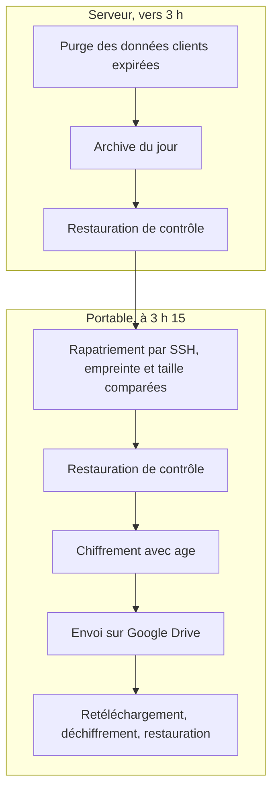

# Sauvegardes

> **Pour qui :** toute personne qui exploite une instance de l'application.
>
> **Vous y trouverez :** ce qui se passe chaque nuit, comment vérifier que
> tout va bien, comment restaurer une archive et protéger la clé de
> chiffrement, puis la référence des commandes, des fichiers et des garanties.
>
> **Statut :** en vigueur.

Les sauvegardes protègent la base et les photos de la collection contre une
panne, une erreur de manipulation ou la perte d'une machine. Chaque copie est
contrôlée par une vraie restauration, pas seulement par sa taille. La copie
hors site, sur Google Drive, part chiffrée : Google ne peut pas la lire.

Les mots [serveur, portable et gestion](GLOSSAIRE.md#le-produit) et
[copie Drive](GLOSSAIRE.md#les-sauvegardes) sont définis dans le glossaire.

## En bref

| Où | Ce qui est gardé | Combien |
|---|---|---|
| Serveur, `/srv/pokeprice/backups` | L'archive de chaque nuit, restaurée pour contrôle | Les 7 dernières |
| Portable, `data/oci-backups` | La même archive, rapatriée et contrôlée de nouveau | Les 3 dernières |
| Google Drive, dossier privé | La même archive, chiffrée, puis retéléchargée et restaurée | 7 jours, puis 1 par semaine sur 8 semaines, puis 1 par mois sur 12 mois ; 30 jours de corbeille |

La collection de référence est sur le serveur ([Héberger le site](DEPLOYMENT.md)).
La base du portable (`data/inventory`) est une copie périmée : n'y écrivez
rien. Aucune tâche planifiée ne la lit ni n'y écrit.

**Pourquoi deux machines ?** Le serveur archive et contrôle, mais n'a aucun
accès à Drive : seul le portable détient le jeton Drive et la clé de
chiffrement. Les secrets restent ainsi isolés : le serveur ne détient ni l'un
ni l'autre, ni l'identifiant du dossier Drive.
Le raisonnement complet est dans la
[fiche de décision 0003](decisions/0003-drive-depuis-le-portable-chiffre.md).

## Ce qui se passe chaque nuit



### Sur le serveur, vers 3 h

Un timer systemd, c'est-à-dire une minuterie qui lance un service à heure fixe,
démarre `pokeprice-backup.service` à 3 h, heure de Paris (le fuseau du
serveur), avec un délai aléatoire de 10 minutes au plus. Si le serveur était
éteint à cette heure, le passage est rattrapé au démarrage suivant. Le service :

1. applique les durées de conservation des données clients (commande `purge`,
   voir [Données personnelles](RGPD.md)), pour que l'archive de la nuit ne
   garde aucune donnée expirée ;
2. écrit une archive cohérente de la base, plus toutes les photos et les
   preuves du référentiel. La base est un fichier SQLite, un moteur de base de
   données qui tient dans un seul fichier ; elle est copiée avec le mécanisme
   de sauvegarde propre à SQLite, et non comme un fichier en cours d'usage.
   L'archive s'appelle `daily-<date>.zip`, où `<date>` est la date de Paris
   écrite année-mois-jour ; ce gabarit est repris dans toute la page ;
3. restaure cette archive dans un dossier temporaire pour la contrôler (voir
   [Ce que vérifie une restauration](#ce-que-vérifie-une-restauration)) ;
4. garde les 7 dernières archives quotidiennes et supprime les plus anciennes.

Si l'archive du jour existe déjà, le service la contrôle de nouveau au lieu de
la refaire : relancer le service ne crée pas de doublon.

### Sur le portable, à 3 h 15

Un timer utilisateur, `pokeprice-drive-backup.timer`, lance la commande
`backup-server-drive`. Celle-ci :

1. se connecte au serveur par SSH (une connexion chiffrée à distance), sans mot
   de passe ni question, et y démarre `pokeprice-backup.service`. Le portable
   attend ainsi une sauvegarde nocturne en retard, ou fait contrôler de nouveau
   l'archive du jour ;
2. choisit la dernière archive `daily-*.zip` du serveur, et relève sa taille et
   son empreinte SHA-256, une somme de contrôle qui change si un seul octet
   change ;
3. la rapatrie en `data/oci-backups/oci-daily-<date>.zip`. Si la taille ou
   l'empreinte diffèrent de celles du serveur, rien n'est gardé. Une
   restauration temporaire contrôle ensuite l'archive. Une archive déjà
   rapatriée avec la même empreinte n'est pas téléchargée une seconde fois ;
4. la chiffre avec [age](https://age-encryption.org), l'envoie sur Drive, la
   retélécharge, la déchiffre et la restaure. La copie n'est marquée réussie
   qu'après ce dernier contrôle.

En cas d'échec, le service réessaie deux fois, à 15 minutes d'intervalle, et ne
démarre pas plus de trois fois par jour. Si le portable était éteint à 3 h 15,
le passage est rattrapé à la prochaine ouverture de votre session.

La copie hors site n'a donc lieu que si le portable est allumé, votre session
ouverte et le réseau disponible. L'envoi passe par
[rclone](https://rclone.org), un outil en ligne de commande qui copie des
fichiers vers des stockages en ligne comme Drive. Sa configuration pour un
service donné s'appelle un « remote » (`gdrive` par défaut) et détient
l'autorisation Google. La copie dépend donc aussi de cette autorisation (voir
[Garanties du transfert](#garanties-du-transfert-vers-drive)).

## Vérifier que tout va bien

### Dans la gestion

Le panneau **Sauvegardes** de la gestion est réservé aux administrateurs.
Les adresses du serveur qui lui fournissent ses données (son API, l'interface
que l'application appelle en coulisse) le sont aussi. Sur le serveur, il affiche :

- la date de la dernière archive restaurée et vérifiée, avec son nombre
  d'exemplaires ;
- la dernière erreur enregistrée ;
- une alerte si cette archive date de plus de 36 heures.

Limite : la gestion du serveur ne voit pas la copie Drive, dont le suivi est
gardé sur le portable. La ligne « Copie Drive » y reste « en attente », le
bouton « Ouvrir le dossier privé Drive » n'a pas d'adresse (le serveur ne
connaît pas ce dossier), et un échec d'envoi sur Drive n'y apparaît pas.
Contrôlez donc la copie Drive sur le portable.

### Sur le portable

À la racine du dépôt :

```bash
# Dernier et prochain passage du timer
systemctl --user list-timers pokeprice-drive-backup.timer
# Journal détaillé de chaque passage, erreurs comprises
journalctl --user -u pokeprice-drive-backup.service
# Suivi : dernière archive rapatriée, dernière copie Drive, dernière erreur
cat data/oci-backups/backup-status.json
```

Dans le suivi, `local` décrit la dernière archive rapatriée et vérifiée,
`external` la dernière copie Drive vérifiée, avec son
[niveau de vérification](#niveaux-de-vérification-dune-copie-drive), et
`last_error` le dernier échec. Un échec n'efface jamais le dernier succès.

> **Attention.** N'utilisez pas `pokeprice-manage backup-status` sur le
> portable. Sans `--data`, la commande lit le suivi de la copie périmée (`data/inventory`). Avec
> `--data data/oci-backups`, elle créerait une base dans le dossier des
> archives, que le rapatriement refuserait ensuite.

### Sur le serveur

```bash
# Dernier et prochain passage de la sauvegarde nocturne
systemctl list-timers pokeprice-backup.timer
# Journal de la sauvegarde nocturne
sudo journalctl -u pokeprice-backup.service
```

### Sauvegarder tout de suite

Dans la gestion, le bouton **Sauvegarder et vérifier maintenant** refait
l'archive du jour sur le serveur et la contrôle par une restauration. Il
n'envoie rien sur Drive : la copie se fera au prochain passage du timer du
portable. Pour l'envoyer sans attendre, lancez sur le portable :

```bash
# Rapatrier la dernière archive du serveur, la contrôler et l'envoyer sur Drive
uv run --extra web pokeprice-manage backup-server-drive --host <utilisateur>@<ip-serveur> --rclone ~/.local/bin/rclone --remote gdrive
```

## Restaurer une archive

Restaurer ne remplace jamais la collection en place. La commande `restore`
exige un dossier inexistant et y reconstruit la collection, puis
affiche son bilan.

### Ce que vérifie une restauration

Avant d'accepter une archive, `restore` contrôle :

- l'empreinte SHA-256 de chaque fichier, comparée au manifeste de l'archive ;
- l'absence de tout fichier hors des emplacements prévus ;
- l'intégrité de la base SQLite et ses clés étrangères (les liens entre
  tables) ;
- une version de base que le code sait lire ;
- la présence de chaque photo citée par la base.

Les comptes de l'équipe et des clients sont restaurés avec leurs mots de passe
hachés. Aucune session ne se rouvre et aucune délégation d'agent ne reste
active : il faudra en créer de nouvelles.

### Restaurer une archive rapatriée

Sur le portable, à la racine du dépôt :

```bash
# Restaurer dans un dossier neuf et afficher le bilan de la collection
uv run --extra web pokeprice-manage --data /tmp/collection-restauree restore data/oci-backups/oci-daily-<date>.zip
```

### Restaurer une copie Drive

1. Télécharger depuis le dossier Drive le fichier
   `oci-daily-<date>-<sha256>.zip.age` voulu.
2. Le déchiffrer avec l'outil `age`, sans avoir besoin de l'application :

   ```bash
   # Déchiffrer la copie avec la clé de sauvegarde
   age -d -i backup-key.txt oci-daily-<date>-<sha256>.zip.age > archive.zip
   # Facultatif : l'empreinte affichée doit être celle du nom du fichier
   sha256sum archive.zip
   ```

3. Restaurer `archive.zip` comme une archive rapatriée.

Un fichier `.zip` sans `.age` n'est pas chiffré : restaurez-le directement.
Le service n'envoie que des copies chiffrées ; la rétention Drive traite les
copies en clair comme les autres archives (voir [Rétention](#rétention)).

### Effacements de clients rejoués

Une archive peut dater d'avant l'effacement d'un client. Si un journal des
effacements (`erasures.jsonl`) se trouve dans le dossier parent de la
destination, `restore` efface de nouveau les clients qu'il cite. Sur le
serveur, ce journal est `/srv/pokeprice/erasures.jsonl` : une collection
restaurée dans un dossier de `/srv/pokeprice/` en profite. Voir
[Données personnelles](RGPD.md).

Pour remettre une collection restaurée en service sur le serveur, suivez
[Héberger le site](DEPLOYMENT.md).

## Protéger la clé de chiffrement

Le portable chiffre chaque archive avec age, en X25519 (chiffrement à clé
publique), avant de l'envoyer. Drive ne reçoit que des fichiers `….zip.age`,
illisibles sans la clé : les données des clients ne sont pas lisibles par
Google.

**Sans cette clé, aucune copie Drive n'est récupérable.**

Créez-la une seule fois, sur le portable :

```bash
# Créer la clé ; seule la clé publique s'affiche
uv run --extra web pokeprice-manage backup-key
```

Si la clé existe déjà, la commande ne la remplace pas et affiche de nouveau sa
clé publique. Elle est rangée dans `~/.config/pokeprice/backup-key.txt` (ou
sous `$XDG_CONFIG_HOME/pokeprice/`), au format de clé d'age, en mode 0600 : vous
seul pouvez la lire.

Règles à suivre :

- Gardez une copie de la clé hors ligne, distincte du portable, par exemple sur
  un disque externe.
- Ne la copiez jamais sur Drive.
- Si la clé manque, ou si d'autres comptes de la machine peuvent la lire,
  aucune copie ne part.
- Chaque copie est déchiffrée après son retéléchargement : une clé perdue ou
  altérée se voit dès la nuit suivante.

Clé exposée ou portable perdu : suivez la procédure de
[Données personnelles](RGPD.md), qui explique comment créer une nouvelle clé.

## Référence

### Commandes

Les commandes appartiennent à `pokeprice-manage`. Sur le portable, lancez-les à
la racine du dépôt avec `uv run --extra web pokeprice-manage`. Sur le serveur,
utilisez la forme décrite dans
[Héberger le site](DEPLOYMENT.md#lancer-une-commande-sur-le-serveur),
avec `--data /srv/pokeprice/inventory`. Sans `--data`, une commande vise
`data/inventory` dans le dossier courant.

| Commande | Rôle | Où |
|---|---|---|
| `backup-key` | Crée une fois la clé de chiffrement ; n'affiche que la clé publique | Portable |
| `backup-server-pull --host <utilisateur>@<ip-serveur>` | Rapatrie et contrôle la dernière archive du serveur, sans rien envoyer sur Drive | Portable |
| `backup-server-drive --host <utilisateur>@<ip-serveur> --rclone <chemin> --remote gdrive` | Rapatrie et contrôle, puis chiffre, envoie sur Drive, retélécharge et restaure | Portable (timer) |
| `--data <dossier-neuf> restore <archive.zip>` | Restaure dans un dossier inexistant | Portable ou serveur |
| `backup-daily [--force]` | Archive quotidienne contrôlée d'une base, rotation à 7 ; `--force` refait l'archive du jour | Serveur (timer) |
| `purge` | Applique les durées de conservation des données clients, juste avant l'archive | Serveur (timer) |
| `backup [<fichier.zip>]` | Archive manuelle ; par défaut `backups/collection-<horodatage>.zip` à côté du dossier de la base | Là où est la base |
| `backup-status` | Affiche le suivi des sauvegardes d'une base | Serveur |
| `backup-drive` | Fait l'archive quotidienne d'une base locale, puis l'envoie sur Drive avec les mêmes contrôles | Instance sur une seule machine ; jamais sur le portable |
| `backup-record-upload <archive> <id-fichier> <taille> --expected-sha256 <sha256-avant-transfert>` | Enregistre une copie Drive faite par un outil de copie externe, après lecture de ses métadonnées Drive. Réservé à cet outil : ne la lancez pas à la main | Jamais à la main |
| `backup-record-failure` | Inscrit un échec visible sans effacer le dernier succès | Rarement |

Options de `backup-server-pull` et `backup-server-drive` : `--mirror` choisit
le dossier des archives rapatriées (`data/oci-backups` par défaut), `--ssh` le
programme SSH. Sans `--rclone`, la commande cherche rclone dans le `PATH`.

L'unité du portable lance la même commande que `backup-server-drive` avec le
Python du projet (`.venv/bin/python -m pokeprice.manage`). Le script
`deploy/oci-pull-backup.sh <utilisateur>@<ip-serveur>` est un raccourci de
`backup-server-pull`, ou de `backup-server-drive` avec `--push-drive`.

### Fichiers et emplacements

| Fichier | Machine | Rôle |
|---|---|---|
| `/srv/pokeprice/backups/daily-<date>.zip` | Serveur | Archives quotidiennes (7) |
| `/srv/pokeprice/backups/before-schema…sqlite3` | Serveur | Copie de la base avant une migration de schéma ; jamais supprimée par la rotation |
| `/srv/pokeprice/inventory/backup-status.json` | Serveur | Suivi lu par la gestion |
| `data/oci-backups/oci-daily-<date>.zip` | Portable | Archives rapatriées (3). Le dossier est privé (mode 0700 : vous seul pouvez l'ouvrir) et refuse d'être un dossier de collection |
| `data/oci-backups/backup-status.json` | Portable | Suivi de l'archive rapatriée et de la copie Drive (mode 0600) |
| `data/backups/daily-<date>.zip` | Portable | Archives faites à partir de la base du portable ; le préfixe `oci-` distingue celles du serveur |
| `~/.config/pokeprice/backup-key.txt` | Portable | Clé de chiffrement (mode 0600) |
| `~/.config/pokeprice/backup.env` | Portable | Adresse du serveur lue par l'unité : `POKEPRICE_OCI_HOST=<utilisateur>@<ip-serveur>` (mode 0600, hors dépôt) |
| `POKEPRICE_DRIVE_FOLDER` ou `~/.config/pokeprice/drive_folder` | Portable | Identifiant du dossier Drive privé, hors dépôt |
| `deploy/pokeprice-backup.service` et `.timer` | Serveur | Unités système de la sauvegarde nocturne |
| `deploy/pokeprice-drive-backup.service` et `.timer` | Portable | Unités utilisateur de la copie Drive |
| `oci-daily-<date>-<sha256>.zip.age` | Drive | Copie chiffrée d'une archive du serveur |
| `daily-<date>-<sha256>.zip.age` | Drive | Copie chiffrée d'une archive faite par `backup-drive` |

Sur Drive, l'empreinte du nom est celle de l'archive en clair. Plusieurs
versions d'un même jour peuvent ainsi coexister.

### Contenu d'une archive

Une archive contient :

- toute la base SQLite, écrite avec le mécanisme de sauvegarde de SQLite. Elle
  comprend les comptes de l'équipe et des clients avec leurs mots de passe
  hachés, nécessaires à la restauration, ainsi que les e-mails et les demandes
  des clients de la vitrine ;
- toutes les photos de la collection, y compris les versions précédentes utiles
  à l'historique ;
- les documents de preuve du référentiel, contrôlés par leur empreinte ;
- un manifeste qui donne l'empreinte SHA-256 de chaque fichier.

Une archive ne contient pas :

- de session ouverte ni de jeton d'agent utilisable ;
- les caches de vision (images de référence et vecteurs), qui se recalculent
  seuls ([Héberger le site](DEPLOYMENT.md)) ;
- les photos originales des pages de classeurs : elles sont dans
  l'[instantané initial](RECOVERY.md) ;
- le code : pour reconstruire l'application, partez du dépôt Git, pas du code
  de l'instantané initial, antérieur à l'application de gestion ;
- les secrets (fichiers `.env`, clés d'API, clé de chiffrement, jeton Drive) :
  reconfigurez-les à part ;
- le suivi des sauvegardes et le journal des effacements, rangés à côté.

### Rétention

| Où | Règle |
|---|---|
| Serveur | Les 7 dernières archives quotidiennes. Les archives ponctuelles (faites avant un lot ou à la main) : les 3 plus récentes sont toujours gardées, les autres 14 jours. Les copies d'avant migration : les 5 plus récentes. Cette rotation passe après chaque archive quotidienne réussie. |
| Portable | Les 3 dernières archives rapatriées, faute de place sur le disque. Cette limite ne touche pas Drive. |
| Drive | Toutes les archives des 7 jours les plus récents qui en ont une, puis la plus récente de chacune des 8 dernières semaines et de chacun des 12 derniers mois. Seules comptent les semaines et les mois qui ont une archive. Les autres archives vont à la corbeille Drive, d'où elles restent récupérables 30 jours. |

Les archives ponctuelles ne sont ni rapatriées ni copiées sur Drive : rapatriez
celles qui doivent durer au-delà de 14 jours. Une sauvegarde est refusée avant
d'écrire si le disque n'a pas la place de l'archive plus une marge de 512 Mo :
un disque plein bloquerait aussi l'application.

La rétention Drive s'applique après chaque copie vérifiée. Elle ne vise que les
archives `daily-*` et `oci-daily-*` du dossier de sauvegarde, fichiers `.zip`
non chiffrés compris ; les autres fichiers du dossier ne sont jamais touchés.
Une copie non chiffrée n'est jamais réutilisée : vous pouvez la mettre à la
corbeille à la main sans gêner le service. Un échec de rétention n'invalide pas
la copie du jour ; la rétention est retentée à la copie suivante.

### Garanties du transfert vers Drive

- **Aucun secret dans le projet.** Le « remote » rclone (`gdrive` par défaut)
  et son jeton sont réutilisés tels quels. Le dossier de destination est imposé par son
  identifiant dans chaque commande, sans modifier cette configuration.
- **Une règle du service, pas du jeton.** Le jeton d'autorisation Google
  (OAuth) donne accès à tout Drive ; la limite au dossier de sauvegarde est une
  règle du service. Révoquer ce jeton couperait aussi les autres outils qui
  utilisent la même configuration rclone.
- **Un dossier et des fichiers privés.** Avant l'envoi, puis après le
  retéléchargement, le service vérifie que le dossier et la copie n'ont qu'une
  permission, celle du compte qui les possède, et qu'ils ne sont ni partagés ni
  à la corbeille. Sinon, il bloque. Il ne partage jamais aucun fichier.
- **Des octets figés.** Une copie temporaire privée fige l'archive pendant le
  transfert, et un verrou empêche deux exécutions simultanées. Une archive
  locale remplacée pendant le transfert n'est pas déclarée à jour.
- **Un nom par contenu.** Le nom porte l'empreinte de l'archive en clair. Après
  un transfert au résultat incertain, l'essai suivant cherche d'abord ce nom
  sur Drive. Un fichier déjà présent n'est jamais écrasé. Une copie chiffrée de
  même contenu, déjà envoyée, est réutilisée.
- **Des blocages francs.** Plusieurs fichiers du même nom, une copie qui ne se
  déchiffre pas ou dont l'empreinte diffère, des métadonnées incohérentes
  (dossier parent, taille, document Google) ou une permission en trop bloquent
  la validation.
- **Un contrôle complet à chaque passage.** Retéléchargement, déchiffrement et
  restauration ont lieu à chaque exécution réussie, même quand rien de nouveau
  n'est à envoyer.
- **Des erreurs visibles, sans fuite.** Toute erreur garde le dernier succès et
  inscrit un échec dans le suivi du portable ; le détail est dans le journal
  systemd. La sortie des commandes omet l'identifiant du dossier Drive, puisque
  ce journal la reçoit. Aucune notification n'est envoyée : surveillez le
  journal ou le suivi.

### Délais maximaux

Chaque appel SSH, rclone ou HTTP a un délai maximal :

| Étape | Délai |
|---|---|
| Connexion SSH au serveur | 15 s |
| Commandes SSH courtes (liste des archives) | 2 min |
| Attente de la sauvegarde du serveur, calcul de son empreinte | 30 min |
| Appel à l'API Google Drive | 30 s |
| Rapatriement, envoi ou retéléchargement d'une archive | Taille divisée par 250 ko/s (environ 2 Mbit/s, un accès domestique lent), entre 4 min et 3 h. Exemple : environ 53 min pour une archive de 790 Mo |
| Service de sauvegarde du serveur | 10 min |
| Service de copie du portable, en entier | 7 h |

### Niveaux de vérification d'une copie Drive

Le suivi inscrit, pour chaque copie Drive, le niveau de contrôle atteint :

| Valeur | Libellé dans la gestion | Sens |
|---|---|---|
| `download-decrypt-sha256-restore` | « chiffrée, puis téléchargée, déchiffrée, SHA-256 et restauration vérifiés » | Copie faite par le service |
| `download-sha256-restore` | « non chiffrée ; téléchargée, SHA-256 et restauration vérifiés » | Copie non chiffrée, retéléchargée et restaurée |
| `metadata-size` | « taille vérifiée » | Copie enregistrée par `backup-record-upload`, d'après ses métadonnées Drive |

### Installer la copie Drive sur le portable

Il vous faut :

1. rclone, avec une configuration de type Google Drive déjà autorisée
   (`gdrive` par défaut) ;
2. l'identifiant d'un dossier Drive privé, dans la variable
   `POKEPRICE_DRIVE_FOLDER` ou le fichier `~/.config/pokeprice/drive_folder`.
   Sans lui, aucune copie ne part ;
3. la clé de chiffrement (`backup-key`, ci-dessus) ;
4. le fichier `~/.config/pokeprice/backup.env`, en mode 0600, avec la ligne
   `POKEPRICE_OCI_HOST=<utilisateur>@<ip-serveur>` ;
5. une connexion SSH au serveur par clé, sans aucune question, avec un compte
   qui peut utiliser `sudo` sans mot de passe : la commande démarre le service
   et lit les archives du serveur avec `sudo`.

Les unités supposent le dépôt dans `~/Projects/pokeprice` et rclone dans
`~/.local/bin/rclone` : adaptez ces chemins à votre machine. Ensuite :

```bash
# Copier les unités, recharger systemd et activer le timer
install -m 0644 deploy/pokeprice-drive-backup.service deploy/pokeprice-drive-backup.timer ~/.config/systemd/user/
systemctl --user daemon-reload
systemctl --user enable --now pokeprice-drive-backup.timer
```

Les unités du serveur s'installent avec le déploiement
([Héberger le site](DEPLOYMENT.md)).
