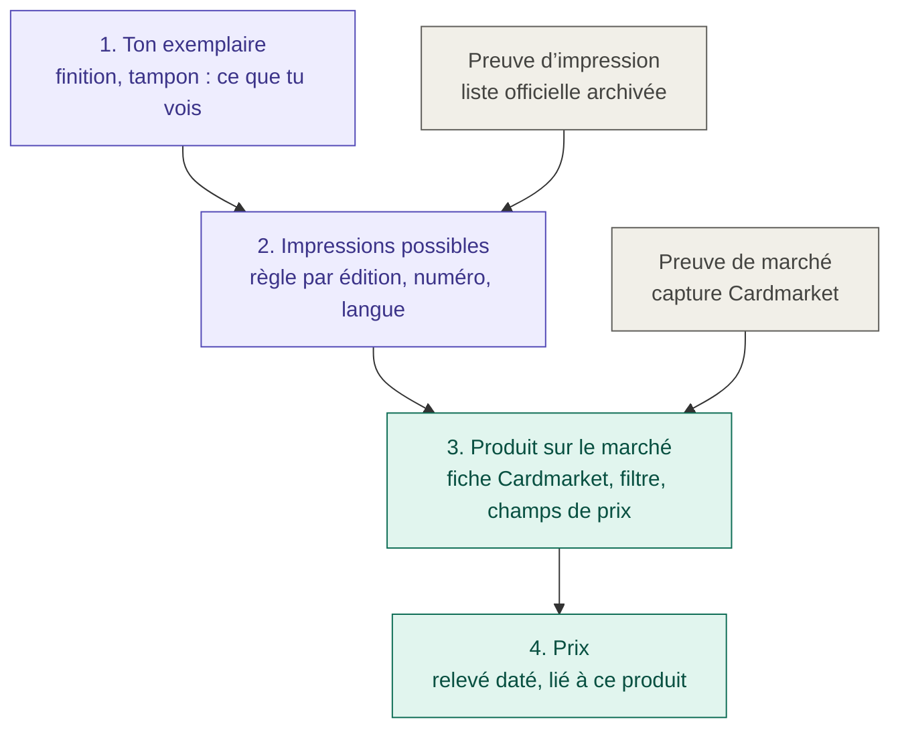
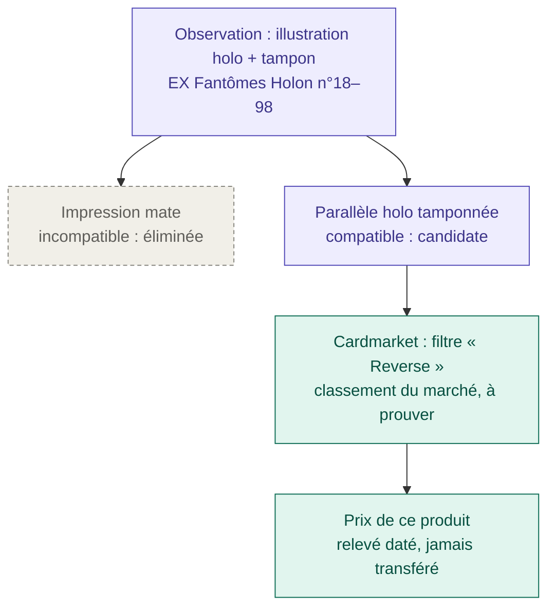

# Référentiel des impressions — guide fonctionnel

Ce guide explique le système de preuve de M1.1 sans détail technique.
Le comportement exact est fixé par [le contrat](PRINT_REFERENCE_CONTRACT.md) ;
l’état de la livraison est dans [l’implémentation](PRINT_REFERENCE_IMPLEMENTATION.md).

## Pourquoi ce référentiel

M1.1 est né d’incohérences dans l’identification des cartes : des vendeurs
proposaient en « reverse » une carte dont seule l’illustration est holo,
certaines impressions n’étaient référencées nulle part, et la case
Standard/Foil devait répondre à deux questions à la fois :

1. **Qu’est-ce que cette carte, physiquement ?** Mate, illustration holo,
   tampon…
2. **Sous quelle fiche le marché la vend-il ?** Produit Cardmarket, filtre
   « Reverse » ou non.

Le classement d’un vendeur répond à la question 2, pas à la question 1. Il
peut même être exact : Cardmarket range peut-être cette impression sous
« Reverse ». Le référentiel sépare donc les deux questions, et chacune a sa
propre preuve.

## Les quatre étages



**1. Ton exemplaire.** Tu notes ce que tu vois : la finition et le tampon
(« non examiné », « absent », « présent : texte »), éventuellement une marque
de distribution. Le serveur enregistre qui l’a vu et quand. Seule une
observation humaine compte : une lecture de Gemini reste une proposition et
n’élimine rien. Une observation partielle s’enregistre toujours, même hors
ligne et sans prix.

**2. Les impressions possibles.** Pour une édition, une plage de numéros et
une langue, une règle liste les impressions qui existent (par exemple
« mate » et « parallèle holo tamponnée »). Chacune s’appuie sur une
**preuve d’impression**. Ton observation élimine les impressions qui ne
collent pas ; un indice non examiné n’élimine rien.

**3. Le produit sur le marché.** Pour chaque impression, la **correspondance
marchande** dit sous quelle fiche Cardmarket elle se vend : numéro de
produit, filtre (Reverse ou non), champs de prix lus, devise. Elle s’appuie
sur une **preuve de marché**. C’est ici, et seulement ici, que vit le
classement des vendeurs.

**4. Le prix.** Un relevé est lié à cette correspondance précise et garde sa
source et sa date. Si la carte change de correspondance, l’ancien prix est
mis de côté et n’est jamais recopié sur l’autre produit.

## Ce qu’est une preuve

Une preuve est une affirmation précise tirée d’un document, avec :

- **la phrase extraite** (« les numéros 18 à 98 existent en versions mate et
  brillante ») et ses limites ;
- **la source** (adresse) et **la date de consultation** ;
- **le périmètre exact** : édition, numéros, **langue** ;
- **l’empreinte SHA-256** du document archivé. Elle sert de scellé : si le
  document change ou disparaît, l’application le signale.

Les documents sont rangés une seule fois par empreinte dans
`reference_documents/` et voyagent avec les sauvegardes.

**Chaque langue a ses preuves.** La collection est multilingue (français,
anglais, japonais, italien) et l’application vise un public international.
Une liste anglaise ne couvre jamais le français ; une règle française exige
une preuve française. Sources officielles connues :

| Langue | Source officielle | Couverture |
|---|---|---|
| Français, italien, anglais… | Encyclopédie des cartes de pokemon.com, par langue | Depuis la série EX ; sans les reverses |
| Japonais | Recherche de cartes de pokemon-card.com | Depuis l’ère XY seulement |
| Anglais | Listes officielles PDF des extensions | Selon l’extension |

Avant ces périodes, et pour les reverses, il faut d’autres pièces :
références communautaires (Poképédia, Bulbapedia…), ou photos d’exemplaires.
Les premières restent des preuves *provisoires* tant qu’elles ne sont pas
confirmées.

## Liste complète ou partielle

Une liste officielle dit rarement « et il n’existe rien d’autre ». Promos,
réimpressions et tirages spéciaux y manquent souvent.

- Une règle est **partielle** par défaut : l’application garde en tête qu’une
  impression inconnue peut exister. Un seul candidat dans une liste partielle
  ne suffit pas à conclure.
- Une règle n’est **complète** que si une preuve dit explicitement que la
  liste est fermée.
- Une impression inconnue peut quand même recevoir un prix si une preuve
  de marché montre que toutes les possibilités, y compris l’inconnue, se
  vendent sous la même fiche.

## Exemple : la carte vendue en « reverse »



La fiche reste exacte physiquement (« illustration holo + tampon ») et le prix
vient de la bonne fiche Cardmarket. Il n’y a plus besoin d’écrire « reverse »
pour obtenir le bon prix. Si un vendeur ou TCGdex dit autre chose, l’écart
est affiché comme un désaccord ; ton observation n’est pas réécrite.

## Ce que l’application peut répondre

| Situation | Réponse |
|---|---|
| Un seul produit possible, prouvé | Un prix, avec sa source et sa date |
| Plusieurs produits possibles, un indice manque | Une question précise (« Y a-t-il un tampon ? ») et pas de prix en attendant |
| Impression connue, aucune fiche Cardmarket prouvée | Impression reconnue, prix inconnu |
| Édition ou langue absente des règles | « Non couvert » : la carte s’enregistre sans blocage |
| Deux preuves se contredisent, ou contestation | Conflit : le prix est mis de côté |

Une observation qui ne correspond à aucune impression connue est gardée telle
quelle, et la carte rejoint le filtre **Examen → Référentiel à compléter**.
On enrichit le référentiel ; on ne force pas la carte dans une case.

## Prix mis de côté, contestés ou saisis à la main

- **Mis de côté (suspendu)** : la correspondance a changé, une contestation
  est active ou les règles ont évolué. Le prix reste visible dans l’historique
  mais sort des totaux. Il ne revient jamais tout seul : il faut une
  restauration explicite.
- **Contestation** : tu peux contester une décision avec un motif. Elle
  suspend le prix concerné ; la retirer ne le réactive pas.
- **Retiré** : effacer ou remplacer un prix lié le retire définitivement.
  Un prix saisi ensuite à la main t’appartient : le système n’y touche plus.
- **Ancien prix** : les prix relevés avant M1.1 restent affichés avec leur
  source et leur date, mais ne sont pas présentés comme vérifiés.

## Ajouter une preuve

1. Enregistrer la source (liste officielle, page Cardmarket en HTML ou PDF)
   et l’archiver :

   ```bash
   uv run pokeprice-manage reference-archive capture.html
   ```

2. Écrire dans `src/pokeprice/reference/prints-v1.json` la phrase extraite,
   l’empreinte donnée par la commande, l’endroit dans le document, la date et
   le périmètre exact (édition, numéros, langue). L’application refuse une
   règle dont les preuves ne couvrent pas tout son périmètre.
3. Après la mise à jour des règles, lister puis appliquer les suspensions :

   ```bash
   uv run pokeprice-manage reference-recheck
   uv run pokeprice-manage reference-recheck --apply
   ```

## État au 13 octobre 2026

- Le mécanisme est en place : observations, moteur, archivage des pièces,
  journal des prix et contestations.
- Le contenu est mince : cinq règles anglaises partielles, sans tampon et
  **sans aucune preuve de marché**. Aucune carte de la collection n’est
  encore résolue.
- Le prix affiché reste celui de M1 en attendant.
- Premier cas de bout en bout visé : EX Fantômes Holon en français (règle
  avec tampon, preuve française, capture Cardmarket). Voir la
  [roadmap](ROADMAP.md).
