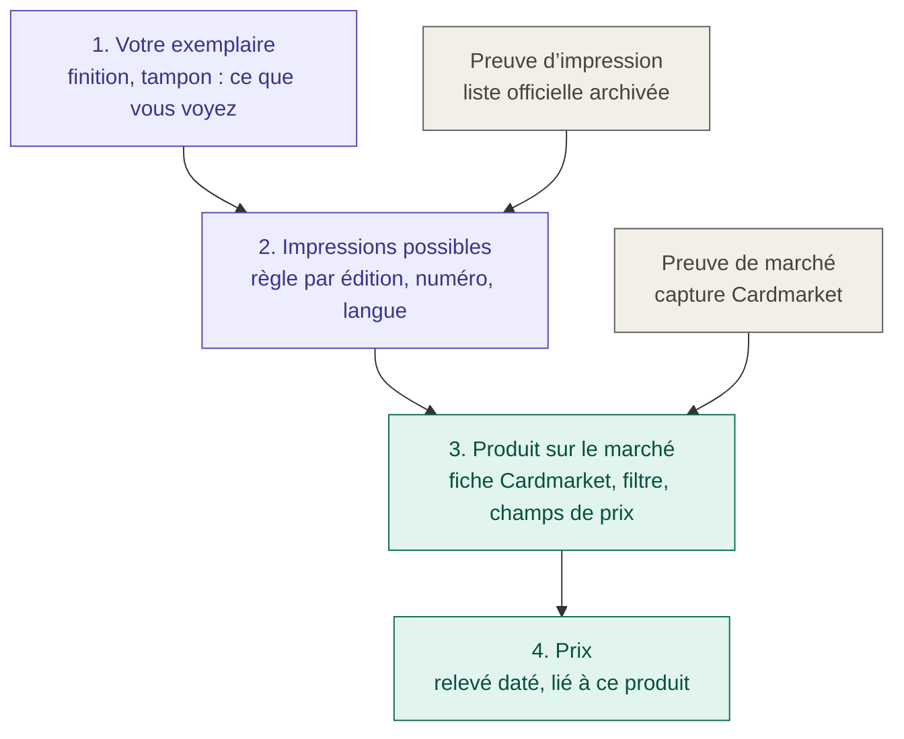
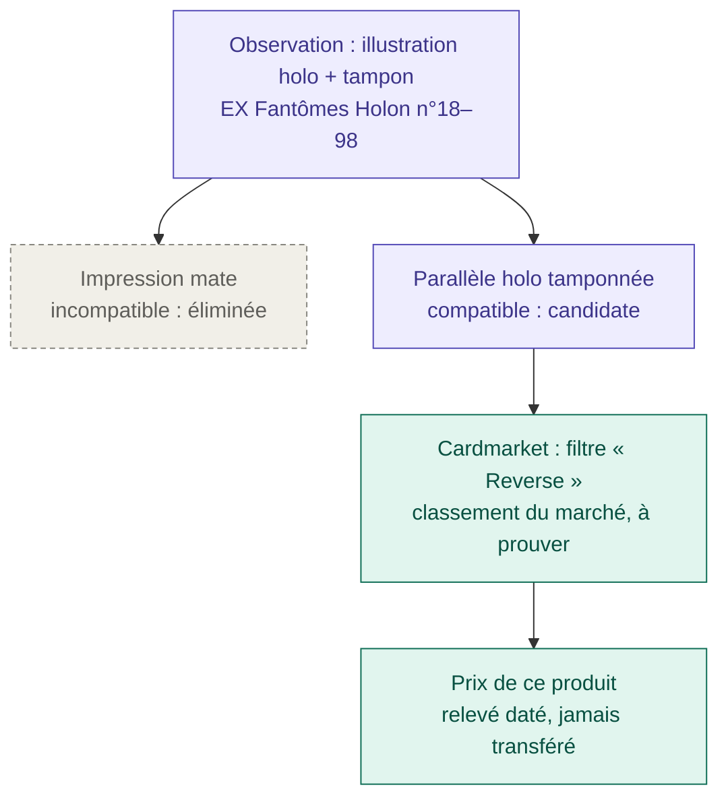

# Le référentiel des impressions

> **Pour qui :** toute personne qui veut savoir comment l'application décide quelle version d'une carte vous avez et quel prix lui appliquer, preuves à l'appui.
> **Vous y trouverez :** pourquoi ce référentiel existe, ses quatre étages, ce qu'est une preuve, ce que l'application peut répondre, comment ajouter une preuve, et ce qui est mis en œuvre aujourd'hui.
> **Statut :** en vigueur, en mode audit. Les règles exactes sont dans le [contrat](PRINT_REFERENCE_CONTRACT.md) ; le choix du mode audit dans la [fiche 0011](decisions/0011-referentiel-mode-audit.md).

## Pourquoi ce référentiel

Le référentiel est né d'incohérences dans l'identification des cartes : des
vendeurs proposaient en « reverse » une carte dont seule l'illustration est
holo, certaines impressions n'étaient référencées nulle part, et la case
Standard/Foil devait répondre à deux questions à la fois :

1. **Qu'est-ce que cette carte, physiquement ?** Mate, illustration holo,
   tampon…
2. **Sous quelle fiche le marché la vend-il ?** Produit Cardmarket, filtre
   « Reverse » ou non.

Le classement d'un vendeur répond à la question 2, pas à la question 1. Il peut
même être exact : Cardmarket range peut-être cette impression sous « Reverse ».
Le référentiel sépare donc les deux questions, et chacune a sa propre preuve.

## Les quatre étages



**1. Votre exemplaire.** Vous notez ce que vous voyez : la finition et le
tampon (« non examiné », « absent », « présent : texte »), éventuellement une
marque de distribution. Le serveur enregistre qui l'a vu et quand. Seule une
observation humaine compte : une lecture de Gemini reste une proposition et
n'élimine rien. Une observation partielle s'enregistre toujours, même hors
ligne et sans prix.

**2. Les impressions possibles.** Pour une édition, une plage de numéros et une
langue, une règle liste les impressions qui existent (par exemple « mate » et
« parallèle holo tamponnée »). Chacune s'appuie sur une **preuve
d'impression**. Votre observation élimine les impressions qui ne collent pas ;
un indice non examiné n'élimine rien.

**3. Le produit sur le marché.** Pour chaque impression, la **correspondance
marchande** dit sous quelle fiche Cardmarket elle se vend : numéro de produit,
filtre (Reverse ou non), champs de prix lus, devise. Elle s'appuie sur une
**preuve de marché**. C'est ici, et seulement ici, que vit le classement des
vendeurs.

**4. Le prix.** Un relevé est lié à cette correspondance précise et garde sa
source et sa date. Si la carte change de correspondance, l'ancien prix est mis
de côté et n'est jamais recopié sur l'autre produit.

## Ce qu'est une preuve

Une preuve est une affirmation précise tirée d'un document, avec :

- **la phrase extraite** (« les numéros 18 à 98 existent en versions mate et
  brillante ») et ses limites ;
- **la source** (adresse) et **la date de consultation** ;
- **le périmètre exact** : édition, numéros, **langue** ;
- **l'empreinte SHA-256** du document archivé. Elle sert de scellé : si le
  document change ou disparaît, l'application le signale.

Les documents sont rangés une seule fois par empreinte dans
`reference_documents/` et voyagent avec les sauvegardes.

**Chaque langue a ses preuves.** La collection est multilingue (français,
anglais, japonais, italien) et le site vise un public international. Une liste
anglaise ne couvre jamais le français ; une règle française exige une preuve
française. Sources officielles connues :

| Langue | Source officielle | Couverture |
|---|---|---|
| Français, italien, anglais… | Encyclopédie des cartes de pokemon.com, par langue | Depuis la série EX, avec des trous (l'édition française n'a aucune carte d'EX Fantômes Holon, l'anglaise les a) ; sans les reverses |
| Japonais | Recherche de cartes de pokemon-card.com | Depuis l'ère XY seulement |
| Anglais | Listes officielles PDF des extensions | Selon l'extension |

Avant ces périodes, pour les trous et pour les reverses, il faut d'autres
pièces : références communautaires (Poképédia, Bulbapedia…), photos
d'exemplaires, page Cardmarket enregistrée. Les références communautaires
restent des preuves *provisoires* tant qu'elles ne sont pas confirmées. Pour
les éditions anciennes en français, la photo d'un exemplaire et la page
Cardmarket filtrée sont les pièces réalistes.

## Liste complète ou partielle

Une liste officielle dit rarement « et il n'existe rien d'autre ». Promos,
réimpressions et tirages spéciaux y manquent souvent.

- Une règle est **partielle** par défaut : l'application garde en tête qu'une
  impression inconnue peut exister. Un seul candidat dans une liste partielle
  ne suffit pas à conclure.
- Une règle n'est **complète** que si une preuve dit explicitement que la liste
  est fermée.
- Une impression inconnue peut quand même recevoir un prix si une preuve de
  marché montre que toutes les possibilités, y compris l'inconnue, se vendent
  sous la même fiche.

## Exemple : la carte vendue en « reverse »



La fiche reste exacte physiquement (« illustration holo + tampon ») et le prix
vient de la bonne fiche Cardmarket. Il n'y a plus besoin d'écrire « reverse »
pour obtenir le bon prix. Si un vendeur ou TCGdex dit autre chose, l'écart est
affiché comme un désaccord ; votre observation n'est pas réécrite.

## Ce que l'application peut répondre

| Situation | Réponse |
|---|---|
| Un seul produit possible, prouvé | Un prix, avec sa source et sa date |
| Plusieurs produits possibles, un indice manque | Une question précise (« Y a-t-il un tampon ? ») et pas de prix en attendant |
| Impression connue, aucune fiche Cardmarket prouvée | Impression reconnue, prix inconnu |
| Édition ou langue absente des règles | « Non couvert » : la carte s'enregistre sans blocage |
| Deux preuves se contredisent, ou contestation | Conflit : le prix est mis de côté |

Une observation qui ne correspond à aucune impression connue est gardée telle
quelle, et la carte rejoint en principe le filtre **Examen → Référentiel à
compléter**. On enrichit le référentiel ; on ne force pas la carte dans une
case. Une exception, due au moteur actuel, est décrite plus bas
([les limites](#les-limites)).

## Prix mis de côté, contestés ou saisis à la main

- **Mis de côté (suspendu)** : la correspondance a changé, une contestation est
  active ou les règles ont évolué. Le prix reste visible dans l'historique mais
  sort des totaux. Il ne revient jamais tout seul : il faut une restauration
  explicite.
- **Contestation** : vous pouvez contester une décision avec un motif. Elle
  suspend le prix concerné ; la retirer ne le réactive pas.
- **Retiré** : effacer ou remplacer un prix lié le retire définitivement. Un
  prix saisi ensuite à la main vous appartient : le système n'y touche plus, et
  une correction sans rapport (note, album…) ne l'efface pas.
- **Ancien prix** : les prix relevés avant le référentiel restent affichés avec
  leur source et leur date, mais ne sont pas présentés comme vérifiés.

## Ajouter une preuve

Les règles font partie du code (`src/pokeprice/reference/prints-v1.json`) ; les
pièces, de la collection. Une preuve s'ajoute donc en deux endroits :

1. **Archiver la pièce dans la base de référence**, c'est-à-dire sur le serveur
   ([forme des commandes](DEPLOYMENT.md#lancer-une-commande-sur-le-serveur)),
   pour qu'elle voyage avec les sauvegardes. Enregistrez d'abord la source
   (liste officielle, page Cardmarket en HTML ou PDF, photo en JPEG ou PNG) :

   ```bash
   pokeprice-manage --data /srv/pokeprice/inventory reference-archive capture.html
   ```

   La commande range la pièce sous son empreinte SHA-256 et l'affiche.
2. **Écrire la règle dans le dépôt** : dans `prints-v1.json`, la phrase
   extraite, l'empreinte, l'endroit dans le document, la date et le périmètre
   exact (édition, numéros, langue) ; augmentez la version de contenu.
   L'application refuse une règle dont les preuves ne couvrent pas tout son
   périmètre. Lancez les tests, commitez, puis déployez le code
   ([Héberger le site](DEPLOYMENT.md#mettre-à-jour-le-code)).
3. **Après le déploiement, sur le serveur**, listez puis appliquez les
   suspensions des cotations devenues incompatibles :

   ```bash
   pokeprice-manage --data /srv/pokeprice/inventory reference-recheck
   pokeprice-manage --data /srv/pokeprice/inventory reference-recheck --apply
   ```

Quand la résolution d'une carte est éligible, sa fiche propose **Saisir un
relevé Cardmarket lié au référentiel** : la tendance et la moyenne à 30 jours
se saisissent ensemble, dans l'ordre du cadre Info de Cardmarket, avec la date,
un motif et, en option, l'empreinte de la capture. Le serveur prend la
correspondance dans sa propre résolution. Une saisie erronée se corrige par une
nouvelle saisie, qui la remplace sans l'effacer.

## Ce qui est mis en œuvre

**Le mécanisme est en place.**

- Observations explicites de la finition, du tampon et de la marque de
  distribution, avec leur texte original, l'auteur attribué par le serveur, la
  date et le motif. Une observation partielle peut éliminer un candidat
  lorsqu'elle a sa propre provenance humaine ; une proposition de modèle, un
  aperçu non enregistré ou un ancien texte de tampon ne le peuvent pas.
- Une résolution locale et déterministe : ensemble de candidats, périmètres de
  langue et de numéros, reste inconnu, indices manquants, preuves, conflits,
  contestations. Plusieurs impressions peuvent partager une correspondance
  marchande prouvée.
- Une clé marchande fondée sur le marché, le produit, la variante, les filtres,
  la famille de mesures, la devise et la population ; une dimension inconnue
  n'est jamais un joker. Tendance et moyenne à 30 jours doivent partager la
  même correspondance, l'euro, la même population et une acquisition
  compatible.
- Un journal des cotations liées, séparé des anciennes hypothèses Foil : une
  correction physique compatible garde montant, source et date ; un changement
  de produit suspend l'ancienne cotation. Chaque décision enregistre ses
  entrées, ses règles exactes et l'empreinte de son moteur, et se rejoue à
  l'identique après une restauration ; un moteur incompatible est déclaré
  indisponible, jamais exécuté automatiquement.
- Le même audit dans la fiche, l'aperçu, les vues, la ligne de commande
  (`reference-audit`) et les exports ; le filtre **Référentiel à compléter**.
- Le paquet de règles fonctionne hors ligne, installé hors du dépôt ; un paquet
  invalide produit un diagnostic explicite et n'autorise aucune nouvelle
  décision vérifiée.

**Le contenu est mince.** Le paquet (version de contenu `2026-10-13.2`) compte
six règles :

| Règle | Périmètre | Fait extrait | Limite |
|---|---|---|---|
| EX Deoxys | anglais, n° 16 à 95 | versions mate et brillante dans la liste | tirages et distributions non fermés |
| EX Fantômes Holon | anglais, n° 18 à 98 | versions mate et brillante dans la liste | idem |
| EX Gardiens de Cristal | anglais, n° 14 à 88 | versions mate et brillante dans la liste | idem |
| Indomptable | anglais, n° 81 à 90 | une version brillante ; le 85 est Roigada Prime | ne décrit pas à elle seule la zone qui brille |
| Destinées Futures | anglais, n° 74 | Baggaïd rare holo dans le jeu de base | autres distributions non fermées |
| EX Fantômes Holon | **français, n° 78 seul** | voir ci-dessous | — |

Ces listes anglaises ne certifient ni les impressions françaises ou
italiennes, ni les tampons particuliers, ni les produits Cardmarket. Les huit
familles de régression sont suivies ; EX Légendes Oubliées, POP Série 9 et
Promo Nintendo restent non couvertes.

**Le premier cas de bout en bout : le Pikachu 78/110 français d'EX Fantômes
Holon.** Une correspondance Cardmarket désigne un produit, donc un numéro : la
règle couvre le seul n° 78.

| Pièce | Type | Statut | Établit |
|---|---|---|---|
| Photo de l'exemplaire | impression | vérifiée | Le Pikachu 78/110 français existe en illustration holo avec le tampon « EX Fantômes Holon » |
| Fiche TCGdex `fr/cards/ex13-78` | impression, marché | provisoire | Une version mate française ; le produit 277048 et ses séries normale et holo |
| Page Cardmarket enregistrée | marché | vérifiée | Produit 277048 « Pikachu (HP 78) » ; offres françaises « Stamp » sous Reverse ; tendance et moyenne à 30 jours de la série Reverse |

| Impression | Observations | Correspondance |
|---|---|---|
| parallèle tamponnée | holo + tampon présent | Cardmarket 277048, Reverse : vérifiée (filtre `isReverseHolo=Y`, mesures `trend-holo` et `avg30-holo`, euros, toutes langues et tous états) |
| mate d'origine | mate + tampon absent | Cardmarket 277048, normale : provisoire |
| reste inconnu | — | Cardmarket 277048, Reverse : la page ne propose que Reverse, Signé, First Edition et Altérée, donc toute impression brillante de ce numéro s'y vend en Reverse |

Le Pikachu de la collection (holo, tampon attesté) a donc un prix vérifié, en
catégorie Foil. Sans liste fermée, son impression reste « candidate ». Une
carte mate reste provisoire ; une autre langue, hors périmètre. **Pour toutes
les autres cartes, le prix affiché reste le calcul hérité** de la
[valeur en jeu](VALUATION.md).

## Les limites

- **Le moteur rattache le reste inconnu à la règle, pas à l'observation.** Une
  holo **sans** tampon de ce numéro, qui ne correspond à aucune impression
  documentée, reçoit le prix Reverse avec le motif `observation_uncovered`, et
  ne rejoint pas « Référentiel à compléter ». Restreindre le reste aux
  observations compatibles demandera un nouveau moteur.
- **Aucune acquisition automatique** n'alimente le journal des cotations
  liées : ni les anciens relevés TCGdex, ni le formulaire de prix habituel ne
  le contournent. Le service de prix garde son calcul hérité.
- **Le repli de langue de TCGdex** trace la langue demandée et la langue
  servie ; les anciens caches gardent une origine inconnue, sans certifier une
  portée française.
- **Le coût d'une preuve** est d'environ une heure de recherche : Cardmarket
  bloque la capture automatisée, il faut enregistrer la page à la main.

**Pour clore ce jalon**, il reste à apporter les preuves physiques pour les
langues et distributions de la collection, les correspondances marchandes et
leurs mesures sur les huit familles, à raccorder l'acquisition à ces
correspondances, puis à refaire l'audit et activer la sélection vérifiée sans
perte inexpliquée. Les nouveaux albums restent saisissables, avec des
observations partielles et un périmètre non couvert. Changer la logique du
moteur exige une nouvelle version du moteur et un lecteur compatible testé pour
les décisions passées. Le détail de la première livraison est
[archivé](archive/PRINT_REFERENCE_IMPLEMENTATION-2026-10-13.md).
