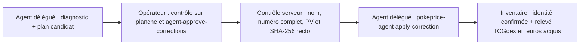

# Résoudre les cartes à identifier, à vérifier et à examiner

> **Pour qui :** l'opérateur de la collection, la personne qui tient le classeur et l'agent qui prépare le travail.
> **Vous y trouverez :** la distinction entre les trois files d'attente, l'enchaînement le plus court pour chacune, la répartition des rôles entre code déterministe, agent et humain, ainsi que le plan d'outillage pour réduire le temps de résolution.

Accélérer le traitement des cartes en suspens demande d'abord de ne pas
mélanger trois états que l'inventaire distingue : une carte **non identifiée**,
une carte dont **l'identité ou le prix attend une confirmation**, et une carte
qui **demande un examen physique dans le classeur**. Chacune relève d'un outil
et d'une autorité différents.

Le [glossaire](GLOSSAIRE.md) définit les termes utilisés ici.

---

## 1. Distinguer les trois files avant d'agir

Traiter toutes les cartes incertaines en ouvrant les fiches une par une dans
l'interface web est le chemin le plus lent : la personne alterne sans cesse
entre recherche au catalogue, lecture de petits numéros sur photo et ouverture
du classeur physique. Le gain de vitesse vient du regroupement par nature de
blocage.

| File | État dans la base | Cause principale | Qui peut trancher | Parcours le plus rapide |
|---|---|---|---|---|
| **1. À identifier** | `status = unidentified` ou découpe `< 93 %` | Carte à l'envers, dos bleu seul, pochette multiple, découpe en tiers qui tronque nom ou numéro | Code local (recadrage, cache catalogue, DINOv2) puis opérateur sur planche PNG | [`scripts/audit_photo_crops.py`](../scripts/audit_photo_crops.py) puis [`scripts/audit_photo_identity.py`](../scripts/audit_photo_identity.py) |
| **2. À vérifier / sans prix** | `status = review` ou `reference_cents` absent | Proposition d'identité non confirmée, suffixe `δ` ou apostrophe, relevé en euros non acquis, cotation absente ou produit Cardmarket partagé | Opérateur par lot préautorisé puis agent délégué ([`pokeprice-agent-prix`](../skills/pokeprice-agent-prix/SKILL.md)) | Validation sur planche + `pokeprice-manage agent-approve-corrections` + `pokeprice-agent apply-correction` |
| **3. À examiner** | `needs_review = true`, trié par `risk_cents` décroissant | Variante Standard / Holo / Reverse indiscernable sur photo fixe, tampon d'édition, désaccord entre lectures, état non confirmé dès 10 € | Personne devant le classeur physique (`variant_confirmed`, `condition_confirmed`) | Séance préparée par l'agent ([`pokeprice-agent`](../skills/pokeprice-agent/SKILL.md)) dans l'ordre des pages et pochettes |

Deux règles gouvernent l'ensemble :

1. **Traitement en lot pour le catalogue, passage séquentiel unique pour le classeur.** Ce qui se vérifie face aux images TCGdex se traite sur des planches groupées ; ce qui exige d'incliner la carte sous la lumière se traite en tournant les pages du classeur une seule fois, dans l'ordre physique.
2. **Séparation stricte de l'autorité.** Ni le code local ni l'agent délégué ne posent `variant_confirmed = 1` ou `condition_confirmed = 1` à partir d'une photo fixe sous pochette.

---

## 2. Parcours 1 : résorber les cartes « À identifier » et les découpes décalées

Ce parcours s'exécute hors ligne, sans appel Gemini ni coût API. Il combine la
revue géométrique des découpes et le rapprochement sur le cache local détaillés
dans [l'audit des photos](AUDIT-PHOTOS.md).

### Étape 1 — Corriger les découpes avant de relire les cartes

Une grille découpée en trois tiers égaux tronque le bas ou le côté des pochettes
quand la feuille du classeur est prise de biais. Avant toute recherche
d'identité :

```bash
uv run python scripts/audit_photo_crops.py audit
uv run python scripts/audit_photo_crops.py recrop
```

1. **Recadrage automatique (`recrop`)** : pour chaque vignette dont la
   corrélation de phase avec la photo de page complète indique un recouvrement
   inférieur à 93 % (`partial` ou `bad`), le script élargit la fenêtre autour
   de la case et régénère la découpe à pleine résolution.
2. **Liste physique des cartes retournées (`card_back`)** : les pochettes où le
   bleu du dos domine ou dont la carte est tête en bas sont isolées. L'opérateur
   reçoit la liste triée par album, page et pochette pour remettre ces cartes à
   l'endroit dans le classeur avant une nouvelle prise de vue.

### Étape 2 — Rapprocher hors ligne contre le cache TCGdex et DINOv2

Une fois les découpes propres, le rapprochement local évite de ressaisir les
références à la main :

```bash
uv run python scripts/audit_photo_identity.py lookup
uv run python scripts/audit_photo_identity.py score
uv run python scripts/audit_photo_identity.py sheets
```

1. **Normalisation des noms et numéros (`lookup`)** : le module
   [`src/pokeprice/names.py`](../src/pokeprice/names.py) unifie les apostrophes
   typographiques et tente la variante `δ` (`Espèces Delta`) lorsque le lecteur
   image a omis le symbole. La recherche interroge d'abord `catalog_lookups`
   en base locale.
2. **Départage visuel des homonymes (`score`)** : quand un nom et un numéro
   partiel laissent plusieurs éditions candidates, l'empreinte visuelle
   `facebook/dinov2-small` compare la vignette aux images de référence du cache
   en masquant les bords de la pochette.
3. **Revue sur planches (`sheets` / `strips`)** : chaque bandeau juxtapose la
   découpe du classeur, le libellé proposé et l'image officielle TCGdex.
   L'opérateur contrôle visuellement une trentaine de cartes par planche au
   lieu d'ouvrir trente fiches.

---

## 3. Parcours 2 : confirmer les cartes « À vérifier » et combler les prix manquants

Une proposition d'identité appliquée sans validation humaine laisse la fiche en
`status = review` et retire tout prix hérité d'une identité précédente. De même,
une carte identifiée peut rester sans `reference_cents`. Le guide
[`pokeprice-agent-prix`](../skills/pokeprice-agent-prix/SKILL.md) et le
[parcours des prix manquants](AGENT_PRICE_EVALUATION.md) structurent leur
résolution en lot. Le [plan d'action](PLAN-PRIX-MANQUANTS.md) applique ce
parcours à la collection.

### Étape 1 — Séparer les quatre causes d'absence de prix

L'agent délégué (`copies:read`, `photos:read`) classe chaque exemplaire sans
prix dans l'une des quatre catégories suivantes :

1. **Identité catalogue absente (`catalog_id` vide)** : la carte relève du
   Parcours 1, ou appartient à une série absente de TCGdex français (telle que
   *Southern Islands*) qui demande une fiche manuelle.
2. **Référence d'impression incomplète (`print_reference_status != complete`)** :
   le nom et l'extension sont connus, mais une variante payante ou un tampon
   d'édition empêche de figer la référence ([guide du référentiel](PRINT_REFERENCE_GUIDE.md)).
3. **Prix non acquis** : la fiche possède son `catalog_id`, mais aucun relevé
   natif en euros n'est rattaché dans `quote_observations`.
4. **Cotation absente ou produit Cardmarket partagé dans TCGdex** : la fiche
   TCGdex ne porte aucun montant `cardmarket` en euros, ou plusieurs impressions
   partagent un même `idProduct` ([`src/pokeprice/market_product.py`](../src/pokeprice/market_product.py)).

### Étape 2 — Approuver et appliquer un lot de rattachements préautorisés

Pour les cartes dont l'identité catalogue est établie sur photo (planche
visuelle ou diagnostic de l'agent), la chaîne préautorisée évite de cliquer
fiche par fiche tout en conservant le contrôle opérateur
([`src/pokeprice/agent_corrections.py`](../src/pokeprice/agent_corrections.py)) :



1. **Approbation opérateur en lot** : sur le serveur, l'opérateur valide le
   fichier JSON des corrections vérifiées :
   ```bash
   pokeprice-manage --data /srv/pokeprice/inventory agent-approve-corrections \
     --user GESTIONNAIRE --input corrections_approuvees.json
   ```
   Le serveur vérifie que chaque `catalog_id` existe dans TCGdex, que le nom
   normalisé, le numéro complet et les PV concordent, et fige l'empreinte
   SHA-256 de la photo recto.
2. **Exécution idempotente par l'agent** : avec la permission
   `copies:apply_approved_correction`, l'agent applique chaque correction :
   ```bash
   pokeprice-agent apply-correction UUID_EXEMPLAIRE \
     --expected-version VERSION \
     --catalog-id ID_TCGDEX \
     --idempotency-key CLE_UNIQUE
   ```
   L'application confirme l'identité catalogue, acquiert le relevé TCGdex en
   euros et conserve les états physiques (`variant_confirmed`,
   `condition_confirmed`) intacts.
3. **Traitement des produits Cardmarket ambigus ou sans prix** :
   - Si le produit est partagé entre plusieurs variantes, enregistrer le verdict
     produit (`accepted` ou `rejected`) après vérification.
   - Si TCGdex n'a aucune cotation en euros, saisir un prix manuel sourcé
     uniquement lorsque la carte a un enjeu de vente ou d'assurance.

---

## 4. Parcours 3 : accélérer la séance physique « À examiner » devant le classeur

Les cartes marquées `needs_review = true` attendent une observation que la photo
fixe sous pochette ne fournit pas : brillance Reverse ou Holo à l'inclinaison,
tampon d'édition, micro-rayures ou pli au verso ([valeur en jeu](VALUATION.md)
et [aide à l'état](CONDITION-ASSESSMENT.md)). L'objectif de la
[feuille de route](ROADMAP.md) (critère S5) est de traiter 100 cartes prioritaires
en moins d'une heure de temps humain actif.

### Étape 1 — Sélectionner par `risk_cents`, parcourir par `(page, pochette)`

Le calcul de `risk_cents` ([`src/pokeprice/valuation.py`](../src/pokeprice/valuation.py))
mesure l'écart en centimes entre le plafond crédible et le plancher prudent de
chaque exemplaire. Une carte d'une seule variante dont le plafond reste sous
10 € ne déclenche pas d'examen d'état inutile.

Pour éviter les allers-retours dans le classeur :

1. **Sélection par l'enjeu** : retenir les $N$ exemplaires de l'album ayant le
   plus fort `risk_cents` (par tranche de 5 à 20 cartes selon le temps
   disponible), sans exclure les cartes déjà publiées en vitrine.
2. **Ordonnancement physique** : trier cette sélection par **page croissante,
   puis pochette croissante (`1` à `9`)**. La personne ouvre le classeur une
   seule fois et avance page par page.

### Étape 2 — Préparer une question concrète par carte avec la photo recto

Avant la séance physique, l'agent délégué ([`pokeprice-agent`](../skills/pokeprice-agent/SKILL.md))
lit la fiche et examine l'image recto (`pokeprice-agent photo`) :

1. **Séparer les faits enregistrés de l'observation sur image** : l'agent
   rappelle le statut (`unidentified`, `review`, `verified`), les confirmations
   absentes et l'absence éventuelle de photo verso.
2. **Distinguer la carte de sa pochette** : sur le recto, l'agent repère si une
   trace blanche ou un pli traverse le bord de la carte ou appartient au reflet
   du plastique, et ignore le numéro d'une carte voisine visible en bordure de
   découpe.
3. **Formuler une question fermée + « Indéterminé »** :
   - *Finition* : « En inclinant la pochette 4 de la page 13, la brillance est-elle sur l'illustration seule (Holo), sur le cadre hors illustration (Reverse), absente (Standard) ou indéterminée ? »
   - *État (carte $\ge 10\text{ €}$)* : « Le pli visible en haut à droite est-il sur le carton ou sur la pochette, et le verso présente-t-il un blanchiment aux coins (NM / EX / GD / joué / indéterminé) ? »

La personne répond dans les fiches existantes avec ses droits humains. Choisir
« Indéterminé » lorsqu'il faudrait sortir une carte fragile de sa pochette pour
un faible enjeu est explicite et prévu.

---

## 5. Répartition des modèles et conditions de découverte des guides

Les essais du [pilote agent](AGENT_CONTROL.md) et de la
[séance de vérification](AGENT_REVIEW_RESULTS.md) montrent que la vitesse et la
fiabilité dépendent autant du choix de l'outil que de la découverte automatique
des guides.

### Trois niveaux d'exécution complémentaires

| Niveau | Outil | Rôle dans la résolution | Ce qu'il ne doit jamais faire |
|---|---|---|---|
| **1. Déterministe local** | SQLite, `catalog_lookups`, [`names.py`](../src/pokeprice/names.py), [`valuation.py`](../src/pokeprice/valuation.py) | Normaliser les noms (`δ`, apostrophes), filtrer les sans-prix, calculer `risk_cents`, trier par page et pochette | Inventer une correspondance quand plusieurs éditions partagent le même numéro |
| **2. Vision géométrique locale** | Corrélation de phase (`audit_photo_crops.py`), DINOv2 (`audit_photo_identity.py`, `edition_check.py`) | Détecter les découpes `< 93 %`, les dos bleus et classer les éditions homonymes par similarité visuelle | Valider automatiquement une identité ou une variante sans revue humaine |
| **3. Agent multimodal guidé** | Client agent doté de vision + guides [`pokeprice-agent`](../skills/pokeprice-agent/SKILL.md) et [`pokeprice-agent-prix`](../skills/pokeprice-agent-prix/SKILL.md) | Examiner les rectos des priorités, préparer les questions physiques dans l'ordre du classeur, appliquer les corrections préautorisées | Tourner sur un petit modèle texte seul (type 4B), toucher la base en direct ou affirmer un état physique |

### Pourquoi le modèle de pilotage doit voir les images et charger les guides

Un modèle local léger orienté texte (tel qu'un 4B généraliste sans entrée image)
échoue sur ces parcours pour deux raisons structurelles :

1. **Absence de vision sur les rectos** : télécharger un fichier JPEG via la CLI
   ne suffit pas ; le client doit transmettre l'image au modèle pour qu'il
   distingue un défaut de pochette, lise un petit numéro de série ou prépare une
   question pertinente.
2. **Suivi de protocole multi-étapes** : enchaîner la vérification des droits
   (`capabilities`), la sélection par `risk_cents`, la lecture des fiches,
   l'inspection des photos et la sortie structurée demande un modèle frontière
   multimodal ou un modèle local dense multimodal d'au moins 12B paramètres
   servi avec son projecteur visuel.

Au sein de la gamme Gemini ([banc comparatif des modèles Gemini](AGENT_PRICE_EVALUATION.md#banc-comparatif-des-modèles-gemini)),
la répartition la plus économique consiste à utiliser **`gemini-3.1-flash-lite`**
(ou **`gemini-2.5-flash-lite`**) pour l'orchestration CLI et l'application des
corrections préautorisées (score `8/8`, onze à dix-huit fois moins coûteux et
jusqu'à cinq fois plus rapide que `gemini-3.8-flash` grâce au regroupement des
commandes), tout en réservant **`gemini-3.8-flash`** à la lecture optique fine
des photos de cartes ([banc de reconnaissance](BANC-RECONNAISSANCE.md)).

### Découverte automatique des guides dans le dépôt

Pour éviter qu'un client agent ne parte en exploration générique du code ou de
la base SQLite, les trois guides versionnés dans `skills/` sont exposés aux
emplacements de découverte standard du dépôt (`.agents/skills` et
`.codex/skills`) et référencés dans [`AGENTS.md`](../AGENTS.md) :

- [`pokeprice-collection`](../skills/pokeprice-collection/SKILL.md) : opérations
  propriétaire et serveur (`pokeprice-manage --data ...`, sauvegardes, imports) ;
- [`pokeprice-agent`](../skills/pokeprice-agent/SKILL.md) : consultation déléguée,
  préparation d'une séance de contrôle dans l'ordre du classeur et brouillons de
  lots ;
- [`pokeprice-agent-prix`](../skills/pokeprice-agent-prix/SKILL.md) : diagnostic
  des cartes sans prix et application des corrections catalogue préautorisées.

---

## 6. Améliorations planifiées pour accélérer encore le flux

Les briques en place couvrent déjà la sécurité des données et la séparation des
droits. Quatre évolutions ciblées réduisent le nombre d'étapes manuelles et le
coût en jetons des séances suivantes.

### 1. Files de travail pré-calculées dans `pokeprice-agent` (priorité haute)

Dans l'état actuel de la CLI déléguée, le client agent pagine l'ensemble des
exemplaires de l'album (`pokeprice-agent copies --limit 100 --offset ...`),
trie lui-même par `risk_cents` dans sa fenêtre de contexte, puis réordonne par
`(page, position)`. Sur un album de 432 cartes, cette pagination consomme cinq
appels et plus de 300 000 jetons cumulés.

**Évolution prévue** : ajouter des vues de file déterministes côté serveur et CLI
(`GET /api/agent/albums/{id}/copies` et `pokeprice-agent copies`) :

- `--queue review --limit N` : sélectionne côté serveur les $N$ exemplaires
  `needs_review = true` au plus fort `risk_cents`, puis les renvoie directement
  triés par `(page, position)` avec leurs `review_reasons` ;
- `--queue missing-price` : renvoie uniquement les exemplaires dépourvus de
  `reference_cents`, groupés par cause (`unidentified`, `incomplete_reference`,
  `missing_quote`, `unpriced_in_tcgdex`).

Le modèle client n'a plus qu'un seul appel de liste à faire avant de lire les
détails et les photos des cartes retenues.

### 2. Pont direct entre les planches `audit_photo_identity.py` et `agent-approve-corrections`

Quand l'opérateur valide visuellement une planche de propositions DINOv2 /
`catalog_lookups`, exporter directement depuis `audit_photo_identity.py` le
fichier JSON attendu par `pokeprice-manage agent-approve-corrections`. Une seule
passe enchaîne alors :

1. contrôle visuel de la planche PNG par l'opérateur ;
2. approbation serveur (`agent-approve-corrections`) avec vérification TCGdex et
   empreinte SHA-256 du recto ;
3. exécution par l'agent (`apply-correction`) qui confirme le `catalog_id` et
   acquiert immédiatement le prix TCGdex en euros.

### 3. Filtrage de la galerie d'éditions par numéro partiel et DINOv2 (jalon M2 tranche 5)

Pour les cartes où le lecteur a reconnu le nom et le début du numéro (par
exemple `4/`) sans identifier le symbole d'extension :

1. restreindre `same_name_gallery` aux seules impressions dont le numéro local
   commence par `4/` et dont l'année de copyright est compatible ;
2. trier les vignettes candidates par similarité cosinus DINOv2 avec la découpe
   du classeur pour présenter l'édition la plus proche en première position.

### 4. Protocole de mesure du gain humain (critère S5)

Chaque amélioration se juge sur le temps humain actif devant le classeur et
devant l'écran, mesuré sur des tranches réelles de 20 puis 100 cartes :

- **Temps de préparation** : durée d'exécution de l'agent et nombre d'appels
  outils pour produire la feuille de route de la séance ;
- **Temps de résolution par carte** : secondes passées par la personne pour
  répondre aux questions dans l'ordre `(page, pochette)` ou valider une planche ;
- **Taux de sortie de file** : part des cartes qui quittent `unidentified`,
  acquièrent un `reference_cents` en euros ou sortent de `needs_review` ;
- **Taux d'indétermination prudente** : part des cartes laissées explicitement
  en « Indéterminé » lorsque la pochette empêche de trancher sans risque.
