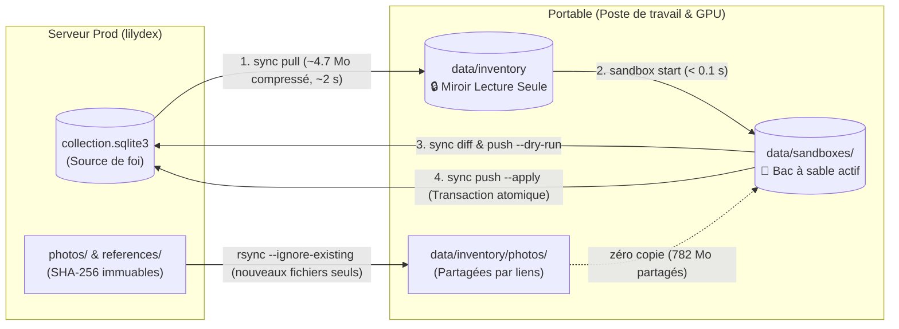

# Proposition — Synchronisation, simulation locale et promotion vers la production (M5)

> **Archive : exploration, non retenue.** Cette proposition de synchronisation entre le portable et le serveur n'a pas été mise en œuvre et ne le sera pas : le serveur fait foi, le portable rapatrie les sauvegardes et sert aux essais. Le texte ci-dessous est conservé tel qu'il était ; seuls les liens ont été mis à jour.

Statut : proposition d'architecture du 19 octobre 2026 (code à `479a4b3`, schéma
18 dans le code, bases en schéma 17), non implémentée. Ce document précise et
étend le chantier « Synchronisation portable ↔ lilydex » de la
[roadmap M5](../ROADMAP.md#m5--exploitation-1-à-3-jours), en
couvrant à la fois le rapatriement rapide, la simulation locale sans risque et
la promotion contrôlée vers le serveur de production.

---

## 1. Objectifs recherchés

1. **Récupérer les derniers changements distants en local (`pull`) en quelques secondes** :
   mettre à jour la base du portable à la demande depuis `lilydex`, sans attendre
   la sauvegarde nocturne de 3 h du matin ni re-télécharger 780 Mo de photos
   inchangées.
2. **Empêcher toute divergence silencieuse** : rendre impossible l'incident du
   16 octobre (une journée de travail effectuée sur la base locale par oubli,
   alors que le serveur faisait foi).
3. **Simuler n'importe quelle opération en local avant mise en production (`sandbox` / `simulate`)** :
   tester sur le portable (qui dispose du GPU, d'Ollama, de DINOv2 rapide et de
   l'environnement de test) un import d'album, un relevé massif de prix TCGdex,
   un script de réparation (`repair-prices`, `repair-pages`, `reference-recheck`),
   une préparation de lots ou une migration de schéma, et mesurer son impact
   métier exact avant de toucher au serveur.
4. **Promouvoir en production le résultat d'une simulation validée (`push`)** :
   appliquer sur le serveur ce qui a été préparé et vérifié en local, **sans
   refaire les appels réseau ou IA (Gemini, TCGdex, DINOv2)** et **sans écraser
   l'activité concurrente de la vitrine** (inscriptions clients, demandes de
   réservation, sessions actives).

---

## 2. Constat chiffré sur l'existant (19 octobre 2026)

Mesures relevées en lecture seule entre la base locale
(`data/inventory/collection.sqlite3`) et la dernière sauvegarde rapatriée du
serveur (`data/oci-backups/oci-daily-2026-10-19.zip`) :

| Mesure | Base locale (`data/inventory`) | Serveur (`oci-daily-2026-10-19.zip`) | Écart / Observation |
|---|---:|---:|---|
| Version de schéma (`PRAGMA user_version`) | 17 | 17 | Code `master` en schéma 18 |
| Taille de `collection.sqlite3` (non compressée) | 29,43 Mo | 31,08 Mo | **4,68 Mo compressée** dans le ZIP |
| Photos `photos/*.jpg` | 3 083 fichiers (781,7 Mo) | 3 083 fichiers (781,7 Mo) | **0 photo manquante ou différente** |
| Taille totale de l'archive quotidienne | — | 790,91 Mo | **98,8 % du volume = photos déjà présentes** |
| Exemplaires (`copies`) | 1 772 | 1 772 | Lignes modifiées côté serveur |
| Événements (`events`) | 8 287 | 9 747 | **+1 460 événements** sur le serveur |
| Dernier événement (`events`) | `#8287` (`2026-10-16T14:20Z`) | `#9747` (`2026-10-18T16:09Z`) | Événements `1..8287` **strictement identiques** |
| Annonces vitrine (`listings` / `listing_items`) | 0 | 1 415 | Publiées uniquement sur le serveur |
| Relevés (`prices`) | 4 022 | 4 023 | +1 sur le serveur |
| Lots (`sales` / `sale_items` / `sale_events`) | 1 / 2 / 3 | 2 / 20 / 9 | +1 lot de test (`Test lot kiky`, les 2 sont `cancelled`, 0 carte vendue/réservée) |
| Comptes (`users`) | 3 | 4 | +1 compte sur le serveur |

### Enseignements techniques

1. **Asymétrie extrême des volumes (4,7 Mo vs 782 Mo)** :
   - La base SQLite compressée ne pèse que **4,7 Mo**.
   - Les photos (`photos/<sha256>.jpg`), les pièces justificatives
     (`reference_documents/<sha256>.<ext>`) et les caches de vecteurs
     (`references/`) sont **adressés par leur contenu ou immuables**.
   - Un rapatriement ou un envoi ne doit donc transférer la base SQLite (~4,7 Mo)
     et ne synchroniser par `rsync --ignore-existing` que les nouveaux fichiers
     immuables.
2. **Séparation naturelle des tables en trois domaines** :
   - **Domaine « Instance & Vitrine temps réel » (autorité serveur)** :
     `sessions`, `agent_grants`, `agent_idempotency`, `requests`,
     `request_items`, et les comptes `users` (notamment `role='client'`). Ces
     tables peuvent évoluer à tout moment sur `lilydex` sans intervention de
     l'opérateur.
   - **Domaine « Collection & Référentiel » (autorité opérateur)** :
     `albums`, `editions`, `sources`, `imports`, `catalog_names`,
     `catalog_lookups`, `reference_rulesets`, `reference_engines`.
   - **Domaine « Fiches, Ventes et Journaux » (versionné avec contrôle optimiste)** :
     - Tables à version explicite (`version INTEGER`) : `copies`, `sales`,
       `listings`, `capture_sessions`.
     - Journaux append-only rattachés aux fiches : `events`, `prices`,
       `condition_assessments`, `verifications`, `reference_decisions`,
       `reference_quotes`, `reference_quote_events`, `sale_events`,
       `agent_drafts`.

---

## 3. Comparaison des options d'architecture

Le choix structurant porte sur la façon de **promouvoir vers le serveur (`push`)**
une opération simulée et validée sur le portable.

| Critère | Option A — **Swap de base contrôlé** *(Snapshot & Replace + greffe)* | Option B — **Changeset transactionnel** *(Diff / Replay « Git-like »)* | Option C — **Hybride : Changeset par défaut + Swap de migration** *(Recommandé)* |
|---|---|---|---|
| **Principe** | On travaille sur une copie locale de la base, puis on remplace le fichier `collection.sqlite3` du serveur si celui-ci n'a pas bougé, en regreffant `sessions` et `agent_grants`. | On extrait du bac à sable local le différentiel logique (`changeset`) depuis l'état de départ, et on l'applique sur le serveur dans une transaction atomique vérifiant chaque `expected_version`. | **Option B** pour toutes les opérations métier courantes + **Option A** réservée aux migrations de schéma (`SCHEMA_VERSION`) ou refontes globales. |
| **Tolérance à l'activité vitrine concurrente** | **Faible** : si un client s'inscrit ou dépose une demande de réservation pendant la simulation locale, le remplacement est bloqué ou exige une greffe délicate. | **Élevée** : tant que les cartes touchées en local n'ont pas changé de `version` sur le serveur, la transaction s'applique sans perturber les sessions, clients ou demandes en cours. | **Élevée au quotidien**, et sûre lors des montées de version de schéma. |
| **Coût des appels externes (Gemini, TCGdex, DINOv2)** | Exécutés **une seule fois** en local (les résultats sont dans SQLite et `references/`). | Exécutés **une seule fois** en local : le changeset transporte les lignes `prices`, `verifications`, `condition_assessments`, `catalog_*` déjà produites. | Exécutés **une seule fois** en local dans tous les cas. |
| **Granularité, audit et rebase** | Tout ou rien (bloc de 31 Mo). | Permet `--dry-run` sur le serveur, filtrage par album/opération, et `sync rebase` si le serveur a avancé sur d'autres cartes. | Complète. |

---

## 4. Architecture cible proposée (5 briques)



### Brique 1 — Rapatriement différentiel rapide (`sync pull`)

Au lieu de télécharger les 791 Mo de `daily-AAAA-MM-JJ.zip` :

1. **Snapshot SQLite cohérent à la volée sur le serveur** :
   - Par SSH, le serveur exécute `sqlite3.Connection.backup()` de
     `/srv/pokeprice/inventory/collection.sqlite3` vers un fichier temporaire
     (en purgant `sessions` et les secrets de `agent_grants` comme dans
     `inventory_backup.backup`), puis le compresse à la volée (`gzip` ou `zstd`,
     ~4,7 Mo).
2. **Synchronisation incrémentale des fichiers immuables** :
   - `rsync -az --ignore-existing` depuis `/srv/pokeprice/inventory/photos/` et
     `reference_documents/` vers `data/inventory/`.
   - Comme chaque fichier porte son SHA-256 pour nom (`<sha256>.jpg`), un fichier
     déjà présent localement n'est jamais retéléchargé. Chaque nouveau fichier
     reçu voit son SHA-256 contrôlé avant d'être déplacé dans `photos/`.
3. **Vérification d'ancêtre avant remplacement (`sync-check`)** :
   - Avant de remplacer `data/inventory/collection.sqlite3`, `sync pull` vérifie
     que la base locale actuelle est un **ancêtre strict** de la base distante
     (tous les `events.id` locaux existent avec le même triplet
     `(id, copy_id, created_at)` sur le serveur).
   - Si la base locale contient des événements absents du serveur, le remplacement
     est refusé par défaut (ou déplace d'abord la base locale vers
     `data/backups/diverged-YYYYMMDDTHHMMSSZ.sqlite3`).
4. **Contrôle d'intégrité** :
   - Vérification `PRAGMA integrity_check`, `PRAGMA foreign_key_check` et
     présence de toutes les photos référencées dans `data/inventory/photos/`.

### Brique 2 — Garde-fou « Miroir en lecture seule » par défaut

Pour éliminer toute écriture accidentelle dans `data/inventory` :

1. **Marqueur d'état `.sync.json`** dans le dossier de données :
   ```json
   {
     "mode": "mirror",
     "source_host": "opc@<IP_OCI>",
     "pulled_at": "2026-10-19T08:15:00Z",
     "base_db_sha256": "...",
     "head_event_id": 9747,
     "head_sale_event_id": 9
   }
   ```
2. **Verrouillage dans `Store.connect(write=True)`** :
   - Si `.sync.json` indique `"mode": "mirror"`, toute ouverture en écriture
     lève une erreur explicite :
     *« Ce dossier est un miroir en lecture seule du serveur (événement #9747).
     Utilisez un bac à sable (`pokeprice-manage sandbox start <nom>`) pour
     simuler ou préparer une modification. »*
   - Les opérations purement dérivées hors écriture métier restent possibles en
     lecture seule (`status`, `export`, `reference-audit`, consultation web).
3. **Signalétique visible dans l'interface web (`localhost:3820/gestion`)** :
   - En mode `mirror` : bandeau fixe **« Miroir de production (lecture seule) —
     état du 19/10 à 10 h 15 (#9747) »**, boutons d'écriture désactivés.
   - En mode `sandbox` : bandeau orange **« Bac à sable local : `<nom>` —
     N modifications depuis #9747 (non publiées en prod) »**.

### Brique 3 — Bacs à sable instantanés (`sandbox` / `simulate`)

Un bac à sable est un environnement de travail complet et isolé dans
`data/sandboxes/<nom>/`, créé en moins de 100 ms :

1. **Création sans duplication des 782 Mo de photos (`sandbox start <nom>`)** :
   - Copie atomique de `data/inventory/collection.sqlite3` (31 Mo) vers
     `data/sandboxes/<nom>/collection.sqlite3` et conservation d'une copie de
     référence `data/sandboxes/<nom>/base.sqlite3` (point de départ exact du
     diff).
   - `photos/`, `reference_documents/`, `references/` et `thumbnails/` sont
     partagés avec `data/inventory/` (par liens symboliques ou hardlinks).
     Puisque `Store.save_photo` écrit sous `<sha256>.jpg` via un fichier
     temporaire renommé atomiquement, toute nouvelle photo créée pendant une
     simulation enrichit le dépôt adressé par contenu sans jamais modifier ni
     corrompre une photo existante.
   - Le marqueur `.sync.json` du sandbox est en `"mode": "sandbox"`, avec
     l'empreinte et le `head_event_id` de `base.sqlite3`.
2. **Usage transparent avec tous les outils existants** :
   - **En CLI** :
     - `pokeprice-manage --data data/sandboxes/test-prix prices --album darkrai`
     - `pokeprice-manage --data data/sandboxes/test-pages repair-pages --apply`
     - `pokeprice-manage --data data/sandboxes/nouvel-album import manifest.json`
   - **En interface Web** :
     - `pokeprice-manage --data data/sandboxes/test-ui serve --port 3821`
   - **Raccourci en une commande (`simulate`)** :
     - `pokeprice-manage simulate <nom> -- <sous-commande...>` :
       tire optionnellement les derniers changements (`--pull`), crée le
       sandbox `<nom>`, exécute la commande, et affiche immédiatement le rapport
       `sync diff`.

### Brique 4 — Comparateur d'impact métier (`sync diff` et `sync check`)

`pokeprice-manage sync diff <nom>` compare `data/sandboxes/<nom>/collection.sqlite3`
à son point de départ `base.sqlite3` (et, avec `--remote`, à l'état courant du
serveur) et produit un rapport structuré en 4 volets :

1. **Fraîcheur et compatibilité avec le serveur (`sync check`)** :
   - Compare le `base.sqlite3` du sandbox avec l'état courant du serveur :
     - *Cas 1 (Fast-forward)* : le serveur est toujours à `#9747` → **aucun
       écart depuis le début de la simulation**.
     - *Cas 2 (Avancée sans conflit)* : le serveur est passé à `#9752`, mais
       aucune des entités (`copies`, `sales`, `listings`) modifiées dans le
       sandbox n'a changé de `version` sur le serveur → **promotion directe ou
       rebase sans conflit**.
     - *Cas 3 (Conflit détecté)* : une fiche modifiée dans le sandbox a aussi
       été modifiée ou réservée sur le serveur (`version` distante ≠
       `expected_version`) → **liste explicite des fiches en conflit**.
2. **Impact sur les indicateurs de pilotage (`Store.summary`)** :
   - Delta du nombre d'exemplaires par statut (`confirmed`, `review`,
     `unresolved`, `deleted`).
   - Delta des trois totaux de valorisation (*Tendance*, *Valeur prudente*,
     *Estimation de vente*) et du taux de couverture.
   - Delta exact de la file **« À examiner »** : quelles cartes y entrent et
     pour quel motif, quelles cartes en sortent.
   - Delta de la **vitrine publique** (`listings` en ligne / hors ligne, total
     affiché) et des **lots** (`sales`).
3. **Comptes de mutations par table** :
   - Nombre d'insertions et de mises à jour par table (`copies`, `editions`,
     `albums`, `events`, `prices`, `verifications`, `condition_assessments`,
     `reference_*`, `catalog_*`, `sales`, `listings`) et liste des nouveaux
     fichiers `<sha256>.jpg` à transférer.
4. **Journal détaillé des modifications (`before → after`)** :
   - Pour chaque exemplaire ou lot touché : champs modifiés, version
     `v_avant → v_après`, auteur (`actor`) et motif (`reason`).

### Brique 5 — Promotion en production à double détente (`sync push`)

Une fois la simulation validée par `sync diff`, la mise en production s'effectue
en deux temps : `sync push <nom> --dry-run` puis `sync push <nom> --apply`.

#### Fonctionnement du Changeset transactionnel (mode standard)

1. **Construction du paquet de promotion (`changeset`)** :
   - Différentiel calculé entre `base.sqlite3` et `sandbox/collection.sqlite3` :
     - **Entités créées** : nouvelles lignes dans `albums`, `editions`,
       `copies`, `sources`, `imports`, `sales`, `sale_items`, `listings`,
       `listing_items`, `agent_drafts`.
     - **Entités modifiées** : pour chaque ligne de `copies`, `sales` ou
       `listings` dont l'état diffère de `base`, capture de `id`,
       `expected_version` (la version dans `base`), `before_sha256` (empreinte
       canonique de la ligne dans `base`), et l'état cible `after` (avec sa
       nouvelle `version`).
     - **Lignes de journaux et de caches ajoutées** : nouvelles lignes dans
       `events`, `prices`, `condition_assessments`, `verifications`,
       `reference_rulesets`, `reference_engines`, `reference_decisions`,
       `reference_quotes`, `reference_quote_events`, `sale_events`,
       `catalog_names`, `catalog_lookups`. Note : pour les tables à clé
       primaire `INTEGER AUTOINCREMENT` (`events`, `prices`,
       `reference_decisions`, `reference_quote_events`, `sale_events`,
       `imports`), les lignes sont insérées dans l'ordre chronologique en
       laissant SQLite attribuer l'`id` séquentiel du serveur, tout en
       conservant `copy_id`, `actor`, `kind`, `reason`, `before_json`,
       `after_json` et `created_at`.
   - **Exclusion stricte des tables d'instance/clients du serveur** :
     `users`, `sessions`, `requests`, `request_items`, `agent_grants` et
     `agent_idempotency` ne sont jamais modifiées par un `changeset` de
     collection.
2. **Transfert préalable des fichiers immuables** :
   - `rsync -az --ignore-existing` pousse vers `/srv/pokeprice/inventory/`
     uniquement les nouvelles photos `<sha256>.jpg`, documents de référence et
     caches de vecteurs `references/`.
3. **Simulation sur le serveur (`--dry-run`, par défaut)** :
   - Le changeset est envoyé au serveur qui l'applique sur une copie temporaire
     de `/srv/pokeprice/inventory/collection.sqlite3` (ou dans une transaction
     annulée par `ROLLBACK`), vérifie :
     - que chaque `expected_version` et `before_sha256` correspond à la ligne
       actuelle du serveur ;
     - qu'aucune carte modifiée ou mise en lot en local n'a été réservée entre-temps
       via une `request` client acceptée sur le serveur ;
     - que `PRAGMA integrity_check`, `PRAGMA foreign_key_check` et la présence
       de toutes les photos référencées passent sans erreur ;
   - Le serveur renvoie le rapport d'application et le nouveau `summary()` sans
     avoir modifié la base active.
4. **Application atomique (`--apply`)** :
   - Sur le serveur :
     1. Sauvegarde instantanée de la base active avant modification dans
        `/srv/pokeprice/backups/before-sync-YYYYMMDDTHHMMSSZ.sqlite3`
        (via `sqlite3.Connection.backup()`, ~0,1 s) ;
     2. Ouverture d'une transaction `BEGIN IMMEDIATE` sur la base active ;
     3. Vérification des `expected_version` / `before_sha256` et application
        intégrale du changeset ;
     4. Contrôle `PRAGMA foreign_key_check` dans la transaction, puis `COMMIT`
        (toute anomalie déclenche `ROLLBACK` et laisse le serveur intact).
   - Sur le portable :
     5. Exécution automatique d'un `sync pull` pour aligner le miroir local
        `data/inventory` sur le nouvel état du serveur (avec les `id`
        d'événements définitifs du serveur) ;
     6. Marquage du bac à sable `<nom>` comme `"mode": "promoted"` (ou
        suppression avec `--cleanup`).

#### Que faire si le serveur a avancé pendant la simulation ? (`sync rebase`)

Si un changement non conflictuel a eu lieu sur le serveur pendant que le bac à
sable local était ouvert :
- `pokeprice-manage sync rebase <nom>` exécute `sync pull` pour mettre à jour le
  miroir `data/inventory`, remplace `base.sqlite3` par ce nouvel état serveur,
  et rejoue le `changeset` du bac à sable par-dessus en local.
- L'opérateur peut alors relancer `sync diff <nom>` sur la base rebasée avant
  de faire `sync push <nom> --apply`.

#### Cas particulier des migrations de schéma (`sync push-migration`)

Lorsqu'une mise à jour du code augmente `SCHEMA_VERSION` (ex. passage 17 → 18) :
1. En local : `sync pull`, puis ouverture d'un sandbox `migration-v18` qui
   déclenche et valide la migration de schéma de `Store.__init__` et la suite de
   tests sur les vraies données.
2. En prod : `oci-deploy.sh` vérifie d'abord via `sync check` l'état du serveur,
   déploie le nouveau code, et au redémarrage de `pokeprice.service`,
   `Store.__init__` crée automatiquement
   `before-schema18-from17-*.sqlite3` avant d'appliquer la migration en
   production.

---

## 5. Optimisation collatérale : rapatriement nocturne `backup-server-pull`

Actuellement, `backup-server-drive` (à 3 h 15) télécharge chaque nuit l'archive
complète `daily-AAAA-MM-JJ.zip` (**791 Mo**) depuis OCI via SSH, alors que 98,8 %
de cette archive sont les 3 083 photos `<sha256>.jpg` déjà présentes sur le
portable.

### Amélioration proposée (sans affaiblir la preuve de sauvegarde)

- Le serveur continue de générer et de vérifier sa `daily-AAAA-MM-JJ.zip` à
  3 h 00 (avec restauration de contrôle sur le serveur).
- Le portable peut, lors de `backup-server-pull` :
  1. Lire sur le serveur le `manifest.json` de la `daily-AAAA-MM-JJ.zip` ainsi
     que le `sha256` et la taille du ZIP complet ;
  2. Ne télécharger depuis le serveur que les entrées du `manifest.json` absentes
     du cache local de photos/documents (soit typiquement uniquement
     `collection.sqlite3`, **~4,7 Mo compressés**, et les quelques photos du
     jour) ;
  3. Si l'on souhaite conserver exactement le même flux `age` vers Drive sans
     dépendre du déterminisme binaire du conteneur ZIP, `rsync --inplace` ou le
     téléchargement direct reste disponible en repli ; ou bien le serveur peut
     fournir un flux delta (`rsync`/tar des nouveaux objets) et le portable
     construit et vérifie l'archive restaurable avant chiffrement `age`.
- **Gain** : passage de **791 Mo/jour (~5 à 15 min de SSH)** à **~5 Mo/jour
  (~3 secondes)** lorsque seules des fiches ou des prix ont bougé.

---

## 6. Résumé des commandes cibles (`pokeprice-manage`)

| Commande | Action |
|---|---|
| `pokeprice-manage sync check [--host user@oci]` | Compare l'état du miroir local (et des bacs à sable) avec le serveur sans rien modifier |
| `pokeprice-manage sync pull [--host user@oci]` | Met à jour le miroir `data/inventory` en ~2 s (SQLite compressé + nouvelles photos seules) et le verrouille en lecture seule |
| `pokeprice-manage sandbox start <nom>` | Crée un bac à sable instantané dans `data/sandboxes/<nom>` (31 Mo SQLite copié, photos liées) |
| `pokeprice-manage sandbox list \| drop <nom>` | Liste les bacs à sable locaux avec leur statut ou supprime un bac à sable terminé |
| `pokeprice-manage simulate <nom> -- <cmd...>` | Crée un bac à sable, exécute la commande dedans et affiche le `sync diff` |
| `pokeprice-manage sync diff <nom> [--remote]` | Affiche le rapport d'impact métier complet (totaux, file « À examiner », vitrine, fiches modifiées, conflits éventuels) |
| `pokeprice-manage sync rebase <nom>` | Rapatrie le dernier état du serveur et rejoue les modifications du bac à sable `<nom>` par-dessus en local |
| `pokeprice-manage sync push <nom> [--dry-run \| --apply]` | Pousse les nouvelles photos puis simule (`--dry-run`) ou applique atomiquement (`--apply`) le changeset sur le serveur |

---

## 7. Découpage incrémental recommandé (par jalons courts)

Pour livrer cette capacité sans tunnel de développement :

1. **Tranche 1 — `sync check`, `sync pull` rapide et mode miroir lecture seule (~0,5 à 1 jour)** :
   - Rapatriement chaud de `collection.sqlite3` compressé + `rsync --ignore-existing` des photos.
   - Fichier `.sync.json` en mode `mirror`, refus des écritures accidentelles dans `Store.connect(write=True)` et bandeau « Miroir lecture seule » dans l'interface web.
   - Alignement immédiat de `data/inventory` du portable (actuellement bloqué à `#8287`) sur l'état du serveur (`#9747`).
2. **Tranche 2 — Bacs à sable (`sandbox`) et comparateur métier (`sync diff`) (~0,5 à 1 jour)** :
   - Commandes `sandbox start/list/drop`, partage sans copie des photos et caches DINOv2, commande `simulate`.
   - Calculateur de `changeset` entre `base.sqlite3` et `collection.sqlite3`, et affichage du rapport d'impact métier (`sync diff`).
3. **Tranche 3 — Promotion transactionnelle vers le serveur (`sync push --dry-run` / `--apply` et `sync rebase`) (~1 jour)** :
   - Application atomique d'un `changeset` avec vérification des `expected_version`, `before_sha256`, contraintes SQLite et snapshot `before-sync-*.sqlite3` automatique côté serveur.

---

## 8. Questions ouvertes à trancher avant implémentation

1. **Ergonomie par défaut de `data/inventory` sur le portable** :
   - Option retenue dans cette note : **`data/inventory` est toujours un miroir en lecture seule du serveur**, et tout travail local passe par un bac à sable nommé (`data/sandboxes/<nom>`).
   - Alternative : autoriser les écritures directement dans `data/inventory` (en gardant `data/inventory/base.sqlite3` comme référence du dernier `pull`) et utiliser `sync diff` / `sync push` / `sync reset` directement sur `data/inventory` comme un dépôt Git.
2. **Canal d'exécution de `sync push` vers le serveur** :
   - **Par SSH (`opc@<IP_OCI>`)** *(recommandé)* : réutilise l'accès opérateur existant de `server_backup.py` (`BatchMode=yes`), permet le `rsync` direct des photos et l'ouverture transactionnelle de `/srv/pokeprice/inventory/collection.sqlite3` sous l'utilisateur `pokeprice`, sans exposer aucune route HTTP d'écriture massive sur Internet.
   - **Par l'API HTTPS** : nécessiterait d'exposer une route d'import/synchronisation administrative sur Internet.
3. **Périmètre des tables autorisées dans un `changeset`** :
   - Autoriser tout le domaine Collection + Ventes/Vitrine (`albums`, `editions`, `copies`, `sources`, `imports`, `events`, `prices`, `verifications`, `condition_assessments`, `reference_*`, `catalog_*`, `sales`, `sale_items`, `sale_events`, `listings`, `listing_items`, `agent_drafts`), tout en interdisant strictement les tables d'accès et de demandes clients (`users`, `sessions`, `requests`, `request_items`, `agent_grants`, `agent_idempotency`).
